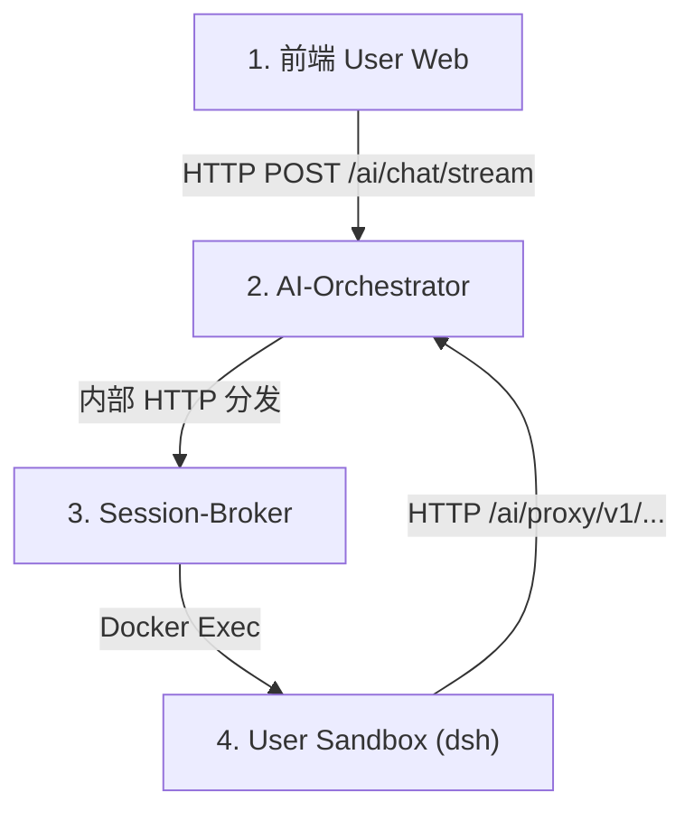

# Execution Auditor (执行审计专员)

本技能用于为 `ops-automation` 智能化平台的任意单次任务执行提供标准化、深度的审计追踪。

## 适用场景
- 用户提供某次具体调用的时间、片段、Session ID 或报错日志，要求进行全面审计。
- 执行结果不及预期（如回答不相干内容、超时中断、未落盘生成文件、报错异常）。
- 评估调用性能瓶颈（TTFT 延迟过高、Prompt Token 预算膨胀、网络检索开销）。
- 争议定责：判断问题究竟是平台底层/沙箱工程问题，还是上游模型理解/幻觉问题。

---

## 4层执行架构与排查路径



### 1. 前端 (Layer 1: User Web)
- **文件路径**: `apps/frontend/user-web/`
- **核查点**:
  - 模式判定：个人模式 (`chat`) vs 工作模式 (`work`)。
  - 用户输入中的 Slash 指令 (`/ppt`, `/research`, `/excel` 等) 是否解析正确。
  - 状态开关：`enableResearch` (深度调研), `enableThinking` (思考模式), `reasoningEffort`。

### 2. 编排层 (Layer 2: AI-Orchestrator)
- **文件路径**: `apps/backend/intelligence/ai-orchestrator/`
- **核查点**:
  - `ChatController`: 接收请求、判定个人沙箱分发路由 (`UserSandboxDispatcherService`)。
  - `SessionService`: Redis 会话存取 (`chat_session:<sessionId>`)。包含 `executionTrace` 遥测数据。
  - `ModelProxyController`: 中继请求 (`/ai/proxy/v1/chat/completions`、`/ai/proxy/v1/search/web`)。

### 3. 会话代理与锁控制 (Layer 3: Session-Broker)
- **文件路径**: `apps/backend/execution-control/session-broker/`
- **核查点**:
  - `LockService`: 基于 Redis 的用户级分布式排他锁（获取锁时延、等待时间、超时释放）。
  - `UserSandboxContainerService`: 容器就绪探测 (`ops-user-sandbox-<userId>`)。
  - `UserSandboxHarnessService`: 组装并执行 `dsh run "<prompt>" --session-id ...` 命令行。

### 4. 沙箱执行内核 (Layer 4: Personal Sandbox Runner)
- **文件路径**: `apps/backend/runtimes/personal-sandbox-runner/`
- **核查点**:
  - `SkillRouter`: 技能与意图路由得分 (`is_research_intent`, `is_search_intent`, `is_generate_intent` 等)。
  - `web_tools.py`: 前置多路检索 (`perform_multi_web_search`) 抓取结果与时延。
  - `prompt_builder.py`: 上下文拼装、附件诊断信息注入。
  - `runner.py` / `agent_loop.py`: ReAct 循环轮次、工具派发与截断、交付物校验。

---

## 根因归因判定矩阵 (Engineering vs. Model)

| 表现特征 | 归因分类 | 典型场景与证据依据 |
| :--- | :--- | :--- |
| **锁等待超时** | **工程性原因** | Redis 锁等待超过 35s，并发请求竞争未释放。 |
| **容器未启动/崩溃** | **工程性原因** | `Docker exec` 返回错误，容器被 OOMKill 或权限拒绝 (UID 1001)。 |
| **网络中继中断** | **工程性原因** | 模型代理日志出现 `aborted`, `socket hang up`, `ECONNRESET`, 502/504。 |
| **附件读取/权限异常** | **工程性原因** | 文件为 MIP 加密格式 (.pfile) 或二进制乱码，系统未能解密。 |
| **工具白名单被拦** | **工程性原因** | 工具名称小写或前缀处理不一致（如 `functions.bash`），被 dispatch 拦截。 |
| **Prompt 激进截断** | **工程性原因** | `ContextBudget` 超出上限导致历史中用户核心关键指令被 drop。 |
| **文件未生成但报成功** | **工程性原因** | 交付物门禁只检查了字符串匹配，未校验 `/workspace` 文件实体。 |
| **事实性幻觉/答非所问** | **模型原因** | 上下文明确提示附件已损坏，模型却凭空胡编或延续历史旧话题。 |
| **死循环反复调同一工具** | **模型原因** | 模型在 ReAct 循环中连续多轮传入相同错误参数，直至最大轮次耗尽。 |
| **口头宣称已完成** | **模型原因** | 要求生成文档时，模型未调用任何代码或工具，仅口头回答“已为您保存”。 |
| **格式与 Schema 偏航** | **模型原因** | 严格要求输出 JSON 或特定代码块，模型输出了散装自然语言。 |
| **上下文超限截断** | **模型/混合原因**| 模型输出达到 max_tokens (`finishReason: length`) 导致 JSON 截断。 |

---

## 标准审计报告模版

```markdown
# 任务执行审计报告：[会话/任务简述]

## 1. 审计结论与定性
- **执行状态**: [成功 / 失败 / 性能劣化]
- **问题定性**: [工程性原因 / 模型原因 / 复合原因 / 符合预期]
- **核心判定摘要**: [一句话总结核心矛盾]

## 2. 调用全链路还原
- **会话与用户**: Session ID / User ID
- **调用参数**: 模型、推理强度、开启标志 (--research, --thinking 等)
- **时序流转**: Frontend -> Orchestrator -> Broker -> Sandbox -> Model

## 3. 性能与资源消耗 (Telemetry)
| 指标 | 数值 | 评价/基准参考 |
| :--- | :--- | :--- |
| 总端到端耗时 | XX ms |  |
| 锁与容器调度耗时 | XX ms |  |
| 网络检索耗时 | XX ms |  |
| 首字时间 (TTFT) | XX ms |  |
| LLM 推理耗时 | XX ms |  |
| Token 用量 (输入/输出) | XX / XX |  |
| 推理速率 | XX tokens/s |  |
| 循环轮次 / 工具调用数 | XX 轮 / XX 次 |  |

## 4. 深度根因追踪与证据链
- **证据 1 (日志/Redis/容器)**: ...
- **证据 2 (代码定位)**: ...
- **工程 vs 模型责任裁决**: ...

## 5. 改进与规避建议
- **工程层面**: [修复的代码位置与防御性代码建议]
- **模型/Prompt层面**: [提示词约束、门禁策略或参数调整建议]
```
