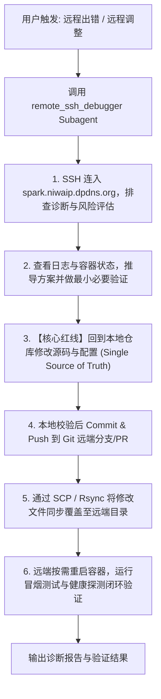

# Remote SSH Debugger Skill & Workflow

本技能用于规范和自动化远程服务器（`spark.niwaip.dpdns.org` / 别名 `spark-d465`）的 SSH 联调排错流程。

## 触发场景
当用户提出如下意图时，主代理必须调用 `remote_ssh_debugger` Subagent 或按照本规范执行：
- “远程调试 / 远程出错 / 远程调整”
- “远端服务起不来 / 远端报错”
- “排查 spark 机器上的问题”

---

## 远程环境资产
- **主机域名**：`spark.niwaip.dpdns.org`
- **主机别名**：`spark-d465`
- **连接通道**：Cloudflare Tunnel (`cloudflared access ssh`)
- **默认用户**：已配置免密公钥登录至 `root`
- **项目路径**：`/home/fchadmin/workspace/ops-automation-main`
- **局域网参考 IP**：`192.168.90.116`

### 本地 SSH 配置要求 (`~/.ssh/config`)
为了让 `ssh`、`scp`、`rsync` 均可原生直连，宿主机配置如下：
```ssh
Host spark.niwaip.dpdns.org spark-d465
  HostName spark.niwaip.dpdns.org
  User root
  ProxyCommand /opt/homebrew/bin/cloudflared access ssh --hostname spark.niwaip.dpdns.org
```
- **简写连接命令**：`ssh root@spark.niwaip.dpdns.org` 或 `ssh spark-d465`
- **显式连接命令**（无需依赖 ssh config 时）：
  ```bash
  ssh -o "ProxyCommand=/opt/homebrew/bin/cloudflared access ssh --hostname %h" root@spark.niwaip.dpdns.org
  ```

---

## 标准工作流闭环 (SOP)



### 详细规范：

### Step 1: 风险评估与故障定位
1. 连入远程机器并检查容器状态：
   ```bash
   ssh root@spark.niwaip.dpdns.org "docker ps -a"
   ```
2. 查看相关服务日志：
   ```bash
   ssh root@spark.niwaip.dpdns.org "docker logs <service-name> --tail 100"
   ```
3. 检查系统与容器服务运行状态：
   ```bash
   ssh root@spark.niwaip.dpdns.org "cd /home/fchadmin/workspace/ops-automation-main && bash docker/start-smart.sh dev ps"
   ```
4. **风险确认**：在执行任何破坏性命令（如 drop tables、清卷、重置 schema）前，必须向用户明确风险并获取确认。

### Step 2: 方案推导与远程临时验证
- 针对定位出的错误（如端口绑定、依赖缺失、权限异常、环境变量未设置等），在远程进行针对性临时验证，确认根因已被排除。

### Step 3: 代码回流本地修改（唯一真相源）
- **绝不直接在远端裸改代码**。本地代码库永远是唯一的真相源。
- 确认有效后，在本地代码库进行规范修改，满足 `AGENTS.md` 单一职责与复杂度要求。
- 在本地完成代码编译和语法检查。
- 提交 git commit 并推送到远端仓库。

### Step 4: SCP / Rsync 增量文件拷贝同步远端并闭环验证
- **重要背景**：远端工作区 `/home/fchadmin/workspace/ops-automation-main` 为解压部署目录（非 Git 仓库，不可直接执行 `git pull`）。
- **同步方式**：**必须通过 `scp`（或 `rsync`）将本地修改好的源码与配置文件直接拷贝覆盖至远端对应路径**。
  ```bash
  # 单文件同步示例：
  scp <local_file_path> root@spark.niwaip.dpdns.org:/home/fchadmin/workspace/ops-automation-main/<relative_file_path>

  # 示例 1: 同步脚本文件并赋予执行权限：
  scp docker/scripts/ops-menu.sh root@spark.niwaip.dpdns.org:/home/fchadmin/workspace/ops-automation-main/docker/scripts/ops-menu.sh
  ssh root@spark.niwaip.dpdns.org "chmod +x /home/fchadmin/workspace/ops-automation-main/docker/scripts/ops-menu.sh"

  # 示例 2: 同步修改后的后端服务源码模块：
  scp path/to/local/file.ts root@spark.niwaip.dpdns.org:/home/fchadmin/workspace/ops-automation-main/path/to/remote/file.ts

  # 示例 3: 目录级同步（排除 node_modules 等大目录）：
  rsync -avz --exclude "node_modules" --exclude ".git" <local_dir>/ root@spark.niwaip.dpdns.org:/home/fchadmin/workspace/ops-automation-main/<remote_dir>/
  ```
- **重启与重载**：根据服务运行模式，按需重启受影响的容器：
  ```bash
  ssh root@spark.niwaip.dpdns.org "cd /home/fchadmin/workspace/ops-automation-main && bash docker/start-smart.sh dev up -d <service>"
  ```
- **验证冒烟**：运行自动化验证与冒烟测试：
  ```bash
  ssh root@spark.niwaip.dpdns.org "cd /home/fchadmin/workspace/ops-automation-main && bash docker/scripts/smoke/core-smoke.sh"
  ```
- 确认健康接口返回 200 OK，完成排错闭环并向用户输出报告。
