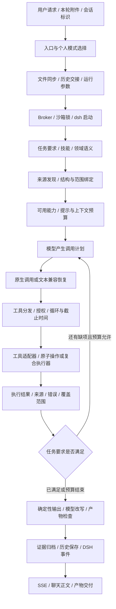

# 个人沙箱调用链：通用机制审查

日期：2026-10-10。分析对象为当前工作区中的个人沙箱调用路径。审查视角调整为通用 Agent 工程机制：任务理解、上下文交接、能力选择、调用授权、执行回执、完成判断、输出和历史复用。

财务与 Excel 会话只是这条路径的已有验证样本；本文不以财务指标、公式或专用关键词作为优化中心。也不能据此认定文档、图像、搜索等所有能力都已完成端到端测试。本次没有修改业务代码、启动或重启服务，也没有新增真实模型请求。新增探针使用替代执行器，无真实工具副作用。

配套材料：

- [本轮通用分发器隔离探针](/Users/chain/Documents/MyProject/ops-automation/docs/artifacts/reviews/personal-sandbox-general-call-flow-probes-2026-10-10.json)
- [前一轮完整调用链、运行环境与样本证据](/Users/chain/Documents/MyProject/ops-automation/docs/artifacts/reviews/personal-sandbox-finance-flow-analysis-2026-10-10.md)
- [前一轮运行核对与隔离探针结果](/Users/chain/Documents/MyProject/ops-automation/docs/artifacts/reviews/personal-sandbox-finance-flow-analysis-2026-10-10.json)

## 1. 通用结论

系统已有较好的执行基础：个人工作区隔离、技能路由、可用工具白名单、任务总截止时间、重复调用限制、结构化工具结果，以及部分任务的确定性验收。

主要缺口是这些保障尚未贯穿同一条通用链路。各分支分别理解任务、收集证据和判断结束；后面的文本转换也未始终保留前面的约束。于是“执行成功”“任务完成”“内容已经验证”“产物已交付”可能指向不同的事实，却在回答或状态上被混合表达。

通用改进方向应是：**同一个任务要求，从入口到最终交付都可追踪；同一个调用身份，从授权到执行都一致；同一个结论，在改写和归档后仍保留证据与限制。** 领域知识和工具只是可替换的提供者。

证据标记：**源码确认**表示当前实现可直接确认；**探针确认**表示本地隔离调用复现；**样本确认**表示既有真实归档显示；**待复现风险**表示源码存在条件，但尚未证明实际发生。探针结果不是线上发生率。

## 2. 整条路径按共同职责展开



这张图是共同职责图。当前实现中，L→M 的完整证据验收主要集中在表格分析、表格比较等分支；普通问答和部分产物任务通过另一套最终输出检查结束。不能把图理解为所有任务已经使用同一验收器。

| 阶段 | 当前主要入口 | 输入→输出 | 通用检查点 |
|---|---|---|---|
| 入口 | `ChatController.chatStream` | 请求、模式→个人 Dispatcher 或其他路径 | 这次请求实际走哪条执行路径？保障是否随路径变化？ |
| 文件与历史交接 | `dispatchPersonalSandbox` | 附件、历史、模型设置→Broker 请求 | 本轮来源与历史参考是否区分？是否把预览当原始数据？ |
| 沙箱运行 | `runHarness` | session、files、prompt→容器内 `dsh run` | 用户/会话隔离、锁覆盖范围、超时和重入是否一致？ |
| 任务与能力准备 | `runner.cmd_run`、SkillRouter、AnalysisContract | 用户请求→技能、语义、工具集合 | 是否保留所有子任务？语义识别是否错误地取消执行要求？ |
| 来源绑定 | 附件结构、表头、范围候选 | 文件→可定位的来源结构 | 实际文件版本、对象、范围、时间、单位能否对应请求？ |
| 模型规划 | `run_agent_loop` | 上下文、可用工具→计划或回答 | 模型计划是否只是候选？能力是否足够发现、执行和恢复？ |
| 调用恢复 | 原生 tool calls、兼容协议、`recover_text_tool_calls` | 多种模型格式→调用 | 各种入口是否经过相同参数校验和授权？ |
| 工具分发 | `dispatch_tool_calls` | 调用→执行器或拦截结果 | 工具名规范化、权限、幂等、重试、预算是否使用同一身份？ |
| 工具执行 | `execute_tool` 和能力适配器 | 参数、截止时间→结果 | 原子操作是否有明确输入输出？复合工具是否报告内部覆盖与失败？ |
| 验收与结束 | AnalysisTurn、比较验收、最终回复检查 | 回执→完成/缺项/继续 | 是否按用户要求验收，而非仅按工具返回成功验收？ |
| 表达与产物 | 确定性模板、synthesis、finalizer | 事实→正文/文件 | 改写是否新增事实？文件内容是否符合要求？交付状态是否真实？ |
| 归档与展示 | evidence/history、DSH、SSE | 结果→持久记录/用户界面 | 哪轮证据对应哪轮回答？部分成功、失败和限制是否保留？ |

源码定位：

- [聊天入口](/Users/chain/Documents/MyProject/ops-automation/apps/backend/intelligence/ai-orchestrator/src/modules/chat/chat.controller.ts:236)
- [个人调度入口](/Users/chain/Documents/MyProject/ops-automation/apps/backend/intelligence/ai-orchestrator/src/modules/chat/user-sandbox-dispatcher.service.ts:241)
- [Broker 请求](/Users/chain/Documents/MyProject/ops-automation/apps/backend/intelligence/ai-orchestrator/src/modules/chat/user-sandbox-dispatcher.service.ts:474)
- [沙箱执行入口](/Users/chain/Documents/MyProject/ops-automation/apps/backend/execution-control/session-broker/src/modules/user-sandbox/user-sandbox-harness.service.ts:197)
- [Runner](/Users/chain/Documents/MyProject/ops-automation/apps/backend/runtimes/personal-sandbox-runner/src/dsh_modules/runner.py:373)
- [Agent 循环](/Users/chain/Documents/MyProject/ops-automation/apps/backend/runtimes/personal-sandbox-runner/src/dsh_modules/agent_loop.py:886)
- [分发器](/Users/chain/Documents/MyProject/ops-automation/apps/backend/runtimes/personal-sandbox-runner/src/dsh_modules/tool_dispatch.py:15)
- [执行器](/Users/chain/Documents/MyProject/ops-automation/apps/backend/runtimes/personal-sandbox-runner/src/dsh_modules/tools.py:443)

## 3. 知识本体、技能与原子操作的共同位置

用户最初提到的知识本体和 Excel 原子操作，在共同架构中应按职责理解，而不绑定某个领域。

| 类型 | 解决的问题 | 应提供的信息 | 不足以证明什么 |
|---|---|---|---|
| 个人知识检索 | 用户有哪些资料、术语和既往约定 | 文档来源、版本、检索范围、引用位置 | 找到知识不代表本轮执行了它 |
| 领域语义/本体 | 概念是什么、关系与规则在何种条件下适用 | 稳定概念 ID、别名、类型、单位、关系、适用条件、版本 | 匹配概念不代表数据列、期间和主体已绑定正确 |
| Skill | 如何做、交付什么、操作顺序是什么 | 方法、能力依赖、流程和交付要求 | 读了技能不代表每个步骤已经完成 |
| 来源适配器 | 文件/接口中的数据实际在哪里 | 真实结构、对象定位、范围、来源版本 | 来源定位不代表已覆盖全部用户要求 |
| 原子操作 | 在明确输入上执行具体动作 | 参数、输出、范围、错误、执行回执 | 一个操作成功不代表整个任务完成 |
| 复合执行器 | 把若干操作确定性地组合执行 | 子步骤、派生关系、失败与覆盖情况 | 名称包含“分析”不代表全部子目标已经实现 |

当前实现中，个人知识扫描、技能加载、领域定义和原生表格执行分别有入口。它们不是同一套自动推理引擎。某个知识文件存在，也不保证本轮已经加载其规则并执行。

`aggregate_spreadsheet`、`check_spreadsheet_equations`、`validate_spreadsheet_rows` 等名称最终复用共同表格分析执行器。因此，评估“原子性”应看底层计划里的操作边界与回执，而不单看工具名称。对于搜索、文档修改、接口查询，也应采用相同标准。

建议把领域扩展限制在“语义定义、适用规则、来源绑定辅助”中，把执行能力放在工具适配器中，把完成判断留在共同任务机制中。新增领域时，不应在主循环里不断增加 `if domain == ...` 的结束逻辑。

## 4. 重点发现：以机制为单位

### 4.1 同一调用在不同阶段使用不同工具名

**探针确认，优先级 P1。** 分发器用去前缀、小写后的 `requested_name` 检查工具白名单；执行器也会清理前缀。但技术咨询安装拦截、提醒意图拦截和重复调用签名仍使用原始 `t_name`。

隔离结果：同样没有提醒授权，`create_reminders` 被拦截，`functions.create_reminders` 到达替代执行器；技术咨询中的 `bash` 安装命令被拦截，`functions.bash` 到达替代执行器。没有实际创建提醒或执行命令。

这证明本地分发器的检查身份不一致。原生模型 API 可能对未声明的名称额外限制，线上是否可经兼容路径到达仍需入口测试，不能把隔离结果表述为线上已发生未授权操作。

改进：仅在入口解析一次 canonical tool ID；白名单、能力属性、授权、幂等签名、执行和交付事件全部使用该 ID。原始名称仅作追踪。别名必须经显式注册，未知身份返回结构化错误。

源码：[分发器](/Users/chain/Documents/MyProject/ops-automation/apps/backend/runtimes/personal-sandbox-runner/src/dsh_modules/tool_dispatch.py:51)、[执行器规范化](/Users/chain/Documents/MyProject/ops-automation/apps/backend/runtimes/personal-sandbox-runner/src/dsh_modules/tools.py:452)。

### 4.2 参数解析失败被转换为默认调用

**探针确认，优先级 P1。** 非法 JSON arguments 被静默替换为 `{}`，继续执行。探针中 `web_search` 接收到空参数。实际执行器对一些工具还提供默认值或备用字段。

通用问题是“模型计划无效”被转换成“模型选择了默认操作”。对于读操作会读错对象；对于写操作可能扩大影响。应明确返回 `invalid_arguments`，告知具体字段/解析问题，允许模型在预算内修正；不要在协议解析层悄悄补成默认任务。业务上允许的默认值应属于工具 schema，且可追踪。

### 4.3 工具成功与执行证据收集没有统一

**源码及探针确认，优先级 P1/P2。** 已有 `ToolResult` 与 `adapt_tool_output`，错误分类能够适配多种返回形式。但分发器收集证据主要检查返回字符串附带的 `.tool_result` 属性。普通字符串、普通 JSON 字符串的 telemetry 可能标记成功，却没有进入同一结构化 evidence 列表。部分拦截分支也只写文本和调用状态。

隔离结果：普通成功文本证据数量为 0；携带 `ToolResult` 的 `TextToolOutput` 证据数量为 1。这里确认的是分发器收集差异，不代表普通文本没有任何日志，更不代表文本内容已经验证。

改进：在共同分发边界把每次调用收敛为同一结果协议，再统一记录执行状态、错误与来源。旧工具包装为结构化回执时，必须保留 `unstructured/unverified` 等证据等级；不能因为封装成 JSON 就提升为可靠事实。

源码：[结果协议与适配](/Users/chain/Documents/MyProject/ops-automation/apps/backend/runtimes/personal-sandbox-runner/src/dsh_modules/tool_result.py:1)、[证据收集](/Users/chain/Documents/MyProject/ops-automation/apps/backend/runtimes/personal-sandbox-runner/src/dsh_modules/tool_dispatch.py:165)。

### 4.4 重复抑制与失败重试混在一起

**探针确认，优先级 P2。** 调用在执行之前写入重复历史，读操作相同参数允许执行一次。首次返回临时错误后，第二次同参数调用仍被 `loop_intercepted` 阻断。签名使用原始名称，也无法统一处理别名。

改进应区分：成功读结果可按来源版本复用；暂时性失败允许有限重试；参数/授权错误需要修正前提；写操作需根据幂等键与副作用确认决定是否重试。共同判据应是调用身份、参数、来源版本、失败类型、预算，而非工具名字是否在一份读工具列表中。

### 4.5 多目标请求可能在分类时丢失部分要求

**源码及前轮探针确认，优先级 P1。** 当前咨询识别会在“存在建议意图、没有命中显式计算词”时清空指标要求。前轮复合请求样本因此从需要取数的任务转入建议任务。

共同问题是用互斥类别覆盖复合目标。例如“检查 A、解释 B，并提出建议 C”，C 不应取消 A 和 B。规则需拆解子任务：查询、验证、解释、建议、生成产物可以同时存在；建议子任务允许定性推断，但依赖当前数据的结论仍需证据。

补充词表可以修补某句，但不能解决这个结构问题。

源码：[任务解析](/Users/chain/Documents/MyProject/ops-automation/apps/backend/runtimes/personal-sandbox-runner/src/dsh_modules/analysis_contract.py:57)、[咨询分支清空要求](/Users/chain/Documents/MyProject/ops-automation/apps/backend/runtimes/personal-sandbox-runner/src/dsh_modules/analysis_contract.py:179)。

### 4.6 范围处理完整，不等于请求完整

**源码、样本及前轮探针确认，优先级 P1。** 表格任务状态检查成功回执、文件哈希、证据 ID、结果非空、声明范围覆盖和部分指标类型。它尚未逐项表达请求中的字段检查、规则、主体、期间和基准义务。当前表格分析之外也没有发现覆盖所有能力的同一验收器。

前轮真实样本显示：请求三类异常检查，某类没有专门规则时仍可通过当前门禁。前轮隔离探针显示：来源哈希有效、但期间不符合请求的回执可通过当前任务状态检查。这不意味着历史回执在线上被当成本轮执行。

共同问题：文件哈希只能证明文件版本；`coverage_complete` 只能证明声明的范围被处理；工具 `success` 只能证明其执行成功。三者都不能单独证明“用户要求的所有内容已完成”。

改进：每个子任务有明确验收条件和支持证据。把请求范围与执行范围比较，而不仅检查工具自己声明的范围。

源码：[当前完成检查](/Users/chain/Documents/MyProject/ops-automation/apps/backend/runtimes/personal-sandbox-runner/src/dsh_modules/analysis_task_state.py:10)。

### 4.7 已验证结果经过改写后，正文可能失去约束

**源码及前轮 mock 探针确认，优先级 P1。** 表格分析正文 synthesis 再调用模型，只排除空、过短或纯 JSON 内容。没有再次核对数值、范围、任务缺项和判断强度。前轮 mock 返回错误数值与未执行的增长结论，被接受并附上原审计明细。

共同问题是可靠执行结果经过有损摘要和自由改写后，可靠性不能自动继承。文档摘要、搜索归纳、图像识别解释、格式转换都应检查同类边界；这些其他能力尚未在本次逐项复现。

改进：模型组织叙述，关键事实由引用绑定或确定性片段输出；正文的事实性断言必须对应回执。源范围、样本限制、缺项和失败不得在摘要中消失。无法校验时使用确定性正文或明确限制，而不是依赖提示词“不要编造”。

源码：[synthesis 接受条件](/Users/chain/Documents/MyProject/ops-automation/apps/backend/runtimes/personal-sandbox-runner/src/dsh_modules/analysis_synthesis.py:92)。

### 4.8 错误原因在呈现层被改成数据缺失

**源码确认，优先级 P2。** `execution_evidence_missing` 原义是缺少本轮成功执行证据，呈现时解释为没有定位到有效数据区域。`missing_metrics` 原义可包括计划遗漏或类型不匹配，呈现时解释为原始列/数据缺失。

这会让用户重新上传其实已经存在的数据。共同机制应保留故障因果链：任务理解错误、参数错误、来源不可用、范围不符、授权拦截、工具暂时失败、预算耗尽、规则不足分别指导不同恢复动作。只在已检查来源且确认缺失时，才要求补充来源。

源码：[未完成说明](/Users/chain/Documents/MyProject/ops-automation/apps/backend/runtimes/personal-sandbox-runner/src/dsh_modules/report_presentation.py:160)。

### 4.9 交付标志不是交付回执

**探针确认，优先级 P1/P2。** 分发器按工具名设置 `is_file_sent=True`，未先检查发送结果是否成功。隔离发送返回明确错误时，标志仍为 True。这证明局部状态有误；最终用户界面是否因此误报，需沿各结束分支补充测试。

共同设计应区分内容已生成、产物已验证、交付已尝试、交付已确认。读取文件存在只能证明路径存在，不能证明内容完整；调用发送工具只能证明尝试，不能证明用户收到。

### 4.10 可观测性和历史需要覆盖全部转换阶段

**源码/既有样本确认，优先级 P2；并发项待复现。** 主循环记录模型 telemetry；synthesis 没有向同一统计对象记录请求。Agent 轮数也不等于全部模型请求数，规划、改写、重试均可能额外耗时。

既有会话中，后续历史重写保留 role/content，证据 sidecar 仍对应较早执行轮。需要按 turn ID 显式关联回答、执行证据与产物，避免把“这个会话曾验证过”读成“这条回复已经验证”。

Harness 在取得沙箱锁前写入历史和附件索引，存在同会话并发覆盖的可能；这是待复现风险，不能表述为已经发生数据串扰。改进前应先验证并发模型和实际调用入口。

## 5. 建议的共同数据契约

以下是待实现的设计建议，不是当前系统已有接口。不需要先建一个庞大的新平台，先让现有分发器和验收器共享最小契约即可。

| 对象 | 最小信息 | 使用者 |
|---|---|---|
| TaskContract | task/turn ID；子目标 ID；必需或可选；输入范围；验收条件；交付要求；允许副作用 | 入口、规划、验收、输出 |
| Invocation | canonical tool ID；原始名称；参数；子目标 ID；来源版本；调用来源；授权结果；幂等键 | 调用恢复、分发器、工具适配器 |
| ExecutionReceipt | 调用 ID；执行状态；结果；来源/范围；覆盖；假设；错误及是否可重试；证据等级 | 任务状态、正文、归档 |
| TaskState | 各子目标 pending/running/satisfied/failed/blocked；支持证据 ID；剩余要求；停止原因 | 主循环、最终输出 |
| DeliveryReceipt | 产物 ID、类型、路径、版本；内容检查结果；交付方式；交付确认或失败 | 交付、聊天、归档 |

示例：对“检查字段 A、字段 B，解释异常，并生成一页报告”，应保留至少四项义务。执行器只检查了 A，不能通过“有成功回执”把 B 和报告都置为完成。

```json
{
  "task_id": "task-example",
  "turn_id": "turn-example",
  "requirements": [
    {"id": "check-a", "required": true, "acceptance": "规则执行且请求范围覆盖"},
    {"id": "check-b", "required": true, "acceptance": "规则执行且请求范围覆盖"},
    {"id": "explain", "required": true, "depends_on": ["check-a", "check-b"]},
    {"id": "report", "required": true, "acceptance": "产物内容符合要求且可交付"}
  ],
  "scope": {"source_id": "source-example", "version": "fingerprint", "selection": "用户指定范围"},
  "state": {"status": "partial", "satisfied": ["check-a"], "remaining": ["check-b", "explain", "report"]}
}
```

子目标可由模型提出，但不能由模型任意删除用户明确要求。存在歧义时标记 unresolved；无须每种歧义都阻断整个任务，独立目标仍可推进。

任务级 `complete/partial/failed/blocked` 与工具级 `success/error/partial` 分开。任务级 blocked 是运行设计中的状态，不涉及本次 Codex 的 goal 工具。证据级“已验证执行”也与“业务检查全部通过”分开：检测出异常可以是成功执行，且恰好完成用户的异常查找要求。

## 6. 能力选择与恢复应采用相同规则

能力集合不仅包括最终执行工具，还要包含必要的来源发现、结构读取、知识获取和错误恢复能力。当前表格分支有专门工具收敛机制；应检查它是否保留依赖能力。此处是需要测试的设计风险，未证明所有任务都会丢失发现能力。

建议每项能力声明：输入 schema、输出 schema、读/写属性、允许副作用、前置能力、可重试错误、幂等方式、可验证的结果类型。路由选择能力依赖闭包；分发器做强制检查；领域插件不能通过提示词扩大权限。

原生调用、文本恢复、系统自动派生和产物修复都应生成同一种 Invocation，并走同一授权和回执路径。兼容机制可以保留，但不能有一条捷径绕过正常验收。

| 失败类别 | 首选恢复动作 | 不应直接推断 |
|---|---|---|
| 参数/计划无效 | 返回字段诊断，模型有界修正 | 原始数据不存在 |
| 暂时性工具失败 | 按能力策略重试，保留失败回执 | 相同调用永远不能再执行 |
| 来源/版本失效 | 重新定位、获取新版本、使旧证据失效 | 历史结果仍适用于本轮 |
| 范围/主体/时间不匹配 | 修正绑定；必要时询问缺失范围 | 文件哈希相同就满足请求 |
| 未授权副作用 | 明确阻断该动作，继续可独立完成的目标 | 模型换个别名即可执行 |
| 预算耗尽 | 给出已完成与未完成目标、停止原因 | 全部成功或全部数据缺失 |
| 输出/交付失败 | 保留执行结果，修复表达或交付 | 已生成等于已发送 |

## 7. 实施顺序与验证标准

| 顺序 | 改动范围 | 可审查的完成标准 |
|---|---|---|
| 第一批 | 分发器统一工具身份；非法参数拒绝；交付成功来自回执 | 名称前缀/大小写/别名不改变授权结果；非法 JSON 不执行；发送失败不置成功 |
| 第二批 | 统一工具结果与错误类型；失败重试和成功缓存分开 | 每次尝试有结构化结果；未知文本不冒充验证证据；临时失败可有界重试；写操作不重复副作用 |
| 第三批 | 在已有表格验收路径接入子目标与来源约束，再推广到其他能力 | 多目标缺一项呈 partial；错误范围/版本不可满足要求；纯建议保留轻量路径 |
| 第四批 | 输出保留证据和限制；正文验收；产物与交付检查 | 篡改事实被拒绝；未执行项目不可称已完成；文件内容和交付状态分别可验证 |
| 第五批 | turn 级归档、阶段 telemetry、并发复现与锁边界 | 任意正文可反查其回执；总请求/耗时涵盖改写与重试；并发上下文不互相覆盖 |

不要把共同机制一次性塞回大型 `agent_loop.py` 或 Dispatcher。按身份解析、调用授权、结果适配、子目标验收、输出验证、归档分别建立小模块；先复用已有 ToolResult、AnalysisTurn 和预算组件。具体拆分仍以实测文件大小及职责为准。

验证按性质设计，而非按某个领域的问句写死：

1. **身份一致性**：canonical、合法别名、前缀、大小写在授权、幂等和执行中语义一致；未知别名失败。
2. **协议完整性**：非法 JSON、非对象 arguments、缺失必需字段都不能触发默认执行。
3. **任务覆盖**：A+B+C 只完成 A 时必须保留 B/C；添加“建议”不删除已有执行要求。
4. **来源绑定**：换文件版本、对象、期间、范围后，原回执不能满足新要求；列重排、数据改名等应由来源适配正确处理。
5. **证明保留**：改写关键数值、扩大样本范围、遗漏限制、把相关性写成因果，必须被阻断或标注未验证。
6. **恢复正确性**：暂时失败可重试；成功结果只有来源不变才可复用；写操作出现超时不能盲目重做。
7. **交付正确性**：执行成功、内容生成成功、内容检查成功和交付成功分别验证。
8. **归档一致性**：每个 turn 有任务要求、调用、结果、停止原因和输出关联；历史只作背景，重新使用证据需校验适用性。

本轮新增探针共 9 组，仅针对分发器局部行为；没有运行全套回归或新的端到端会话。前轮运行环境哈希核对可支持已核对 Python 模块与当前沙箱一致，但本轮没有再次核对全部部署组件。改动实施后，跨服务链路与实际容器生效情况需按仓库 `AGENTS.md`，从根目录通过 `./docker/start-smart.sh` 做最小必要验证。

## 8. 后续审查可以沿用的共同问题

审查任何一次调用，都依次询问：用户明确要了哪些结果？这些要求在哪一步被结构化？执行用了哪个来源和版本？调用身份与权限是否一致？工具证明了什么、没有证明什么？还有哪些要求未满足？改写有没有新增断言或删掉限制？产物和交付是否分别确认？最终回复能否反查本轮证据？

这组问题可以复用于财务、人事、采购、运营、文档、搜索和代码任务。具体规则随能力变化；调用身份、来源适用性、任务覆盖、证据保留和真实交付这些共同约束应稳定。
