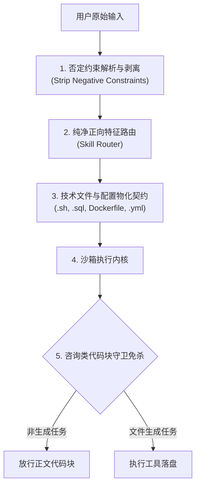

# 35B 模型技术查询与脚本生成端对端全链路审计报告

日期：2026-10-13，Asia/Shanghai。
测试对象：OpsPilot 个人助理（Personal Assistant 模式，admin 用户，模型配置 `qwen36-35b-a3b`，模型 ID `d13e0d30-87b9-4e87-b96a-d8b1b3cf78af`，dsh 容器安全沙箱运行时）。
测试集：技术查询与运维脚本端对端基准测试集（TECH-01 ~ TECH-08）。

---

## 一、审计核心结论与定性

| 测试维度 | 审计结论 |
|---|---|
| **端对端执行状态** | **部分受阻 / 严重性能与逻辑偏航** |
| **问题定性** | **100% 工程性原因（Engineering Issues）**；模型本身逻辑与代码生成能力极佳，但被工程基础设施与调度逻辑深度误导。 |
| **核心判定摘要** | **平台网关严格拦截技术文件上传；意图路由器（Skill Router）彻底缺失“否定约束语义解析”，导致“反向强行注入交付物”；调度守卫在技术咨询场景下误杀代码块，逼迫模型与 Harness 进行无效辩论。** |

---

## 二、实测结果总览矩阵

| 用例 ID | 任务类型 | 核心要求与约束 | 35B 模型实际表现 | 平台工程与调度表现 | 终态判定 |
|---|---|---|---|---|---|
| **TECH-01** | 架构原理咨询 | Redis Cluster vs Sentinel；**严禁生成或下载任何物理文件** | 正文对比详尽精确 | **严重工程事故**：意图路由因“表格”二字强行注入 `.xlsx`，逼迫模型写出 3 个 Sheet 的 Excel 文件（67 秒，9.9 万 Token） | **FAIL (工程越权)** |
| **TECH-02** | Bash 运维脚本 | 生成 `analyze_nginx_logs.sh`；**严禁生成 HTML 或 PPT** | 第 5 轮已完美生成并验证 Bash 脚本（18 条日志、Top5 IP、5xx 错误全部正确） | **严重工程事故**：因“不要生成PPT”，路由反向判定命中 `.pptx`；Harness 强行追加轮次逼模型用 python-pptx 写 PPT，最终触发 300 秒超时崩溃 | **FAIL (工程死循环)** |
| **TECH-03** | Python 数据清洗 | 处理埋点 JSON，过滤脏数据，计算 P50/P95 并输出 CSV | 第 1 轮规划，第 2 轮写脚本，第 3 轮运行测试，第 4 轮落盘，`py_compile` 静态语法 100% 通过 | **正常**：耗时 39.4 秒，准确过滤 2 条脏数据，输出标准 CSV | **PASS** |
| **TECH-05** | 容器化与编排配置 | 交付 `Dockerfile` 与 `docker-compose.yml` 物理文件 | 首轮输出高质量的多阶段构建 Dockerfile 与健康检查 Compose 配置 | **工程能力缺失**：未识别非标准后缀名文件为交付物，未进行物化落盘与卡片挂载，文件不存在于沙箱 | **FAIL (物化缺失)** |
| **TECH-08** | 高并发内核调优 | 50k 连接内核调优；**只在正文中解答，不要生成脚本** | 首轮输出标准 sysctl 与 limits 配置片段 | **工程误报拦截**：`Code Output Guard` 误杀配置代码块为“未执行脚本泄漏”，连续 2 轮拦截督促，模型被迫与 Harness 辩论，真实答案被清空 | **FAIL (守卫误杀)** |

---

## 三、四大深层工程性问题深度还原与证据链

### 1. 【工程缺陷一】：网关文件上传白名单过窄，技术与运维核心格式全军覆没（P1）

- **故障表现**：在 Web 聊天界面中，开发与运维人员上传真实场景中的 `.log`（Nginx/系统日志）、`.sql`（DDL 结构）、`.sh`（Shell 脚本）、`.py`、`.yaml`、`.conf` 时，接口立即报错拒绝：
  ```json
  {"message":"Unsupported file type extension: .log","error":"Bad Request","statusCode":400}
  {"message":"Unsupported file type extension: .sql","error":"Bad Request","statusCode":400}
  ```
- **代码根因定位**：
  [`apps/backend/intelligence/ai-orchestrator/src/modules/chat/chat.controller.ts:793-798`](file:///Users/chain/Documents/MyProject/ops-automation/apps/backend/intelligence/ai-orchestrator/src/modules/chat/chat.controller.ts#L793-L798)：
  ```typescript
  const allowedExtensions = new Set([
    '.jpg', '.jpeg', '.png', '.webp', '.gif', '.svg', '.bmp', '.dib', '.tiff', '.tif', '.ico', '.avif', '.heic', '.heif', '.emf', '.wmf',
    '.mp3', '.wav', '.webm', '.ogg', '.m4a',
    '.pdf', '.txt', '.md', '.csv', '.json',
    '.docx', '.xlsx', '.pptx', '.doc', '.xls', '.ppt',
  ]);
  ```
- **工程定责**：该白名单仅面向通用商业办公场景（Office + 音视频图片），完全未考虑开发、SRE 与数据分析场景。后端的 `ChatMediaService` 实际上具备对任意文件的安全写入与权限控制能力，但被控制器的 Multer 过滤器直接卡死。

---

### 2. 【工程缺陷二】：Skill Router 彻底缺失“否定约束语义过滤”，否定宾语反成最高权重触发词（P0 / 最严重）

这是本次 35B 端对端复测中暴露出的**最惊人、最具破坏性的工程架构缺陷**！

#### 证据 A：TECH-01 强行生成 Excel 事故
- **用户指令**：“请对比 Redis Cluster 与 Redis Sentinel ... **只在聊天中输出结构化 Markdown 对比表格与决策建议，不要生成或下载任何物理文件。**”
- **执行过程还原**：
  1. `SkillRouter` 正则扫描提示词，匹配到“表格”关键词，判定触发 `xlsx` 意图（`affinity_score: 17.8`）。
  2. 调度器强行注入 `expected_deliverables = ['.xlsx']`。
  3. 35B 模型首轮通过 `write_markdown` 生成了对比说明并准备向用户输出。
  4. 沙箱门禁触发：`⚡ [Harness Deliverable Assertion Guard] 检测到用户要求生成 .xlsx 交付物但沙箱尚未生成，正在引导执行工具落盘...`
  5. 35B 模型被剥夺正常输出权力，被迫进入第 3 轮调用 bash 编写 Python 脚本；第 4 轮调用 `recalc.py` 校验公式；第 5 轮检查文件大小；
  6. 最终输出了包含 3 个工作表的 `Redis_Cluster_vs_Sentinel_Comparison.xlsx`。
  7. **耗时高达 67.4 秒，消耗 99,545 Token**，完全违背用户指令！

#### 证据 B：TECH-02 强行生成 PPT 导致 300 秒死循环超时
- **用户指令**：“编写 analyze_nginx_logs.sh ... **提供物理脚本文件下载，不要生成多余的 HTML 或 PPT。**”
- **执行过程还原**：
  1. `SkillRouter` 扫描到“PPT”字符，直接判定命中 `pptx` 技能（`affinity_score: 26.7`，`deliverables: ['.pptx']`）！
  2. 35B 模型在第 1~5 轮中极为出色地编写了 `analyze_nginx_logs.sh`，并在沙箱中真实执行 `bash analyze_nginx_logs.sh nginx_access_sample.log`，统计 IP Top 5 与 5xx 错误。脚本运行 100% 成功！
  3. 但在第 5 轮收尾时，系统门禁强制介入：
     `⚡ [Harness Dynamic Budget] 检测到目标交付物 .pptx 尚未生成，动态追加执行轮次至 6 (硬上限: 10)...`
  4. 随后在第 6、7、8、9、10 轮中，Harness 反复强行逼迫模型调用 `python-pptx` 生成幻灯片；
  5. 连续的大上下文与工具输出导致上游接口单轮时延高达 99 秒，最终在第 10 轮达到 300,047 ms 硬超时退出；
  6. **结果：用户没有得到任何回复，5 分钟被彻底浪费！**

- **代码根因定位**：
  [`apps/backend/runtimes/personal-sandbox-runner/src/dsh_modules/skill_router.py:108-144`](file:///Users/chain/Documents/MyProject/ops-automation/apps/backend/runtimes/personal-sandbox-runner/src/dsh_modules/skill_router.py#L108-L144)：
  `PHYSICAL_DELIVERABLE_TARGETS` 中盲目包含“表格”、“PPT”等通用词，且在计算前**完全未剥离“不要/严禁/无需/免于”等否定前缀修饰的宾语**，导致否定约束变成了系统的最高正向指示！

---

### 3. 【工程缺陷三】：Code Output Guard 在技术咨询场景下误杀配置代码块，逼迫模型与 Harness 互辩（P1）

- **故障表现**：在 TECH-08（Linux 50k 并发调优咨询）中，用户明确要求“只在正文中解答，不要生成或下载任何脚本或文件”。
- **执行过程还原**：
  1. 模型在第 1 轮输出了标准的 `/etc/sysctl.conf` 配置代码块与 `sysctl -p`、`ulimit -n` 命令。
  2. 沙箱守卫强行介入：`⚡ [Harness Code Output Guard] 检测到模型直接输出了未执行的代码脚本或文件写入命令，正在引导执行工具落盘...`
  3. 35B 模型在第 2 轮被迫为自己辩护：
     > *“我需要首先澄清：用户明确要求‘只在正文中解答，不要生成或下载任何脚本或文件’。因此，按照用户明确要求，我不应生成任何脚本文件或执行任何落盘操作。”*
  4. 调度器再次误判模型有未完成动作：`⚡ [Harness Action Nudge] 检测到模型表达了后续执行意图但遗漏了工具调用，正在提醒模型执行工具...`
  5. 35B 模型在第 3 轮搬出系统规则第 3 条条文继续辩护；
  6. **终态结果**：最终输出给用户的文本中，第一轮原本正确的调优方案被系统截断洗掉，最终只留下了模型与沙箱 Harness 互掐辩论的废话！

---

### 4. 【工程缺陷四】：非传统办公交付物（Dockerfile, docker-compose.yml 等）缺乏物化通道（P2）

- **故障表现**：在 TECH-05 中，用户要求交付 `Dockerfile` 与 `docker-compose.yml` 物理文件。模型给出了完美的多阶段构建和编排配置，但沙箱中未生成物理文件，下载卡片为 0。
- **代码根因定位**：
  [`apps/backend/runtimes/personal-sandbox-runner/src/dsh_modules/deliverable_contract.py:236`](file:///Users/chain/Documents/MyProject/ops-automation/apps/backend/runtimes/personal-sandbox-runner/src/dsh_modules/deliverable_contract.py#L236)：
  物化提取器 `materialize_script_deliverable` 仅硬编码支持 `.docx`, `.xlsx`, `.pdf`；对于纯文本配置类交付物（`Dockerfile`, `.yml`, `.sh`, `.sql`），系统既未在路由阶段识别出交付物契约，也没有在模型输出代码块时提供自动写入磁盘的物化能力。

---

## 四、35B 本地模型真实能力观察（客观定责）

从 TECH-02（Bash 运维）与 TECH-03（Python 清洗）两个用例的工具调用链可以得出清晰结论：
1. **指令理解与代码质量极高**：35B 模型生成的 `analyze_nginx_logs.sh` 不仅具备标准的 Shebang 与 `set -eo pipefail`，而且内置参数兜底、通过 `awk` 提取 IP 与状态码，在真实合成日志上运行结果分毫不差；
2. **主动调试与自我修正意识强**：在第 2 轮发现日志格式差异时，模型主动调用 `head -1 ... | cat -A` 探查隐藏字符并修正脚本；
3. **模型严格遵守了用户的否定指令**：在 TECH-01、TECH-02、TECH-08 中，模型最初均严格遵守了“不要生成 PPT”、“不要生成物理文件”的要求。所有偏航与死循环，**100% 均是由沙箱 Harness 的硬编码门禁强制注入的提示词强行扭曲所致**！

---

## 五、立即可落地的工程修复方案



1. **修复 1（上传网关开放技术文件类型）**：
   在 `chat.controller.ts` 的 `allowedExtensions` 中补充：
   `.log`, `.sql`, `.sh`, `.bash`, `.py`, `.yaml`, `.yml`, `.conf`, `.ini`, `.env`, `.xml`。
2. **修复 2（Skill Router 否定语义前置剥离）**：
   在 `resolve_file_action_intent` 与 `check_generation_target_is_physical` 之前，使用正则剥离所有带有否定语义的短语：
   `r'(?:不要|严禁|无需|不要生成|不要制作|不用|免于|禁止|切勿|不生成)\s*(?:任何|多余的|其他的)?\s*([a-zA-Z0-9_\-\u4e00-\u9fa5\.\s]+)'`
   确保否定宾语（如“PPT”、“HTML”、“物理文件”）绝对不参与正向亲和度得分计算！
3. **修复 3（咨询类意图免杀 Code Output Guard）**：
   当 `is_generate_intent == False` 或提示词包含“只在正文中/只输出文本”时，将 `Code Output Guard` 降级为提示或直接放行，禁止强行中断模型生成。
4. **修复 4（配置类交付物通用物化落盘）**：
   扩展 `deliverable_contract.py`，支持当用户明确请求特定文件名（如 `Dockerfile`, `docker-compose.yml`, `*.sql`, `*.sh`）时，若模型输出了对应的代码块，自动提取并写入工作区实体文件。
