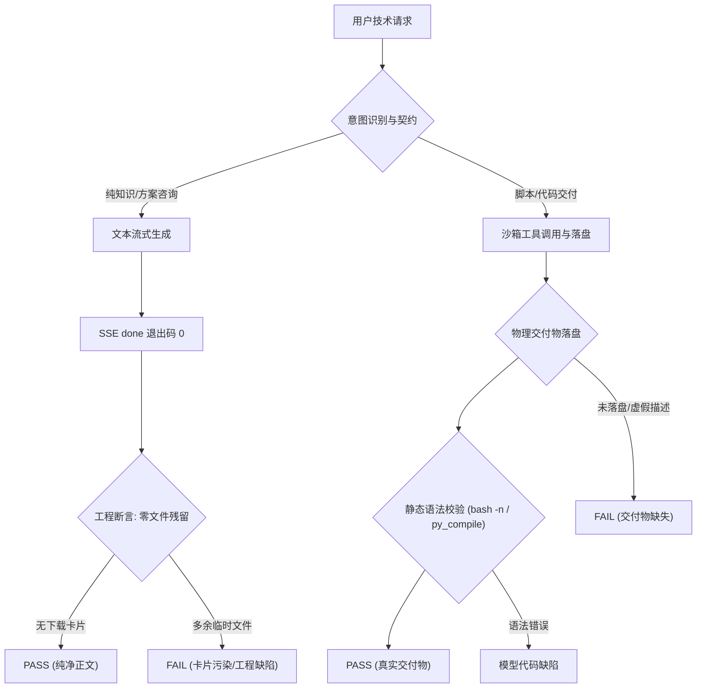

# 技术查询与脚本生成端对端基准测试集

日期：2026-10-13，Asia/Shanghai。测试对象：OpsPilot 个人助理（Personal Assistant 模式，admin 用户，系统默认模型，dsh 沙箱运行时）。

本测试集针对开发者、DevOps/SRE 工程师与数据分析人员日常高频的**技术方案查询、运维脚本编写、数据自动化处理、SQL 报表与优化、容器配置以及故障排查巡检**场景，制定端对端（E2E）闭环验证用例与客观物理断言规范。

---

## 一、测试场景设计矩阵

| ID | 场景分类 | 测试输入 | 核心提示词概括 | 最小验收断言 | 产物预期 |
|---|---|---|---|---|---|
| **TECH-01** | 纯架构原理咨询 | 无附件 | 对比 Redis Cluster 与 Sentinel 架构差异、主从切换时延、脑裂与客户端寻址，给出选型建议 | 退出码 0、正文包含核心对比维度；**断言无物理文件生成、无冗余下载卡片** | 纯 Markdown 正文 |
| **TECH-02** | Bash 运维分析脚本 | `nginx_access_sample.log` | 统计独立 IP Top 5、各 HTTP 状态码分布、过滤输出所有 5xx 请求 URL | 真实交付 `analyze_nginx_logs.sh` 可下载；包含 `#!/usr/bin/env bash` 与 `set -eo pipefail`；`bash -n` 语法通过；无额外未请求文件 | `analyze_nginx_logs.sh` |
| **TECH-03** | Python 数据自动化处理 | `telemetry_sample.json` | 清洗过滤脏数据（空 trace_id 或负耗时），计算 P50/P95 耗时与错误率，导出 CSV | 真实交付 `process_telemetry.py` 可下载；仅使用 Python 3 标准库；`python3 -m py_compile` 静态语法通过；无外部依赖报错 | `process_telemetry.py` |
| **TECH-04** | SQL 报表与索引优化 | `ecommerce_schema.sql` | 统计各月各品类支付金额与用户数，窗口函数计算次月复购率，提供复合索引与优化建议 | 真实交付 `monthly_repurchase_analysis.sql` 可下载；SQL 字段与 DDL 严格一致；窗口函数正确；包含 `CREATE INDEX` 优化语句 | `monthly_repurchase_analysis.sql` |
| **TECH-05** | 生产级容器构建与编排 | 无附件 | 编写多阶段构建 Dockerfile（非 root 用户、HEALTHCHECK）及配套带资源限额的 docker-compose.yml | 同时交付 `Dockerfile` 与 `docker-compose.yml` 可下载；多阶段构建完整；YAML 语法结构合规；无多余临时脚本 | `Dockerfile`, `docker-compose.yml` |
| **TECH-06** | 故障诊断与巡检监控 | `pool_exhaustion_crash.log` | 分析系统崩溃根因并在正文说明；编写 Python 连接池健康巡检脚本，模拟活跃连接占比与超时连接告警 | 正文准确指出连接未释放导致的连接池耗尽；物理交付 `check_db_pool_health.py` 可下载；`python3 -m py_compile` 通过；逻辑包含超时告警 | `check_db_pool_health.py` |
| **TECH-07** | 多轮脚本升级与参数化 | `analyze_nginx_logs.sh` | 在 TECH-02 会话中，将脚本重构升级为支持 `-f`, `-n`, `-h` 命令行参数，输出 v2 脚本，不覆盖原版 | 同会话生成 `analyze_nginx_logs_v2.sh` 可下载；原脚本 SHA256 保持不变；包含 `getopts` 参数解析；刷新后历史与双文件可访问 | `analyze_nginx_logs_v2.sh`（原件保留） |
| **TECH-08** | 高并发内核调优咨询 | 无附件 | 针对 Linux 承载 50k+ 并发长连接常见瓶颈，给出 sysctl.conf 与 limits.conf 调优方案及排查命令 | 退出码 0；包含 file-max, nofile, tcp_tw_reuse, somaxconn 说明；**断言无物理文件生成、无冗余下载卡片** | 纯 Markdown 正文 |

---

## 二、工程验收与模型观察边界

### 1. 工程验收边界（平台与工程职责）
- **SSE 通信与终态**：流式接口必须返回标准 `done` 事件，沙箱退出码为 0，不得产生未捕获的 5xx 异常或超过 300 秒超时。
- **纯查询零污染约束（TECH-01, TECH-08）**：
  - 用户未明确要求下载文件时，平台**严禁生成未请求的物理文件**（如擅自生成 `.sh`、`.html`、`.txt` 下载卡片）。
  - 不得在前端产生多余的附件卡片污染。
- **物理交付物真实性（TECH-02 ~ TECH-07）**：
  - 声明交付的文件必须真实存在于沙箱文件系统并挂载至下载卡片。
  - 文件可直接通过后端接口下载，字节数非空且符合预期格式。
- **多轮会话一致性与原件保护（TECH-07）**：
  - 在同一会话进行代码增量迭代时，新生成文件（如 `_v2.sh`）独立挂载，**前序生成的基础脚本内容及 SHA256 哈希必须保持不变**，不得发生意外覆盖。
  - 浏览器刷新会话后，历史卡片中的两份产物均可正常访问下载。

### 2. 模型行为观察（模型代码能力与推理质量）
- **静态语法正确性**：
  - Bash 脚本必须能通过 `bash -n <script.sh>` 语法检查，包含正确 Shebang。
  - Python 脚本必须能通过 `python3 -m py_compile <script.py>` 语法编译检查，仅使用标准库以防在无外网环境下 `ModuleNotFoundError`。
- **逻辑严密性与 DDL 一致性**：
  - TECH-04 的 SQL 脚本中引用的表名与字段名必须与上传的 `ecommerce_schema.sql` 完全匹配，不得幻觉捏造字段（如捏造不存在的 `user_level` 或 `payment_status`）。
- **根因诊断准确率**：
  - TECH-06 面对连接池堆栈时，必须明确识别连接持有未释放（Connection leak）这一核心诱因，而非笼统归咎为“数据库压力过大”或“内存配置过小”。

---

## 三、合成测试资料清单

所有测试资料已存放在 `docs/artifacts/reviews/technical-e2e-benchmark-files/` 目录中，不依赖任何外部内网环境或真实业务数据库，保证 100% 可脱敏重放：

| 文件名 | 大小 | 资料类型 | 构造特征与注入测试点 |
|---|---|---|---|
| `nginx_access_sample.log` | 1.9 KB | Nginx 访问日志 | 包含 18 条标准格式日志；覆盖 5 个独立 IP（192.168.1.10 出现 6 次为 Top 1）；状态码包含 200/404/500/502/304；包含 5 条 5xx 错误请求 |
| `telemetry_sample.json` | 2.0 KB | 跟踪埋点数据 | 包含 10 条微服务调用 JSON 记录；故意注入 2 条脏数据（`trace_id: null` 且 `duration_ms: -10`、`trace_id: ""`）；耗时分布跨越 15ms~5000ms |
| `ecommerce_schema.sql` | 789 B | DDL 表结构定义 | 包含 `dim_users`、`fct_orders`、`fct_order_items` 三张核心表；包含外键关联逻辑与状态枚举说明 |
| `pool_exhaustion_crash.log` | 2.5 KB | 真实系统崩溃日志 | 模拟 HikariCP 连接池耗尽、`ProxyLeakTask` 泄漏告警（持有超过 180s）、以及后续引发的线程堆积与 `OutOfMemoryError` 堆栈 |
| `test-cases.json` | 3.5 KB | 结构化用例描述 | 包含全部 8 个用例的规范化 JSON 结构，可供自动化测试脚本读取运行 |

---

## 四、各用例详细提示词与自动化断言规则

### TECH-01：纯架构原理咨询
- **自然语言 Prompt**：
  > “请对比 Redis Cluster 与 Redis Sentinel 在集群架构、主从切换时延、高可用方案及客户端寻址路由机制上的核心差异与适用场景。只在聊天中输出结构化 Markdown 对比表格与决策建议，不要生成或下载任何物理文件。”
- **断言与验证命令**：
  1. `assert exit_code == 0`
  2. `assert len(download_files) == 0`（严格零物理文件）
  3. 文本中包含表格，且覆盖“主从切换”、“客户端路由”、“集群槽位/Sentinel监控”等关键词。

### TECH-02：Bash 运维分析脚本生成
- **测试附件**：`nginx_access_sample.log`
- **自然语言 Prompt**：
  > “根据我上传的 Nginx 访问日志，编写一个 Bash 运维分析脚本，文件名命名为“analyze_nginx_logs.sh”。脚本需满足：1. 使用 /usr/bin/env bash 并开启 set -eo pipefail；2. 统计独立访问 IP Top 5 及频次；3. 统计各 HTTP 状态码分布；4. 过滤并输出所有 5xx 错误的请求 URL。提供物理脚本文件下载，不要生成多余的 HTML 或 PPT。”
- **断言与验证命令**：
  1. 物理文件存在：`test -f analyze_nginx_logs.sh`
  2. 头部检查：`head -n 2 analyze_nginx_logs.sh | grep -E "#!/usr/bin/env bash|#!/bin/bash"`
  3. 语法检查：`bash -n analyze_nginx_logs.sh`
  4. 实际运行检查：`bash analyze_nginx_logs.sh nginx_access_sample.log`（输出中必须包含 `192.168.1.10` 及 `500` 或 `502` 错误统计）。
  5. 零未请求产物：`assert len(download_files) == 1`。

### TECH-03：Python 数据自动化清洗脚本生成
- **测试附件**：`telemetry_sample.json`
- **自然语言 Prompt**：
  > “针对上传的微服务埋点 JSON 数据，编写一个 Python 3 自动化清洗脚本“process_telemetry.py”。要求：仅使用 Python 标准库（json、csv、datetime 等），清洗过滤掉 trace_id 为空或耗时<=0 的脏数据；计算合法请求的 P50 与 P95 耗时及错误率；将清洗后的有效数据导出为 clean_telemetry.csv。提供可下载的脚本文件。”
- **断言与验证命令**：
  1. 物理文件存在：`test -f process_telemetry.py`
  2. 语法编译检查：`python3 -m py_compile process_telemetry.py`
  3. 依赖合规检查：脚本中无第三方外部包导入（仅允许内置库）。
  4. 沙箱执行验证：`python3 process_telemetry.py telemetry_sample.json`，检查生成的 `clean_telemetry.csv` 行数是否排除了 2 条脏数据。

### TECH-04：SQL 报表与性能优化脚本
- **测试附件**：`ecommerce_schema.sql`
- **自然语言 Prompt**：
  > “参考上传的电商 DDL 结构，编写用于月度复购分析的 SQL 脚本“monthly_repurchase_analysis.sql”。要求：1. 计算各自然月、各商品品类的支付总金额、下单用户数；2. 使用窗口函数计算用户次月复购率；3. 针对大数据量场景，给出合理的复合索引创建语句（CREATE INDEX）和查询优化建议。提供物理 SQL 文件下载。”
- **断言与验证命令**：
  1. 物理文件存在：`test -f monthly_repurchase_analysis.sql`
  2. 模式匹配：包含 `CREATE INDEX`，包含 `LAG` / `LEAD` / `OVER (PARTITION BY ...)` 窗口函数。
  3. 字段一致性：引用的字段必须存在于 `ecommerce_schema.sql`（`order_status`, `total_amount`, `paid_at`, `category_id`, `category_name` 等）。

### TECH-05：生产级容器配置生成
- **自然语言 Prompt**：
  > “请为一个基于 Node.js/TypeScript 的 Web 服务编写生产级容器化配置文件：1. “Dockerfile”，采用多阶段构建（build 阶段编译、production 阶段运行），使用非 root 用户（node），包含 HEALTHCHECK 指令；2. 配套的“docker-compose.yml”，配置资源配额（mem_limit/cpus）与健康检查探针。提供可下载的 Dockerfile 与 docker-compose.yml 物理文件。”
- **断言与验证命令**：
  1. 物理文件双交付：`test -f Dockerfile && test -f docker-compose.yml`
  2. Dockerfile 规则：包含 `AS builder` 或 `AS build`，包含 `USER node`，包含 `HEALTHCHECK`。
  3. Compose 规则：包含 `services:`，包含 `mem_limit` 或 `deploy.resources.limits`，包含 `healthcheck:`。

### TECH-06：系统故障诊断与健康巡检脚本
- **测试附件**：`pool_exhaustion_crash.log`
- **自然语言 Prompt**：
  > “根据上传的系统崩溃日志，诊断系统故障根因，并在正文中清晰说明。同时，编写一个独立的 Python 数据库连接池健康巡检脚本“check_db_pool_health.py”，要求能够模拟定时检查活跃连接占比、发现超时未释放连接并打印告警。提供该巡检脚本文件下载。”
- **断言与验证命令**：
  1. 根因诊断命中：正文必须包含“连接泄漏”或“未释放连接导致连接池耗尽”（Connection leak / pool exhaustion）。
  2. 物理文件存在：`test -f check_db_pool_health.py`
  3. 语法编译检查：`python3 -m py_compile check_db_pool_health.py`。
  4. 巡检逻辑包含阈值判断与警告打印。

### TECH-07：多轮脚本增量迭代与重构
- **测试前置**：在 TECH-02 成功执行且生成 `analyze_nginx_logs.sh` 的同一会话中继续提问。
- **自然语言 Prompt**：
  > “将上一轮的 analyze_nginx_logs.sh 脚本升级为支持命令行选项，生成新文件“analyze_nginx_logs_v2.sh”并提供下载：支持 -f 指定日志文件路径，-n 指定 Top 排名数量，-h 打印帮助说明。保持原有分析能力，不要覆盖或破坏原始 analyze_nginx_logs.sh 文件。”
- **断言与验证命令**：
  1. 独立文件交付：`test -f analyze_nginx_logs_v2.sh`
  2. 原件完整性：对比上一轮 `analyze_nginx_logs.sh` 的 SHA256 哈希，必须完全相同。
  3. 参数支持检查：`grep -E "getopts|case \"\$1\"" analyze_nginx_logs_v2.sh`
  4. 语法检查：`bash -n analyze_nginx_logs_v2.sh`
  5. 刷新历史一致性：刷新浏览器或重新调用 `/chat/sessions/{id}`，两份脚本均在 `downloadUrls` 中且字节一致。

### TECH-08：高并发内核调优咨询（纯正文）
- **自然语言 Prompt**：
  > “请针对 Linux 服务器在承载 50,000+ 并发长连接时可能出现的常见系统瓶颈（如 TIME_WAIT 过多、文件句柄耗尽、SYN 队列溢出），给出详细的内核参数调优方案（/etc/sysctl.conf 与 limits.conf）与排查命令。只在正文中解答，不要生成或下载任何脚本或文件。”
- **断言与验证命令**：
  1. `assert exit_code == 0`
  2. `assert len(download_files) == 0`（严格零物理文件）
  3. 覆盖关键参数：`net.ipv4.tcp_tw_reuse`, `net.core.somaxconn`, `fs.file-max`, `nofile`。
