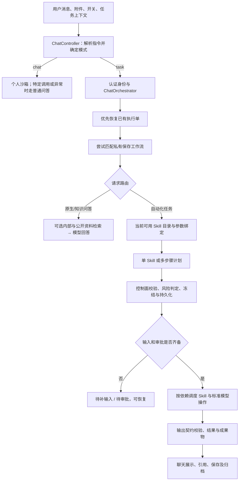

# 工作模式能力地图与执行边界

日期：2026-10-15（Asia/Shanghai）。范围：当前工作区源码、声明式能力包和已有验收报告。先用 codebase-memory 图谱定位，再核对磁盘源码；图谱存在遗漏与行号滞后，以磁盘为准。本次不修改业务代码，不启动或重启服务，不执行邮件、通知或企业流程。

本报告是架构与实现理解，不是当前登录账号的实时授权清单，也不是全能力端到端验收。仓库已有大量未提交修改，本文描述包含这些修改的工作区状态，不能直接等同于容器已部署版本。

用户明确的设计方针：工作模式主动受限，以获得高度确定的业务结果、可回放的执行过程，并减少重复规划与 Token 使用；后续通过追加 Skill 扩展能力。它与个人模式的区别是既定产品方向。后续验证应优先发现和解决路由、参数、版本、状态与观测等工程问题，不将这些故障归结为模式定位有误。对应测试设计见 `docs/testing/work-mode-routing-e2e.md`。

## 1. 工作模式的组成

项目的工作模式/企业协同模式对应 `config.mode = 'task'`，个人模式对应 `'chat'`。它们有不同入口与执行机制。

| 层次 | 能力来源 | 职责与边界 |
|---|---|---|
| 模型直接回答 | ModelService 与会话上下文 | 问答、写作、推理、计算、分析和受支持的图片理解；直接模型调用不携带自由工具循环 |
| 标准模型操作 | LLM Operation 注册与版本契约 | 将摘要、文本生成、变换、字段提取和排版作为执行计划中的受控步骤 |
| 系统内置 Skill | `builtin-skills/*` → 注册中心数据库 → Handler | 搜索、文档、邮件、空间、通知等平台能力 |
| 用户/管理员发布 Skill | SkillConfig、CapabilityRelease、DeploymentRecord | 已发布的业务能力，可关联模板、执行流及运行时；需要检查部署与权限 |
| 私有保存工作流 | user_saved_skills 与版本快照 | 从成功执行沉淀固定计划与固定输入，匹配后复用冻结步骤 |
| 企业工作流 | OrgWorkflow 与 CoordinationStageEngine | 人员分工、提交、审批、自动化、驳回及归档；阶段再绑定 Skill 或基础工作流 |
| 文档空间 | Workbench Workspace | 保存资料与成果、提供正文/摘要/检索/引用、支持流程归档 |
| 底层工具与适配器 | ToolExecutor、RuntimeAdapterRegistry | 执行机制；不代表所有工具都直接向工作模式模型开放 |

这里有多种名为 Skill 的概念。仓库业务平台发布的 Skill，与个人沙箱加载的 SKILL.md，以及本次 Codex 会话自身的技能目录，不是同一份注册表。

## 2. 主执行链路

实际路由还有图片处理、提醒列表查询、能力目录问答、上一执行结果续接等分支。多步骤计划可由模型提出拓扑；“确定性”指执行前校验并冻结计划，不能理解为全过程没有调用规划模型。

任务无法形成可验证计划时通常返回未执行或错误。兼容 ReAct 回退仅在 `PRODUCTION_REACT_FALLBACK_ENABLED=true` 时开启；Compose 默认值为 false。本次没有读取运行容器的有效环境值。

单 Skill 未匹配到能力时，如果有模型服务且请求没有被判为外部系统变更，存在原生模型回答分支。因此“未匹配 Skill”也不总是以相同终态结束；原生回答完成并不证明执行过外部操作。

## 3. 系统内置能力：14 个源码能力包

下列版本是当前源码 manifest 版本，不代表数据库活动版本或当前用户已获授权。

| Key | 能力 | 源码版本 | 生命周期 |
|---|---|---|---|
| platform.document.markdown-artifact-writer | 生成并持久化 Markdown 成果物 | 1.0.2 | stable |
| platform.document.pdf-content-extractor | PDF、PPTX、Word、Markdown 等正文、分页与元数据提取，声明支持视觉 OCR | 1.0.2 | experimental |
| platform.document.pdf-create | 简单 PDF 生成 | 1.0.2 | stable |
| platform.document.pdf-merge | 多 PDF 合并 | 1.0.0 | stable |
| platform.document.pdf-split | PDF 拆页 | 1.0.1 | stable |
| platform.document.contract-reviewer | 合同智能审查、诊断与审查成果 | 1.0.2 | experimental |
| platform.document.contract-comparator | 合同版本比对与红线审查 | 1.0.2 | experimental |
| platform.email.messages | 邮件读取、列表与搜索 | 1.0.2 | experimental |
| platform.email.send | 邮件发送 | 1.0.1 | experimental |
| platform.email.update | 邮件状态更新 | 1.0.1 | experimental |
| platform.notification.internal-message | 内部通知 | 1.0.0 | stable |
| platform.notification.reminder | 一次性或定期提醒，站内与可选微信渠道 | 1.2.0 | stable |
| platform.search.web | 公开互联网搜索与来源返回 | 1.0.5 | experimental |
| platform.workspace.explorer | 空间检索、文档摘录及行引用 | 1.0.1 | experimental |

内置能力包由 manifest、workflow、lock 和 fixtures 描述元数据、输入输出 Schema、Handler 路由与版本指纹。目录投影检查启用、活动版本、健康/已部署记录以及 discover 权限；执行 resolve 另查 execute 权限与指定版本。

文档操作主要委托 document-domain；搜索、邮件、空间、合同和通知由控制面 Handler 分发到相应服务。实际可用性还受模型、文档引擎、搜索渠道、邮箱配置和通知渠道影响。

源码 README 的目录示例只列 12 项，未列入两个合同能力；本报告按实际 manifest 统计为 14 项。

## 4. 模型能力有两种接入方式

### 4.1 原生回答

`executeLlmNativeTask` 调用模型会话流，提供选定模型、思考配置、历史上下文、附件内容；图片要求可用的视觉模型。此分支不开放任意工具调用。

“原生回答”也可能由后端先进行真实检索：开启知识/联网开关后，检索结果被注入回答上下文。这类执行不一定生成控制面执行单，不能用“有没有执行单”判断是否读过外部资料。

### 4.2 标准 LLM Operation

源码系统定义中有 6 个 active 操作：

- `summarize_list`：列表摘要。
- `summarize_text`：文本摘要。
- `generate_text`：文本生成。
- `transform_text`：分析、建议、翻译、改写、润色、提取、合并与格式化。
- `extract_structured_fields`：结构化字段提取。
- `format_document_blocks`：标题、段落、表格等文档块组织。

另有 3 个 deprecated 兼容操作：`rewrite_to_markdown`、`classify_intent_label`、`merge_multi_source_notes`。运行时要求冻结计划提供 operationVersion、operationDigest 与 contractDigest；系统定义的 active 状态仍不等同于实际数据库发布状态。

例如“搜索资料→总结→生成 Markdown”可组合真实搜索 Skill、标准摘要操作与成果物 Skill。模型生成的正文和真正落盘的文件是不同阶段。

## 5. 用户发布 Skill、私有工作流与企业工作流

### 5.1 用户/管理员发布的业务 Skill

统一目录的已发布 Skill 投影要求有发布版本、成功部署记录、激活状态及允许的角色。工具绑定服务校验工具是否注册、是否禁用、是否允许被 Skill 绑定，以及执行流用到的工具是否显式声明。

Planner 同时合并统一目录和旧 `/skills` 目录，保留兼容能力。因而不能仅根据统一目录投影就断言所有入口已经遵循完全相同的发布筛选；需要继续检查旧目录与最终执行 resolve。

Skill 匹配存在置信度门槛，默认 0.8，可由环境配置调整。目标 Skill、参数 Schema、上传附件、企业流程阶段绑定以及上一任务结果都会影响匹配和参数收集。

### 5.2 私有保存工作流

保存来源要求成功执行和冻结计划，并有确定性检查与审查结果。执行时验证所有者、active 状态、精确数字版本以及计划/固定输入哈希。命中名称、别名等后直接创建执行单，复用保存计划。

这类工作流是个人固定流程资产，和面向全企业发布的组织流程具有不同权限及生命周期。

### 5.3 企业工作流

组织流程同时包含参数契约、阶段定义、角色授权和基础工作流组装。阶段有 submission、approval、automation、archive；可按负责人、角色、部门、指定用户或发起人分配审批。

阶段触发事件包括提交、阶段审批、批准和完成；基础组件可为 Skill、execution_flow 或 temporal_workflow。流程还承担任务分派、人工确认、驳回及后续自动化。

聊天携带 taskContext 后，后端通过组织、版本与阶段重新解析权威绑定，覆盖不一致的客户端 skillId。解析绑定具备组织及版本检查；这不替代企业流程所有入口的完整授权验证。

源码有合同生成/审查默认组装；NDA 流程展示了“专用生成 Skill→业务确认→自动合同审查→法务确认→PDF 归档→回执通知”。模板存在不代表其中专用 Skill 在当前环境必然健康可用。

## 6. 文档空间与知识能力

空间分为个人、部门、公司公共盘和流程归档四类。既存放上传资料，也接收笔记、AI 回答、沙箱成果与流程交付物。服务包含文件树、上传/下载、正文索引、摘要卡片、AI 清洗、知识统计、预览与按行引用等能力。

当前普通访问检查：个人空间限本人或 admin；部门空间按部门身份/成员关系或 admin；公司公共盘可读、修改限 admin；流程空间可读、删除限 admin，当前实现并非所有写入都限 admin。

| 接入方式 | 实现 | 对用户的含义 |
|---|---|---|
| 文件名搜索 | `/workspaces/search` | 用于文件选择与概览，存在返回条数限制 |
| 全文检索 | `/workspaces/search-content` | 关键词、正文和伴生缓存检索；当前是有候选上限的扫描，不是全库向量检索 |
| 知识增强回答 | ChatKnowledgeRetrievalService | 检索后注入模型上下文，默认最多取 5 篇文档，可与公开资料合并 |
| 空间探索 Skill | platform.workspace.explorer | 生成执行单，返回 answer、citations、searchedFilesCount 等结构化结果 |
| 文档预览与研读工具 | preview、workspace_outline、workspace_read | 提供摘要、大纲或原文行窗口；受实际入口和权限影响 |

知识增强检索失败时可降级到模型既有知识。内部检索异常被转换为空结果，用户看到的“未找到”不一定意味着检索服务确实正常完成。

全文检索只扫描候选集合，且二进制格式依赖索引/摘要/文本缓存处理；因此“没有命中”不能作为文档绝对不存在的证明。

## 7. 受限工具的内部结构

ReAct 运行模块注册了 14 类工具：

| 类别 | 工具名 |
|---|---|
| 匹配、参数与交互 | skill_match、param_collect、user_ask、preview_params |
| 文件与模板 | file_parse、document_render |
| 流程与步骤 | flow_execute、script_execute、browser_step、api_call |
| 空间 | workspace_search、workspace_outline、workspace_read |
| 人员协同 | coordination_task |

工具并不等于内置 Skill：前者是调用机制，后者是版本化业务能力。`script_execute` 只是顺序调用工具并传递输出，不是任意 Shell 或 Python 解释器。

工作模式兼容 ReAct 快照会排除 `api_call`、`skill_match`，并声明 Skill 绑定执行；`document_render` 还要求存在文档类 Skill。工具可进一步受请求 tools、角色、选定 Skill 工具集合、目录状态、暴露策略与审批约束影响。

ToolExecutor 的标准执行入口执行白名单、可见性、prompt_only、Skill 绑定、审批、角色和参数检查。目录支持 hidden、prompt_only、runtime_only、prompt_and_runtime 四种暴露策略。

控制面另有计划级校验：依赖顺序与深度、参数类型绑定、最终输出、敏感数据、外部数据来源及输入输出契约。风险规则将读操作归 L0、内部写入归 L1；外部写入、破坏性操作等通常要求审批，受限/秘密数据也会提高风险。不能把快照中的 requireHumanReviewOnWrite 字段理解为所有写操作都已统一强制人工确认。

## 8. 当前实现中必须保留的差异

1. **能力自述尚不是完整能力总表。** ChatCapabilityInquiryService 加载合并后的 Skill 和私有保存工作流，并标成“系统内置自动化技能”；没有直接加载组织工作流目录、完整空间能力或标准 LLM Operation 清单。描述层也混合了内置与已发布 Skill。
2. **工具目录与运行模块不完全一致。** ToolCatalogService 的源码种子只有 9 项，运行模块注册 14 项。数据库可能另有补录，本次未查库，不能直接断言运行环境缺少对应记录。
3. **空间探索文案与 Handler 有差异。** 界面写“多步 Agent 探查”，当前 Handler 主要是关键词搜索、兜底搜索、必要时读取预览并拼装摘录，没有模型自主调用 outline/read 的循环；manifest 的 workspaceId、maxFiles 也没有在该 Handler 中实际参与查询控制。
4. **空间探索身份有权限扩大风险。** Handler 固定传 `x-user-role: admin`，缺用户时还有默认管理身份兜底；JwtAuthGuard 在合法内部凭证下接受此角色。需要按普通成员实测可达范围，不能宣称已验证跨角色/跨组织隔离。
5. **串行工具没有逐步经过标准检查入口。** ScriptTool 内部直接 getTool 后调用 tool.execute，没有再次经过 ToolExecutor.executeTool；由此不能断言子步骤全部经过快照/白名单/审批检查。该点主要涉及兼容 ReAct 路径，不能据此声称默认冻结计划路径都可绕过。
6. **开关与意图路由存在不同口径。** Planner 会根据显式检索意图推断联网需求，同时处理否定语句与附件上下文；原生知识增强函数主要看开关。知识开关、`/doc` 及别名在不同层也有不同判断，应按路径理解，不能把开关当作已经统一验证的全局网络隔离策略。

以上为源码观察与待验证风险，没有在本次执行漏洞利用或修改实现。

## 9. 已有实测证据与本次边界

2026-10-15 14:50 的工作模式验收报告记录：企业成员账号的帮助、简单计算、空间空结果/命中、引用预览和刷新恢复已覆盖；缺附件 `/extract` 仅部分通过，并观察到会话显示及反馈接口异常。报告明确没有覆盖全能力和所有角色权限。

本次没有重新运行该验收，也没有读取当前用户的实时能力目录、数据库活动版本或容器有效配置。因此后续如需回答“此账号现在具体能执行哪些”，必须以同一登录身份读取运行目录、组织流程目录和服务状态，再做针对性验证。

## 10. 主要源码与证据入口

- [聊天主编排](/Users/chain/Documents/MyProject/ops-automation/apps/backend/intelligence/ai-orchestrator/src/modules/chat/chat-orchestrator.service.ts:120)
- [能力问答的实际汇总范围](/Users/chain/Documents/MyProject/ops-automation/apps/backend/intelligence/ai-orchestrator/src/modules/chat/chat-capability-inquiry.service.ts:51)
- [标准模型操作定义](/Users/chain/Documents/MyProject/ops-automation/apps/backend/intelligence/ai-orchestrator/src/modules/llm-operation/system-operation-definitions.ts:12)
- [内置与已发布能力统一目录](/Users/chain/Documents/MyProject/ops-automation/apps/backend/registry-release/skill-registry/src/builtin/catalog-projection/builtin-skill-catalog-projection.service.ts:20)
- [Planner 的目录合并和开关过滤](/Users/chain/Documents/MyProject/ops-automation/apps/backend/intelligence/ai-orchestrator/src/modules/planner/skill/skill-cache.service.ts:52)
- [ReAct 能力快照](/Users/chain/Documents/MyProject/ops-automation/apps/backend/intelligence/ai-orchestrator/src/modules/react-engine/capability-resolver.ts:37)
- [标准工具执行入口](/Users/chain/Documents/MyProject/ops-automation/apps/backend/intelligence/ai-orchestrator/src/modules/react-engine/tool-executor.ts:441)
- [串行工具子步骤调用](/Users/chain/Documents/MyProject/ops-automation/apps/backend/intelligence/ai-orchestrator/src/modules/react-engine/tools/script.tool.ts:100)
- [空间服务与访问检查](/Users/chain/Documents/MyProject/ops-automation/apps/backend/governance/workbench/src/workspace/workspace.service.ts:955)
- [空间探索 Handler 的身份头](/Users/chain/Documents/MyProject/ops-automation/apps/backend/execution-control/control-plane/src/modules/execution/adapters/workspace/workspace-explorer.handler.ts:164)
- [企业流程数据结构](/Users/chain/Documents/MyProject/ops-automation/apps/backend/governance/workbench/src/coordination/org-workflow.entity.ts:1)
- [计划风险规则](/Users/chain/Documents/MyProject/ops-automation/apps/backend/execution-control/control-plane/src/modules/execution/risk/plan-risk-evaluator.service.ts:11)
- [已有工作模式验收报告](/Users/chain/Documents/MyProject/ops-automation/docs/artifacts/reviews/work-mode-e2e-2026-10-15-1450.md)
