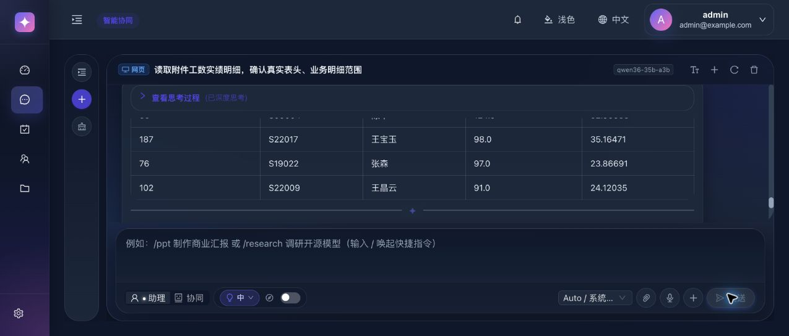

# 工数表个人模式 35B 端对端复测（第 2 轮）

测试时间：2026-10-25 15:38–16:11（Asia/Shanghai）。
会话：`chat-session-1792913884915-mf3awvji`。
模型：`qwen36-35b-a3b`，个人助理模式，深度思考中档，深度调研关闭。通过实际网页提交 10 个原有用例，只为隔离产物将文件名改为 r2；未修改业务代码，未更换大模型。

## 结论

**本轮未通过数据正确性门槛。** 10 个用例中，1 个完整交付且数据正确，8 个明确失败或提示重试，1 个文件正确但最终聊天回复包含错误数据。明确失败本身不按模型能力不足判为阻断；最终已交付的错误数据必须阻断。

本轮未复现上轮“未执行完整重复审计却宣称重复为零”，但该检查提前失败，不能宣称审计能力已经通过。副本写入这次实际产生了文件，未再仅停留于工具不可用；任务最终超时且没有交付链接，完整链路仍未通过。

## 用例结果

| 用例 | 能力 | 最终结果 | 独立核对与限制 |
|---|---|---|---|
| K01 | 结构、范围、总计 | 安全未完成 | 超时/连接中断，未输出汇总数字；只读任务却显示“文件写入前超时、深度思考已关闭”，提示与任务及界面配置不符 |
| K02 | 组合筛选、排序、行号 | 安全未完成 | 未通过证据核验，没有输出冒算数字；把“总工数、按工数”误称为缺失原始列 |
| K03 | 员工聚合 Top 5 | 完整通过 | 5 人编号、姓名、记录数、工数、金额及并列排序与独立 Decimal 基准一致 |
| K04 | 部门交叉汇总及占比 | 安全未完成 | 计划校验失败；明确 4 项检查未覆盖；失败提示误将派生指标称为缺失原始列 |
| K05 | 完整重复与客户空值审计 | 安全未完成 | “客户名称”字段绑定校验失败；原文件实际有该列。没有再输出未经执行的重复零值 |
| K06 | 每日粒度缺失 | 安全未完成 | 没有编造日数据；未准确解释缺少每日日期，而称缺少“2026年10月工数”列，交互解释仍不准确 |
| K07 | 精确编号及零结果 | 安全未完成 | `in` 条件缺少非空 values，校验拦截，没有把全表合计或未执行检查报成个人数据/未找到 |
| K08 | CSV 导出 | **错误数据，阻断** | 实际下载 CSV 的 49×19 个字段、顺序正确；回复预览第 4、5 条错误，原列位置说明也偏移一列 |
| K09 | 副本增删改、公式及样式 | 安全未完成 | 300 秒超时，无下载链接；工作区留下中间 Excel，记录修改及公式文本正确，274 个公式缓存缺失 |
| K10 | 部门报告与图表 | 安全未完成 | 300 秒超时，无下载链接；中间 Excel 的 7 部门数据、公式缓存及图表引用正确，冻结表头缺失 |

“安全未完成”表示没有把计算成功作为最终交付，不代表失败解释完全正确。没有将本轮低完成率当作要求更换模型的理由，也没有要求必须一次完成。

## 阻断项：文件正确，摘要补出了错误记录

K08 trace：`d2f3c2b4-697c-49f4-a776-7acae6fe8beb`。
执行回执的 bash 结果仅给前三条记录预览；最终自然语言回复自行扩写成五条。额外的第 4、5 条与独立原表及实际 CSV 均不一致：

| 位置 | 正确原行号 / 员工 / 工数 / 金额(K) | 最终聊天回复 |
|---|---|---|
| 第 4 条 | 83 / S14042 / 97.41 / 34.95300 | 76 / S19022 / 97.0 / 23.86691 |
| 第 5 条 | 176 / S22014 / 90.00 / 23.82353 | 102 / S22009 / 91.0 / 24.12035 |

另有字段来源说明错误：原表“会计年度”是第 1 列，回复称“原文第 2 列”，其后沿用偏移后的序号。实际 CSV 的字段顺序未错。

归因边界：错误记录产生于模型最终摘要；工程层没有把新增数字限制为执行证据中的数据，因而放行了错误回复。K08 回执 `verified=false` 并不等于已经对文件生成后的全文数据进行核验，最终仍以成功文案交付。这不是 CSV 筛选计算错误，也不能因下载文件正确就把整个用例判为通过。

建议修复与回归点：由实际文件确定性提取最终预览；或在最终发送前核对摘要中的记录、数值与生成文件。为这个固定反例保留回归：正确第 4/5 条必须为 83、176；没有执行证据时应省略预览或明确未核验。

## 超时、模型与工程问题的区别

K01 期间模型代理日志有 15 秒/60 秒上游超时及重试。K09、K10 均由 300 秒沙箱任务上限终止。它们没有虚假成功交付，按本轮原则属于允许的明确失败；这只能说明完成度和耗时，不能仅据此认定写入工具仍被旧问题拦截。

K02/K04/K05/K07 存在不合法计划，模型生成计划错误与工程校验成功拦截应分开记录。K02/K04/K06/K07 的最终失败提示还包含未经充分证实的“原始列缺失”，这不是正确的缺失数据说明。K05 的“客户名称不存在”是本轮计划绑定错误，原表第 12 列确有“客户名称”，不能要求用户补一列已经存在的数据。

## 实际产物和交付核对

- CSV：刷新聊天后，找到实际下载链接并下载到 Downloads，再复制归档；不是只查看工作区文件。UTF-8 BOM，1 行表头 + 49 行，首列原行号，后 18 列逐字段比对正确。SHA256：`fe8b3ff7c68100b526481bc7f01758a0225c12414531d16f0b25b999cec5275e`。
- 编辑 Excel：从工作区恢复的未交付中间产物，275×19；全部 274 条记录的增删改、原字段、`=O行/8`、两位/五位小数、A2 冻结、A1:S275 筛选和 O2:O275 >8 条件格式正确。公式缓存均为空，标记 fullCalcOnLoad；属于尚未重算，不能称为错误计算值，也不能声称已验证计算后数值。
- 报告 Excel：从工作区恢复的未交付中间产物，9×7；7 个部门、工数、金额、有偿/无偿、占比公式和缓存正确；合计为 6532.01 小时、1887.73102 K；有偿 6078.78 小时、无偿 453.23 小时；总占比为 E9/C9。柱形图值引用 C2:C8，名称引用 B2:B8；没有冻结首行。

两份 Excel 仅作诊断证据，不计入下载交付成功，也不在本报告中替系统补交成品。未打开 Excel 做图表视觉验收；仅核对文件结构、数据、公式、图表引用和冻结属性。没有修改或重算产品生成文件来让测试通过。

原附件和沙箱副本 SHA256 均仍为 `5d5b57bdcb5e3257b93ccd4e2f5b194e96c3c573e651b93799c3dec2ec8d5374`。测试前后 dsh_modules 递归哈希无变化，文件只读绑定已确认。通过仓库标准入口检查运行栈，未执行不必要的服务重启。

## 证据与复现

- `cases.json`：实际 10 个用例及原评估原则。
- `oracle.json`：独立原表数据及 Decimal 基准。
- `verification.json`、`outcomes.json`：逐用例结论。
- `K*-request.json`、`K*-stream.json`、`K*-evidence.json`：请求、流、执行回执；缺失回执单独记录，未借用上一轮证据。
- K09 网络事件在归档时不可用，未伪造 stream；保留 `K09-observation.json`、界面截图及 `K09-history-trace.json`。刷新后的完整 20 条消息包含全部 10 对问答，已保存为 `history-after-refresh.json`。
- `verify_outputs.py`、`output-verification.json`：只读文件核对。274 个缓存缺失与 1 个冻结缺失有明确诊断，不将它们当作已交付的错误金融数值。
- `intermediate-artifacts-verification.json`、`environment-start.json`、`environment-end.json`：产物结构、工作区生成时间、源文件及运行时哈希。
- `model-proxy-log.txt`：本轮上游超时证据。

本轮未修业务代码。下一轮优先验证 K08 的“最终回复与文件一致”门槛，然后分别验证超时后产物交付与失败原因说明。
