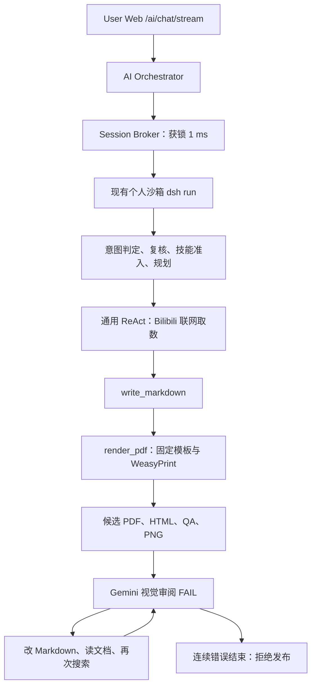

# Bilibili 单页 A4 PDF 调用审计：2026-10-29 18:08

## 1. 结论与范围

**任务失败，工程问题主导，模型行为放大。** 联网取数成功，生成了 1 个 A4 候选 PDF，但 HTML 容器里的 Markdown 没有被解析，两个榜单变成带管道符的纯文本。随后只修改了 Markdown、没有重新渲染，运行时却对同一个候选页面连续调用 8 次视觉模型，消耗 286.29 秒，占内核运行时间的 77.23%。最后正确拒绝发布。

这次不是未生成任何 PDF，也不是生成器运行了 8 次，更没有证据表明是 Docker 启动、锁等待或网络超时造成失败。只生成过 1 版候选；8 次都是视觉审阅失败。最终与当前代码的连续 8 次工具错误阈值吻合，不能描述为 300 秒超时或仅仅“模型轮次用完”。日志没有单独记录最终 break 原因，这是可观测性缺口。

本次只审计、归档与执行不访问模型/网络的对照检查。未修改业务代码、重启服务、重新生成或发布用户 PDF。仓库原有未提交改动保持原状。

## 2. 调用身份与路径

- 请求：`查看今天的bilibili热点，生成一页的pdf ，需要a4 美观，便于阅读`。
- Session：`chat-session-1793268116614-iy01yu8z`。
- Journal：`d8595422f3814c698f51549e19ea528d`。
- Turn：`1793268507076815963-69af72769caa4667ac192b327f279d72`。
- 用户/沙箱后缀：`e7fce333-a8f4-4097-9a53-f0a4c729da46`。
- 入口：`--web-search --thinking --reasoning-effort medium`，模型 ID `d13e0d30-87b9-4e87-b96a-d8b1b3cf78af`，显示名 `qwen36-35b-a3b`。
- 服务日志确认：普通模型请求实际路由 Qwen；8 次页面视觉请求实际路由 `gemini-3.8-flash-high`。遥测仍给视觉调用标记请求侧模型 ID，不能据此认定图像由 Qwen 审阅。

任务包含实时检索，因此没有进入纯正文 PDF 快速路径。这个选择本身合理；缺陷在于检索结束后没有进入受控的“内容修复→重新渲染→新版本审阅”阶段。

检索工具的源码路径为 `web_tools.perform_web_search`，Bilibili 专用分支请求热搜接口和 popular 接口，再返回带链接的榜单文本。本轮两次实际搜索均成功，各约 4.5 秒；另一次相同查询被循环拦截，没有再次执行。当前保留的是工具结果文本，没有原始 HTTP 响应及逐条抓取时间，不能进一步证明每条热点的事实与时间，也不能把热门接口的顺序直接当作全站播放量总榜。

## 3. 时间与资源

北京时间：Broker 18:02:15.974 获锁，18:02:16.231 启动 dsh，内核 18:02:16.384 开始，18:08:27.086 结束，18:08:27.147 释放锁。

| 指标 | 实测 | 解释 |
| --- | ---: | --- |
| 服务端请求总时长 | 371.233 秒 | `/ai/chat/stream` 的日志耗时；不是前端点击至显示的精确延迟 |
| 内核总时长 | 370.703 秒 | 日志和事件一致 |
| 获锁等待 | 1 ms | 没有显著锁竞争；但整个失败任务占住用户执行锁约 371 秒 |
| 模型逻辑调用 | 23 次 | 15 次普通/决策/规划 + 8 次视觉 |
| 模型累计耗时 | 359.636 秒 | 约占总时长 97%，本轮基本串行 |
| 意图、复核、准入 | 6.800 秒 | 正式工具循环之前的 3 次调用 |
| 规划 | 10.084 秒 | 简短单页任务仍付出单独规划成本 |
| 两次实际检索 | 4.530 / 4.621 秒 | 合计 9.152 秒，不是主要瓶颈 |
| render_pdf 工具 | 约 0.965 秒 | 含绑定参数、子进程和生成 QA |
| 生成器内部耗时 | 0.444 秒 | 渲染 0.263 秒，结构检查 0.025 秒，PNG 0.136 秒 |
| 8 次视觉审阅 | 286.287 秒 | 总时长的 77.23%；其中首次之后的 7 次为 260.410 秒 |
| 输入 token | 239,873 | 累计输入，并非单次上下文长度 |
| 可见输出 / 推理 token | 6,398 / 25,935 | 按原始遥测字段口径；总量 272,206 |
| 工具计数 | 19 条 | 含 1 次 loop_intercepted；实际结果收据 18 条 |
| 遥测 TTFT | 2.232 秒 | `ttftScope=model_request`，是正式循环首个模型请求，不含前置决策与规划，也不代表用户首字 |

没有价格与账单快照，不能据 token 精确推算费用；没有解码阶段计时，不能把累计输出/总时长当作模型纯生成速度。

正式循环的 prompt 从 14,547 增长到 25,208 token。改稿、重复反馈和无效工具操作持续扩大上下文，15 次非视觉调用累计输入 229,033 token。

### 主要时序（相对内核开始）

| 时间 | 动作 | 实际效果 |
| --- | --- | --- |
| +19.24 秒 | bash 执行 `web_search -q ...` | 退出码 127，命令不存在 |
| +22.18～26.71 秒 | 正规 web_search | 成功取得 8 条热搜及 8 条热门视频 |
| +37.97 秒 | write_markdown | 写入源稿 |
| +46.12～47.09 秒 | 唯一一次 render_pdf | 生成 1 页 A4 候选，两个表格未解析 |
| +47.09～72.97 秒 | 首次视觉审阅 | FAIL，发现源码泄漏 |
| +80.59 秒 | 重写 Markdown | 去掉 HTML 包裹，但未重新 render_pdf |
| +80.59～167.97 秒 | 第二次审阅 | 仍查旧候选，87.35 秒，REPAIR |
| +170.65～197.76 秒 | 相同搜索被拦后再次审阅 | 仍查旧候选，FAIL |
| +202.33～221.28 秒 | 读设计文档后再次审阅 | 仍查旧候选，REPAIR |
| +229.40～260.15 秒 | 写 final.md 后再次审阅 | 仍查旧候选，FAIL |
| +264.76～290.33 秒 | 读生成器文档后再次审阅 | 仍查旧候选，REPAIR |
| +297.38～347.00 秒 | 再次检索后再次审阅 | 仍查旧候选，FAIL；另提出错误日期判断 |
| +349.57～370.69 秒 | 读自然观察示例后再次审阅 | 仍查旧候选，FAIL；最终拒绝发布 |

## 4. 工程根因与证据

### E1：HTML 内嵌 Markdown 的契约不完整，造成首次排版失败（高优先级）

模型提交了 `
`，内部放 `##` 标题及竖线表格。`skills/pdf/scripts/pdf_design/content.py:42–50` 只启用 `tables/fenced_code/sane_lists`，Python-Markdown 将原始块级 HTML 视为原样内容，里面的 Markdown 没有解析。

本轮 `document.html` 直接包含 `## 实时热搜 TOP 8` 与表格分隔符，两个榜单没有 `<table>`。这已发生在 HTML 阶段，不能归咎于后续 WeasyPrint、字体嵌入或 PDF 光栅化。实际 PNG 也能清楚看到管道符、粗体标记和丢失的行列。

在原沙箱 Markdown 3.8.2 中执行只读对照：

| 输入/解析方式 | HTML 表格数 | 裸分隔符 |
| --- | ---: | --- |
| 本轮真实源稿，现有解析器 | 0 | 存在 |
| 仅去掉 div 包裹，其余正文不变 | 2 | 消失 |
| 给 div 加 markdown 属性并启用 md_in_html | 2 | 消失 |

最后一项是诊断对照，不代表单独打开扩展就能完成版式修复：还要明确支持的容器、子块结构和跨页行为。当前两个独立 grid 容器也不等同于正确的双栏布局。

平台的 CSS 暴露 grid/card 组件，通用编辑指引也推荐这些组件，但 `configure_pdf_tools` 又说不要写 HTML。此次通用检索路径没有使用纯 PDF 的 schema 收窄，整体契约不一致。不能断言模型本次一定读到了某条固定指引，因为未保存完整请求 prompt。

### E2：同一个失败版本被重复审阅，修复没有改变待验收产物（最高优先级）

`agent_loop.py:571–577` 在任意工具批次执行后，只要存在已注册 PDF 就调用 `review_current_pdf_pages`。`pdf_preview_tool.py:82–83` 仅用 `reviewed` 成功集合过滤页面；失败页不入集合，也没有按“PDF/PNG 哈希 + 页码 + 审阅契约版本”缓存失败结果。

结果是 write_markdown、read_file、搜索成功甚至搜索被拦截之后，都再次触发同一页视觉请求。原稿 `.pdf-source-a624...md` 是 render 时的独立快照；后续改另一个 Markdown 文件，不会自动刷新候选 PDF。

8 次错误均为 runtime_workflow；真实证据只有 1 次 render、1 个候选 SHA256：`d8eeb3c671a6bd50cb7457de515a4513fa1b6bc23369b28bcb35059a9f23860a`。只读 mock 对照也证实：注册同一候选，第一次审阅 FAIL 后，不变更任何内容再次运行 review，仍会重新调视觉接口。

需要改成显式状态：检索完成→渲染新版本→审阅→修复→重新渲染。失败版本保留诊断，仅新版本或明确的传输类重试能再次审阅。简单跳过重复视觉调用也不够，还必须驱动内容修复和重新渲染。

### E3：专用止损遗漏视觉失败，通用计数要等到 8 次（高优先级）

`tool_failure_recovery.py:22` 只处理 bash/render_pdf 错误，排除了 inspect_pdf_page；现存 8 次视觉失败传入该函数，返回 `None`。该调用点还位于本轮自动视觉审阅之前。

通用连续工具错误计数在审阅后增加，默认阈值 8，正好对应本轮第 3～10 轮 8 次视觉失败。没有证据表明触发 timeout；所有模型请求正常返回且最后仍完成状态输出。建议记录终止 guard 的具体原因，不再仅用 `managed_pdf_terminal` 隐去“为何结束”。

### E4：装饰清理误删了排名信息（中优先级）

原始 render 参数中前三名用 🥇/🥈/🥉。`pdf_task_contract.py:133–138` 不区分装饰与结构语义，直接删除这些符号；实际 normalized Markdown 中前三行排名列为空，后两行仍为 4、5。

因此“前三名没有序号”不能全归给模型。模型选择奖牌表示排名，平台清理过程造成结构性信息丢失。只读对照确认前三个排名单元格都被清空。应在清理前把排名语义转为数字，或拒绝需要破坏语义的清理。

### E5：结构 QA 未发现可确定识别的源码泄漏（中优先级）

候选 QA `valid=true`：1 页、595.28×841.89 pt、字体嵌入、无页面外字符，均属实。但 `pdf_design/quality.py` 用归一化字符 Counter 检查覆盖，去除了大部分 Markdown 标记，也不检查表格是否实际成为 HTML 表格；源码作为纯文本进入 PDF 仍可通过。

结构检查不是虚假通过所有验收，QA 本身标明 `visual_review=required`。不过这种明显的结构失败应在视觉模型前发现：比较源表格与 HTML 表格结构，检查未解析的块级 Markdown，并返回能指导修改的错误。不要仅凭 `|` 字符存在就拒绝所有文档，代码示例可能合法包含管道符。

### E6：视觉成本、事实上下文和观测口径没有闭环（中优先级）

8 次视觉耗时依次为 25.88、87.35、27.11、18.94、30.74、25.56、49.60、21.11 秒。第 2 次仅 200 个可见输出 token，却计入 9,086 个推理 token。页面审阅请求侧明确使用 `thinking=false`、`max_tokens=350`，但实际上游仍产生大量推理。350 不能当作包含推理的总预算保证。

当前 `reasoning-request-adapter.ts` 对 Gemini 的关闭路径只删除 reasoning_effort，不能证明上游默认推理被关闭；还有供应商拒绝关闭后的低强度重试逻辑。未取得该轮真实上游请求体与配置快照，不能断言是哪一种机制生效。应区分请求值、适配后值、实际模型和响应 usage，验证上游支持的能力及预算，而不是继续假定 thinking=false 已生效。

第 7 次视觉审阅宣称“2026-10-29 与现实时间不符”，与真实执行日期冲突。该审阅 prompt 只附用户要求与页码，没有权威当前日期/时区或检索证据；模型越权作了事实判断。不能按这条建议改成其它日期。主阻断问题仍是表格破损，并非日期。

图片旁的 page-1.txt/page-1.png.txt 只在不存在时写入，故只保留第一次审阅文本；后续 7 次应查 journal/evidence。建议每次审阅按版本与调用 ID 保存独立回执。

## 5. 模型责任及正确防线

模型存在可归责的问题：首次把工具名当成 shell 命令；收到明确“重新 render_pdf”反馈后，只写 Markdown 或读取文档，没有重新渲染；重复搜索，甚至转去读取与本任务不相关的自然观察示例。这些都加剧了失败。平台不能依赖模型每轮都选对动作，需要状态约束和无进展止损。

内容方面，生成稿把取得的 8 个热门视频按播放量重排取 5 个，并标题化为 TOP 5。它不是工具原序前五，也不是有证据的全站播放量前五；应标为“抓取样本按播放量排序/精选”。例如“精彩操作引发热议”“文化话题持续发酵”是基于短标题的扩写，缺少进一步资料支持。此次未发布，所以尚未形成对用户的新文件交付。

发布门禁工作正常：`evidence.verified=false`、候选 `published=false`。同名正式文件仍是 17:20:02 的旧版，SHA256 `b8a14d46e838281fceabce2bb127d8ce5d89a93480137a0e13e47f5591c5fca1`，与本轮候选不同。最终“未发布新的交付文件”是真实说明，不能为解决交付失败而移除门禁。

## 6. 建议顺序与验收方式

1. **先修生命周期。** 仅审阅新候选；缓存同版本失败；检索结束后收窄工具并驱动重新 render；对连续无新产物/相同错误设置少量修复预算。验收：读文档、改 Markdown、重复搜索均不得增加旧版本的视觉调用数；新 render 必须重新审阅。
2. **再修内容解析契约。** 统一纯 Markdown 与受支持布局组件，必要时由结构化 block 生成 HTML，保留本地插图与分页。验收覆盖裸 Markdown 表格、HTML 内嵌表格、真实双栏、中文长单元格、跨页和代码文本。
3. **保留语义并前置结构诊断。** 排名符号清理后仍有 1～5；源稿要求的两张表须有可核对的 HTML 结构；不会误报合法代码中的 Markdown。
4. **控制审阅成本并补齐事实上下文。** 传入权威日期/时区和必要证据；区分布局检查与事实核验；记录实际路由及上游有效推理参数，限制视觉总耗时与修复次数。缓存键包含页面哈希和审阅契约。
5. **最后压缩无效前置与上下文。** 明确的单页热点任务，减少重复决策与过长反馈；保留必要的来源和验收门禁，不简单扩大轮次、超时或强制缩小字体。

优先按职责提取 PDF 生命周期/修复协调器，避免把更多 PDF 状态堆进通用 agent_loop。当前 runner.py 约 1242 行、agent_loop.py 约 1087 行、file_tools.py 约 909 行；runner 已超过仓库 1200 行评估线，后续改动应先评估职责下沉。

## 7. 证据与限制

归档：`docs/artifacts/reviews/bilibili-call-audit-20261029-1808/`。包含原始事件、执行收据、metrics、会话终态、去令牌服务日志、真实 render 参数、源稿、HTML、候选 PDF、PNG、QA、后续两个改稿、缓存契约、源码快照，以及只读复现脚本和结果。

原执行证据中的 `source_hashes={}`，没有完整 prompt、代码哈希、上游请求参数快照，也没有前端点击/显示时戳。代码图索引对新增 PDF 模块不完整，先用图检索/调用追踪定位，再以实际源文件、产物和运行事件交叉核对。运行时 skill 与本地对应文件内容一致，但共享 skill 的同步时间晚于调用；报告对历史行为的确定性结论以当次 HTML/源稿/QA/事件为主，不将当前源码快照冒充完整的历史版本证明。

所有只读对照断言通过：原稿无表格、去包裹或启用受控嵌套解析后有两个表格；排名清理丢失前三项；失败同版本重复触发审阅；8 次真实视觉错误不触发专用重复失败 guard。没有消耗新的模型调用。
