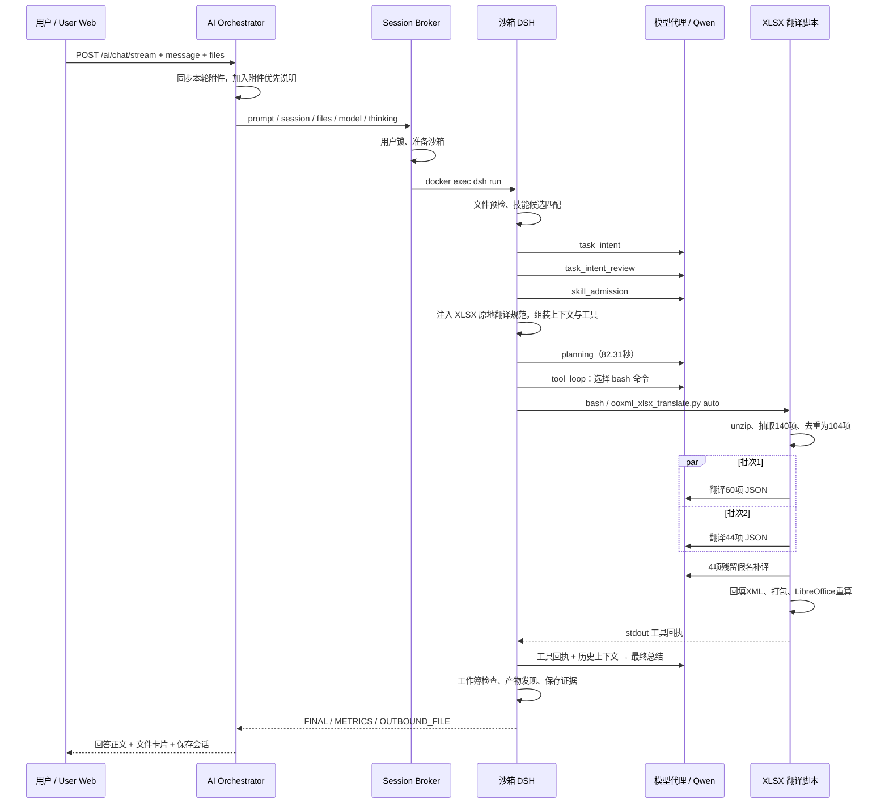

# Excel 中文翻译全业务流与调用流审计（2026-11-06 10:55）

## 1. 结论与目标轮

这次实际执行了文件翻译并交付 XLSX。流程是“模型识别任务与选择技能 → 模型规划 → 模型调用一次 bash → 专用脚本抽取、并发模型翻译、补译、回填、重算 → 模型总结 → 平台验收与文件卡片”。它不是主模型逐个单元格手写译文，也不是调用外部 MCP Excel 服务。

耗时主要来自规划：HTTP 121.359 秒，规划 82.310 秒，占约 67.8%；真正的一次翻译工具执行 21.649 秒。现有验收支持文件生成、可解析及公式相关检查，不足以证明回答中的“100% 版式完整”“全量精准转换”。

- Session：`chat-session-1793932768263-n7m09ui3`
- Turn：`1793933722259066875-c9afdbcba1644f9795a67b7b369b4fb1`
- Event run：`1d4fc34e57fa4c43b94659326801d606`
- 时间：北京时间 10:53:20 接入，10:55:22 完成；10:55 是完成时段。
- 输入：`別紙3_クラウド設定・運用セキュリティチェックリスト_v1.xlsx`，用户消息标记 23,180 字节。
- 输入 SHA-256：`8286d137887531eb15492f2a08e6cc53ed2d153d019007517d93cb7fa71bc9e8`。
- 输出：`別紙3_クラウド設定・運用セキュリティチェックリスト_v1_中文.xlsx`。
- 实际代理模型：服务日志显示 `default` 解析至 `qwen36-35b-a3b`。

该会话 11:14 还有另一轮执行；其他会话也有同文件早期 openpyxl 执行。本报告只计算用户引用的这轮，使用独立 event run 和按 turn 保存的 evidence，没有使用已被后轮覆盖的 latest evidence 代替目标轮。

## 2. 一张图把握整体



## 3. 从用户请求到执行契约：如何识别意图

### 3.1 前端与编排入口

用户消息 metadata 为 `mode=chat`，带上传附件，并未显式使用 `/excel`。Dispatcher 将当前文件同步至会话目录和用户 workspace，再把请求包装成：

```text
【当前轮次用户上传附件】: <原文件名>（这是用户本轮刚上传的新文件，为本次指令的主要处理对象）
用户指令：翻译文件，保持格式不变，生成中文的excel文件
```

这样模型知道操作对象是当前附件。Broker 实际执行参数包括 `--files`、`--web-search`、`--thinking`、`--reasoning-effort medium`、`--model default` 和模型展示名。`--web-search` 是能力授权，本轮没有搜索工具调用。

代码入口：`user-sandbox-dispatcher.service.ts` 的 `syncFilesToSandboxWorkspace`、`dispatchPersonalSandbox`；`user-sandbox-harness.service.ts` 的 `runHarness`。用户级锁等待仅 1ms，不是性能瓶颈。

### 3.2 物理预检与候选发现

附件预检发现工作表名、首列表头、8处下拉框、7处条件格式，领域为 generic。它提供结构事实，并不翻译正文。

SkillRouter 根据命令/语义候选发现 xlsx；MCP 候选也被匹配，但日志明确 `mcp_skill_route=not_selected`。最高 MCP 候选分数 0.69 不意味着实际调用了它；执行门禁为 disabled。

### 3.3 三个模型决策请求

| 请求 | 目的 | 本次结论 | 耗时 |
| --- | --- | --- | ---: |
| task_intent | 抽取用户真正要做什么及交付方式 | standalone、execute、artifact、[.xlsx] | 4.252秒 |
| task_intent_review | 复核执行/对话及文件交付边界 | accept | 2.196秒 |
| skill_admission | 判断候选 xlsx 能否承接该要求 | use xlsx、applicable、use_default_rules=false | 2.136秒 |

requirements 绑定用户原文，避免技能自行增加业务目标。`use_default_rules=false` 不等于不使用 xlsx：它表示不自动继承技能额外的默认业务口径；随后执行器仍可注入平台的受控翻译规范。

### 3.4 专用原地翻译路由

`xlsx_workflow.is_xlsx_in_place_transform_task` 检查 Excel 输入及“翻译 / 保持格式 / 生成中文”等信号。命中后，runner 把 skill_context 换为 `XLSX_IN_PLACE_TRANSLATE_INSTRUCTION`，记录 `xlsx_in_place=direct_execution`。

这是一条混合路由：上层任务契约由模型做语义判断，具体 Excel 转换路径由文件格式与关键词规则选择。`direct_execution` 只是该分支的标记，本轮随后仍执行了模型 planning，不能把它理解成完全绕过模型直接运行脚本。

## 4. 上下文与工具如何组装

当前 runner 的拼装顺序是：

1. system prompt：工作区、知识目录、模型信息、预算裁剪后的技能规范。
2. 独立 system message：execution_contract_context，把已准入的执行和交付约束带入后续。
3. 按 ContextBudget 裁剪的会话历史；若有丢弃，插入提示。
4. user turn：原请求、当前附件、预检/内容摘要、可用工具名、交付目标、时间等。
5. planning 结果作为 assistant 消息加入。
6. 再追加 user 执行指令，明确必须调用 bash 执行原生脚本、输出到 workspace。

对既有 Excel 高保真翻译，附件上下文只提供受控摘要，不把整表内容先倾倒进主模型；完整文本由专用脚本抽取并送翻译模型。主模型与脚本内模型看到的上下文不同。

工具 schema 由 `select_active_tools` 选择。本轮物理执行只见一次 bash。前三个结构化决策也可能以 tool_calls 形式结束，但它们属于决策协议，不是三次真实沙箱工具操作。

模型返回 tool_calls 后，agent_loop 解析名称与 JSON 参数，交给 `tools.execute_tool`；该函数规范化工具名，按 deadline 执行 shell 子进程，把结果转为 ToolResult。ToolResult 保存 status、stdout、provenance（tool、round、tool_call_id），再反馈给模型。

目标轮的命令 telemetry 只保存了截断字符串；可确认执行 `ooxml_xlsx_translate.py auto`、原输入路径及产物名称。本文不把从当前模板重建的完整命令冒充历史原始参数。

## 5. 一次 bash 内部到底发生了什么

入口为 `skills/xlsx/scripts/ooxml_xlsx_translate.py`，`auto_translate_xlsx → unpack_xlsx → translate_texts → pack_xlsx`。

### 5.1 解包与建立映射

XLSX 是 ZIP 容器。脚本解压原文件，建立两个数据结构：

- translation_input.json：定位键 → 待翻译文本，例如 sst_12、sheet_name_0、dv_sheet1.xml_0_1。
- ooxml_mapping.json：定位键 → 原 XML 文件、节点索引/单元格坐标、原文、富文本属性等。

抽取范围是 sharedStrings、工作表名称、字面量数据验证列表及简单 inlineStr。公式、数字、URL、短英文缩写等透传。**140是抽取的文本位置项，不能等同于140个单元格，更不能全部说成140项都被翻译。**

### 5.2 去重、分批与内部模型请求

工具回执确认：总项140，去重后需译104，免翻译透传文本8，分2批，并发配置4。按默认 batch_size=60，可还原为60项和44项两个批次；由于只有2批，实际首轮最多2个批次并行。

脚本把相同原文映射至同一个 t_N，调用 `/ai/proxy/v1/chat/completions`，设置 `model=default`、temperature=0.1、stream=true、thinking=false、reasoning.enabled=false、request_context=spreadsheet_translation。翻译 prompt 要求 key 不变、只译 value、仅返回 JSON，并含云安全术语约束。

这里的文本翻译由脚本内部模型请求完成，外层主模型负责选择命令和交付总结。脚本没有通过外层 call_model_proxy 遥测，所以这些请求未纳入6次外层 callsLedger。

服务日志可见2个并发请求分别约13.352和19.111秒，随后补译请求约1.870秒。它们与工具回执的2批及4项补译吻合。本轮可见逻辑模型请求共9次：外层6次 + 内部翻译3次；不能用外层账本推算完整费用。

### 5.3 增量补译

脚本检测中文结果里是否还含日文假名，本轮发现4项并发起补译，再按原映射回填全部重复位置。这是字符残留启发式，并不是完整的语义翻译质量检查：纯汉字日文、漏译、误译、术语漂移未必能识别；当前代码补译后也没有严格二次失败门禁。

### 5.4 回填与重组

- sharedStrings：按 sst 索引回填；富文本把整段译文放进首个 run，清空其余 run 的文本。
- workbook.xml：替换翻译后的 sheet 名，去非法字符并截断到31字符。
- sheet*.xml：替换数据验证字面量选项与 inlineStr。
- 其余原归档内容沿用，重新 ZIP 打包，排除临时翻译 JSON。
- 调用 recalc.py，通过 LibreOffice 刷新公式缓存。回执显示 verified。

因此“原地”指沿用原工作簿结构、靶向改写文本；仍会生成新输出文件。它不是在原文件上简单改几个字节。尤其 recalc.py 会让 LibreOffice 重新保存文件，最终容器内容不具备字节级不变保证。

## 6. 回复与文件卡片如何组装

脚本把进度、140/104统计、补译、打包和重算结果写到 stdout。agent_loop 将成功 ToolResult 放回 messages，第二次 tool_loop 模型请求据此生成372字符的最终总结。回复中的140、104、XML与LibreOffice描述直接对应工具回执；术语对照是总结模型生成的，没有单独可验证的术语对照回执。

后处理还会对新生成工作簿重算/校验，隔离无效工作簿并检查物理产物。本轮 `workbook_delivery=accept / verified_workbook_deliverable`。当前检查主要涉及工作簿可解析、公式错误/缓存、内部公式依赖等，并非完整视觉保真鉴定。

ArtifactExporter 扫描本轮新文件，排除输入附件和临时文件，输出 `{filePath,fileName}`。DSH 发出 FINAL、METRICS、OUTBOUND_FILE 标记；Dispatcher 解析，构造 `/api/ai/chat/workspace-files/<userId>/<encodedFileName>` 下载地址，写入 executionTrace.artifacts、outboundFiles 及消息 artifacts。前端据此展示文件卡片；它不依赖用户从正文复制 /workspace 路径。

## 7. 精确时序与性能

| 阶段 | 北京时间 | 耗时 |
| --- | --- | ---: |
| 意图抽取 | 10:53:21.365—25.618 | 4.252秒 |
| 意图复核 | 10:53:25.632—27.828 | 2.196秒 |
| 技能准入 | 10:53:27.860—29.998 | 2.136秒 |
| 规划 | 10:53:30.101—10:54:52.413 | 82.310秒 |
| 模型选择 bash | 10:54:52.425—54.796 | 2.370秒 |
| 工具执行（含内部模型翻译） | 10:54:54.799—10:55:16.448 | 21.649秒 |
| 最终总结模型 | 10:55:16.452—20.418 | 3.962秒 |
| 验收、导出、收尾 | 至10:55:22.261 | 约1.84秒 |

HTTP总时长121.359秒，Harness121.285秒，DSH120.956秒。外层LLM累计97.227秒，输入24,873 / 输出8,506 Token，总33,379；此数不含脚本内部翻译请求。planning输出7,797 Token占外层输出约91.7%，不能把它全当用户可见正文或有效业务译文。

TTFT=2.370秒、scope=model_request，对应执行阶段第一次 tool_loop；并非从用户发出请求到看到答案只有2.37秒。日志没有本轮代理失败重试、搜索或锁竞争证据，不能把82秒规划直接归因为网络故障或纯模型解码算力。

## 8. 审计发现与改进方向

| 发现 | 归因 | 建议 |
| --- | --- | --- |
| 确定性翻译脚本前仍规划82秒 | 编排设计为主，模型输出量放大成本 | 原地翻译路由明确后跳过自由文本规划，结构化确定输入、目标语言、输出名再执行 |
| 外层只计6次模型，内部3次不记账 | 工程遥测缺口 | 脚本模型请求接入统一call/span/usage，保留批次、补译与重试口径 |
| “140处全部精准转换”“100%版式”超出验收范围 | 模型表述过强；平台规范本身也含绝对保证 | 按可验证能力报告覆盖率和验收范围；添加结构差异检查与必要的渲染对比 |
| 脚本失败/缺key可回退原文，假名补译不是严格验收 | 工程质量门禁不足 | 验证键覆盖、值类型、残留语言、补译后结果；未达标明确部分完成 |
| 富文本并入首run、sheet改名未同步全部引用、LO重新保存 | 当前实现潜在保真风险，不能算本轮已证实损坏 | 分别验证run样式、跨表公式/命名区域/验证引用、LO保存后的结构差异 |
| 最终术语对照没有绑定实际译文字典 | 工程证据契约不足及模型生成风险 | 从真实输入输出映射采样术语，交给总结模型作为权威数据 |

当前源码已包含禁止暴露OOXML/LibreOffice和140/104等内部统计的规范，但最终回复仍出现这些内容。工作区这些文件正有其他未提交改动，未取得10:55时全部源代码快照，不能据当前禁令直接断言当时模型违反了同一版提示词。

## 9. 证据、代码与边界

证据目录：`docs/artifacts/reviews/excel-translation-audit-20261106-1055/`，含目标消息/trace、独立事件、独立回执、脱敏服务日志、转换后时间线和哈希清单。

关键源码（相对仓库根）：

- `apps/backend/intelligence/ai-orchestrator/src/modules/chat/user-sandbox-dispatcher.service.ts`：附件同步、prompt包装、沙箱分发、标记解析与产物。
- `apps/backend/execution-control/session-broker/src/modules/user-sandbox/user-sandbox-harness.service.ts`：dsh参数、用户锁、容器执行。
- `apps/backend/runtimes/personal-sandbox-runner/src/dsh_modules/skill_router.py`、`task_intent.py`、`skill_admission.py`：候选发现、契约、准入。
- 同目录 `xlsx_workflow.py`、`runner.py`、`prompt_builder.py`、`planning_phase.py`：专用路由、提示组装、规划与执行切换。
- 同目录 `agent_loop.py`、`tools.py`：模型工具调用、shell、回执、交付检查。
- `apps/backend/runtimes/personal-sandbox-runner/skills/xlsx/scripts/ooxml_xlsx_translate.py`：抽取、去重、模型翻译、补译、回填。
- 同 scripts 目录 `recalc.py`；dsh_modules 中 `workbook_delivery.py`、`artifact_exporter.py`：重算、门禁及产物发现。

按要求先用codebase-memory图谱发现并追踪，再读取当前源码；部分新文件未进入图谱、部分行号过期，以实际文件为准。当前源码解释机制，目标轮日志证明发生了什么；二者不等同于历史版本逐字节一致。

本次未重跑翻译、未覆盖产物、未修改业务代码、未重启服务。没有取得目标轮不可变输出副本或完整模型请求体，因此不宣称已独立验证全部译文、截图版式或历史工具完整参数。目标轮产物名后来被同会话再次使用，当前同名文件也不能自动视作10:55的原始产物。
