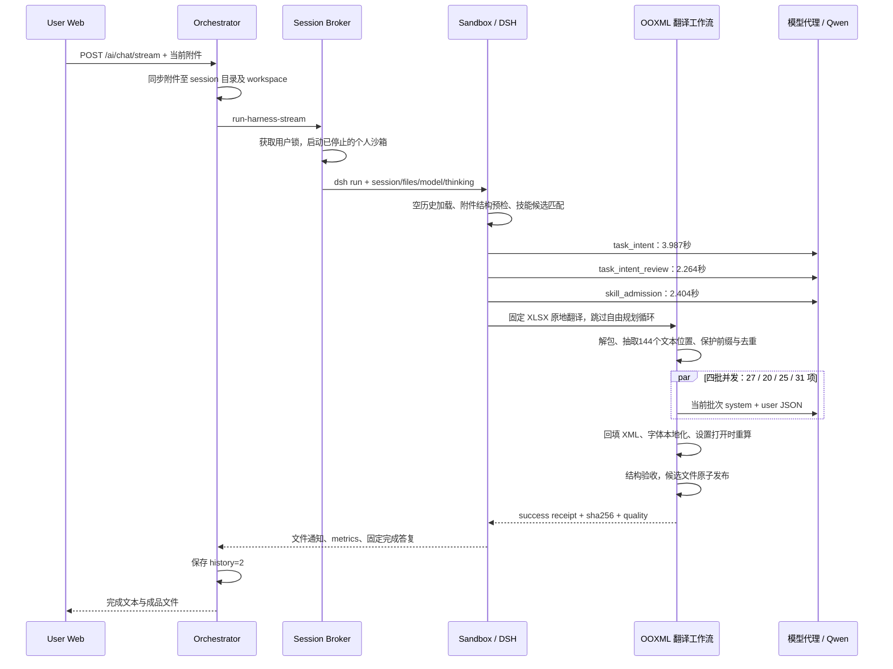

# Excel 中文翻译调用审计（2026-11-11 18:13）

## 1. 审计结论与定性

**执行成功并交付了本轮文件；结构保留有证据，翻译质量未完全达标，不能把“校验通过”理解为全文准确或视觉完全一致。**

- 性能：HTTP 请求 23.057 秒，沙箱执行 21.977 秒。三次串行准入模型请求占 8.655 秒，四批并发翻译占 13.038 秒。没有锁排队，没有本轮模型失败、拆批重试或补译事件。
- 质量：确认存在列范围含义受损、中文混入普通英文、部分语义偏移和符号丢失。现有验收没有挡住这些问题。
- 格式：单元格绑定、合并、行列尺寸、公式、下拉框与条件格式得到保留；字体发生系统性替换，未经原生 Excel 视觉与交互验收。
- 归因：**工程与模型复合问题**。C–D 列错译有工程侧破坏输入上下文的直接证据；英文残留、部分语义偏移属于模型输出问题；验收覆盖、进度与证据状态不一致属于工程问题。
- 最终答复来自运行时固定字符串，不是模型在检查文件后生成的总结。原件没有图形，答复仍称“图形标签已处理”，属于工程模板措辞失实。

本次仅审计并保存证据，未修改业务源码、用户原件或成品，也未重新发起翻译模型调用。

## 2. 调用身份与完整流程

| 项目 | 本轮身份 |
| --- | --- |
| 用户 | `e7fce333-a8f4-4097-9a53-f0a4c729da46` |
| Session | `chat-session-1794391972260-1553uvh4` |
| Event run / Job | `731c3292e5184de4b52065bc438be001` |
| Evidence turn | `1794392022086268752-1085b725ab644731af16f99408b6d0fc` |
| 原件 | `別紙3_クラウド設定・運用セキュリティチェックリスト_v1.xlsx` |
| 原件 SHA256 | `8286d137887531eb15492f2a08e6cc53ed2d153d019007517d93cb7fa71bc9e8` |
| 成品 SHA256 | `25f05d44c1d9b1136e3773fdc0a3ae1d340f37688bc6d66acc827a9e0df9f75b` |
| 逻辑 / 实际模型 | `default` / 代理日志解析为 `qwen36-35b-a3b` |

时间均为北京时间。服务日志显示 18:13:19 接入，18:13:42 完成；23.057 秒是服务器 HTTP 请求耗时，不包含用户上传、点击前等待和浏览器最后渲染耗时。

Broker 命令包含 `--web-search --thinking --reasoning-effort medium --model default`，未启用 research。翻译子请求显式关闭 thinking；外层 thinking 标志不代表每个翻译批次都进行思考。`--web-search` 表示允许该能力，本轮没有网页检索。MCP 技能有候选得分 0.69，但最终 `not_selected`，没有实际调用外部 Excel MCP 服务。

历史条数为 0，缓存 `miss`、加载 0 项。翻译请求摘要均为 `[system,user]`，历史条数 0，输入来自当前原件。没有本轮跨会话译文复用的证据。

144 是抽取的文本位置数，包含 sharedStrings、工作表名、下拉选项、公式字面量，不能称为“翻译了 144 个单元格”。原始文本去重后有 116 种，其中按原文统计需译 104 种；保护代码前缀后，实际提交模型的唯一正文为 103 种。四批 JSON 指纹可由保存的输入与代码重建，全部与事件 `request_summary.input_sha256` 匹配。

文件当前字节哈希与本轮回执一致，且 18:13:48 出现成品下载请求日志。这支持本轮确实生成并发布了文件，下载日志本身不能证明用户已在 Excel 成功打开。

## 3. 性能与资源消耗

| 指标 | 实测 | 解读 |
| --- | ---: | --- |
| HTTP 请求总耗时 | 23,057 ms | 接入到响应结束 |
| DSH 墙钟耗时 | 21,977 ms | 非 HTTP 全部耗时 |
| 用户锁等待 | 0 ms | 无排队 |
| HTTP 与 DSH 差值 | 1,080 ms | 包含启动、分发等，无法精确拆到各环节 |
| 意图判断 | 3,987.21 ms | 1,721 输入 / 159 输出 tokens |
| 意图复核 | 2,264.28 ms | 2,255 / 159 |
| 技能准入 | 2,403.59 ms | 5,410 / 90 |
| 三次串行准入合计 | 8,655.08 ms | HTTP 耗时的 37.5% |
| OOXML 抽取 | 16.03 ms | 非瓶颈 |
| 翻译墙钟耗时 | 13,037.60 ms | 四批并发 |
| 打包 / 验收 | 18.41 / 7.74 ms | 非瓶颈 |
| 模型请求数 | 7 | 3 次准入 + 4 次翻译 |
| 实际工作流操作 | 1 次 `translate_xlsx` | 无自由规划 / ReAct 执行轮次 |
| 输入 / 输出 / 总 tokens | 13,627 / 3,081 / 16,708 | 本轮逻辑账本 usage 完整 |
| TTFT 字段 | 3,986.91 ms | `model_request` 口径，非用户首次看到正文 |
| 模型请求时长累加 | 56,833.62 ms | 包含并发，不能当作实际等待时间 |

翻译四批分别耗时 9.687、12.578、12.884、13.029 秒，输出 500、640、714、819 tokens。按完整请求时长计算的有效输出速率约 50.9–62.9 tokens/s，包含网络和预填充，不能称作推理引擎纯解码速度。翻译子请求未记录逐批首 token 时间，无法把排队、预填充、解码和传输精确拆开。

准入消耗 9,794 tokens，占全部 58.6%；其中技能准入单次就有 5,410 输入 tokens。实际翻译共 6,914 tokens。对于目标明确、单附件、固定交付类型的任务，准入是最明确的优化对象。可以评估合并意图判断和复核、缩短候选技能输入、针对明确整本翻译增加受控快速准入，但节省幅度必须通过回归和实测确认。

四批已在约同一时刻启动，翻译耗时接近最慢批次，未见调度串行化。13 秒翻译仍是最大单阶段，但没有本轮异常重试或网络故障证据，不应将其定性为故障。不能根据这次小文件结果直接推算大文件耗时。

## 4. 质量、格式与责任归因

### 4.1 已确认的内容问题

| 位置 | 实际问题 | 原因与影响 |
| --- | --- | --- |
| B7，`sst_93` | `C-D列の選択肢をよく読み…` → `C-请仔细阅读D列的选项…` | 原意是“仔细阅读 C–D 列选项，再从 E 列选择”。工程把句首 C 误识别为评分代码并拆走，模型实际只收到 `-D列…`，回填后 C 成为孤立前缀。工程输入破坏与模型翻译共同作用，不能全归模型。 |
| G66，`sst_53` | 中文正文出现“外部机构的 security 状况” | 模型未把普通词完整译为中文；现有中文验收主要检查假名，未拦截。`security` 不属于应保留的 AzureAD、SaaS 等专名。 |
| G58，`sst_103` | “向云服务商充分确认日志采集内容与保留期限”变成“确认…是否由云服务提供商执行” | 模型改变了“向谁确认”的关系，引入原文没有的“是否由服务商执行”问题。 |
| B19/B20，`sst_17/18` | `C＊（適合）` / `N＊（不適合）` → `C（符合）` / `N（不符合）` | 全角星号丢失。COUNTIF 中的 `C*` / `N*` 仍在，未发现由此造成计算公式损坏，但显示标签失去了原有通配含义。拆前缀后输入正文只剩 `＊（適合）` 等，模型还自行补出了 C/N。 |
| G62，`sst_104` | “用户账号的改廃”译为“用户账号的新增与删除” | “修改/废止”被替换为“新增/删除”，属于语义偏移，不能由假名检测证明准确。 |

并非全文均不可用：多数条目已成为可读中文，否定选项、每月检查、每年检查、1 年以上日志保存等关键区别在本轮抽核中仍可见。以上是确认的问题样本，不是通过抽样估计的全文错误率。

### 4.2 实际保留与实际变化

独立 ZIP/XML 比对确认：

- 原件和成品均有 14 个归档部件；仅 workbook、sheet1、styles、sharedStrings、docProps/app 五个部件改变。
- 1 张工作表、`A1:H72`、474 个单元格节点、60 个合并区域、3 个公式、8 处下拉框、7 处条件格式保持一致。原件没有冻结窗格。
- 单元格坐标与样式索引、行列尺寸、合并、页面设置得到保留；下拉选项已中文化，C/N 代码与条件格式规则保留。
- 三个公式及数值缓存保持原样：D19=`COUNTIF($E$26:$E$72,"C*")` 缓存 10，D20 的 N* 缓存 0，D21=`10-SUM(D19:D20)` 缓存 0。独立核对 10 个实际选择值均以 C 开头，支持 10/0/0 的结果。
- 字体列表中的 11 项由 `BIZ UDPゴシック` 改为 `微软雅黑`，charset 由 128 改为 134；字号、颜色、加粗等其余结构保留。验收函数先把原件字体也按同一规则转换后再比较，因此“样式通过”明确允许了字体变化。用户所说的“格式不变”并未严格按字体原样执行。
- 原件和成品均无 drawings、charts、media 部件。因此这次没有实际图形标签翻译工作。
- `fullCalcOnLoad=1`、`forceFullCalc=1` 已设置；没有执行原生 Excel 重算和交互验收。答复“打开时重新计算”有设置依据，“公式已在 Excel 验证通过”则没有依据。

本次审计补做 Artifact Tool 只读预览，覆盖 A1:H23、A24:H57、A58:H72。表格颜色、区块与内容总体可辨识；中文与字体变化带来换行差异。预览是第三方渲染，不能证明原生 Excel 完全一致。

特别注意：预览导入后把源/目标的汇总都显示为 0/0/10，与两文件 XML 缓存和独立统计的 10/0/0 不符。故没有把该预览计算结果当作本轮公式错误，也没有将渲染导出回工作簿。最终原生显示及下拉、条件格式交互仍待 Excel 验证。

### 4.3 验收存在的覆盖缺口

`xlsx_translation_quality.validate_delivery` 检查译文 JSON 是否完整非空、是否含假名、频率/代码前缀及原生结构。但它未逐项验证候选文件中的普通 sharedStrings 文本等于已验收译文；图形比较也有意忽略文本。

只读内存变异实验结果：基线通过；把候选文件 `sst_93` 在内存中替换成完全不同的中文后，仍然通过。实验只替换校验器读取 ZIP 的数据，未写用户工作簿。这证明结构校验本身不足以证明译文已正确落盘；不表示本轮真实文件遭到了篡改。本次实际成品已独立定位到上述具体译文。

应增加按映射回读实际输出的逐项比对，再做与 JSON 完整性不同的语言与语义检查。中文语言检测需要区分合理专名和普通英文词，不能简单禁止所有 ASCII。

### 4.4 状态不一致与答复来源

1. **进度误报**：manifest 为 published、quality.passed=true，但 progress 为 104/98/6。进度代码使用“完整原文”查缓存，批次翻译代码则以“拆掉保护前缀的正文”为缓存键。6 种不同完整原文因此查不到缓存；实际正文有 103 种且检查点均已保存，144 个输出键全部存在。“剩余6项”不是6条漏译的证据。
2. **证据状态误报**：metrics=`verified_xlsx_translation`，质量通过且已发布，但 immutable evidence 的 `verified=false`。`persist_turn_evidence` 未识别 `translate_xlsx` 成功回执为交付证据，兜底主要识别 send_file/OUTBOUND 字符串/workbook_delivery。应统一 XLSX publication 与通用 evidence 协议。现有状态矛盾已实测；后续具体界面或行为影响未经本次运行验证。
3. **固定完成措辞**：`xlsx_translation_turn.py:161` 无条件输出用户引用的完整答复，没有根据本轮是否含图形、字体是否改变、是否做过视觉与语义复核来调整。“图形标签已处理”由工程模板造成，不能归于模型幻觉。

相关代码位置：

- `apps/backend/runtimes/personal-sandbox-runner/skills/xlsx/scripts/xlsx_formula_references.py:98`：`split_protected_prefix` 将公式 C/N 代码保护扩散到所有同前缀自然语言。
- `apps/backend/runtimes/personal-sandbox-runner/skills/xlsx/scripts/xlsx_translation_batches.py:60`：实际拆前缀、去重、批次与检查点口径。
- `apps/backend/runtimes/personal-sandbox-runner/skills/xlsx/scripts/xlsx_translation_quality.py:30`：结构与语言启发式验收。
- `apps/backend/runtimes/personal-sandbox-runner/src/dsh_modules/xlsx_translation_turn.py:129`：进度口径错误；`:161`：固定答复。
- `apps/backend/runtimes/personal-sandbox-runner/src/dsh_modules/evidence_store.py:23`：通用 verified 与 XLSX 发布状态未统一。
- `apps/backend/runtimes/personal-sandbox-runner/skills/xlsx/scripts/xlsx_font_normalization.py:78`：字体本地化策略。

## 5. 建议优先级与证据范围

| 优先级 | 建议 | 验收目标 |
| --- | --- | --- |
| P1 | 收窄代码前缀保护范围，保留完整列范围与自然语言上下文 | `C-D列…` 不被拆成 `C` 与 `-D列…`；真实下拉 C/N 评分仍受保护 |
| P1 | 增加候选文件逐项回读比对和针对关键关系的翻译质量复核 | 已验收译文与输出实体一致；发现普通英文残留、列引用/否定/期限/责任主体变化 |
| P2 | 明确格式保留政策，并以实际处理项生成完成回执 | 字体变化可追踪；无图形时不声称处理图形；结构、语义、视觉状态分开表达 |
| P2 | 统一进度键和 evidence/publication 协议 | 成功运行进度完整，通用 verified 与实际发布证据一致 |
| P2 | 合并/缩短固定任务准入 | 先优化已测得的 8.66 秒与 9,794 tokens；保留误路由回归保障 |
| P2 | 增加按批次 TTFT、代理解析模型与版本、服务端时延拆分 | 能区分预填充、排队、生成、传输，缓存身份绑定实际模型/策略版本 |

证据目录为 `docs/artifacts/reviews/xlsx-call-audit-20261111-1813/`：本轮不可变 evidence、事件流、manifest、输入/译文/映射/检查点、metrics、性能汇总、验收内存探针、原件与成品六张分区预览。服务日志中的 URL token 和锁 token 已脱敏。

当前源码与沙箱共享技能挂载中的六个翻译脚本哈希一致，运行产物和重建请求指纹吻合。图谱用于代码入口发现；图谱部分函数范围滞后，因此具体归因又以当前文件内容和运行证据复核。没有保存本轮开始前全部源码快照和全部原始模型 HTTP 报文，不把审计重建冒充全量抓包，也不把当前文件哈希当作执行前代码版本证明。

## 6. 整体流程合理性与补充工程评估

### 6.1 总体判断

四层职责划分成立：Orchestrator 管会话和请求，Broker 管执行锁与容器，沙箱隔离执行，固定翻译引擎处理 OOXML。保持原归档结构、以模型翻译文本、再验收发布，符合本任务的主要约束。本轮没有证据表明跨服务 HTTP 或容器启动是主要瓶颈；仅凭服务层数不能判断应该合并服务。

问题集中在**前置决策成本较高、执行与验收契约不统一、文件身份绑定不完整**。这些问题应先在现有边界内修复。

| 环节 | 合理性评估 | 调整方向 |
| --- | --- | --- |
| 附件结构预检 | 合理；用真实文件结构约束路由 | 将文件身份、类型和能力范围纳入统一任务契约 |
| 候选技能匹配 | 合理；减少盲目执行 | 固定任务只展开必要能力说明，避免传入大段通用操作规范 |
| 意图 → 意图复核 → 技能准入 | 通用请求有价值；本次明确单文件整本翻译的收益不足以证明三次串行模型判断必要 | 合并为一次受 Schema 约束的决策；对歧义、局部修改、多附件、复杂约束再进入深入判断 |
| 固定 OOXML 工作流 | 合理；跳过自由规划已减少不确定性与额外耗时 | 明确支持范围，路由只选择工作流，转换策略由统一契约提供 |
| 去重和并发批次 | 合理；本轮四批确实并发 | 保留；补充表头/列引用等最小上下文及统一术语，避免只凭字符串去重处理有语境差异的文本 |
| 代码前缀保护 | 保护评分与公式依赖的目的合理，当前作用域过宽 | 绑定具体下拉项、公式依赖或单元格角色，不对所有同前缀正文切分 |
| 校验后发布 | 顺序合理，验收证明范围不足 | 分别记录结构、内容落盘、语言语义、视觉、原生计算状态 |
| 进度与完成答复 | 固定工作流可以生成确定性回执 | 从统一事实生成进度与摘要，不能由独立模板扩大完成范围 |

明确任务的目标路径可以收敛为：附件身份与能力预检 → 一次结构化任务契约 → 固定转换 → 逐项回读与分层验收 → 持久化发布回执 → 文件卡片及按事实生成的答复。快速准入仍需识别“只翻某列”“不要翻专名”“保持公式”“按术语表”等约束，不能仅凭出现“翻译”和“.xlsx”就放行。

### 6.2 新增确认：缓存恢复丢失前缀指纹

`execute_translation` 恢复检查点时写入 `cache_identity(input, language, scope)`，没有传 `protected_prefixes`；`ooxml_xlsx_translate.translate_texts` 则从映射提取保护前缀，再传给批次层。后者计算的身份含 `prefix_sha256`，两份 metadata 不相等，已恢复的译文被整批丢弃。

用本轮输入和保存的译文，在临时目录连续运行两次固定执行器，模型函数全部替换为离线桩：

- 首轮执行 4 批；第二轮 manifest 报 `cache.status=hit, entries_loaded=103`。
- 第二轮仍调用离线翻译函数 4 次，未真正复用任何已完成批次。
- 这是离线复现的工程缺陷；本次历史运行本来就是冷缓存，不能将其算作历史 23 秒的额外耗时。

应由同一个组件生成完整缓存身份并同时负责保存与恢复。身份至少绑定源文件、语言、会话、保护映射、实际模型版本及翻译策略版本；缓存命中数量应记录实际通过过滤后进入翻译流程的数量。

### 6.3 新增确认：发布文件与持久状态存在中间失败窗口

当前顺序为 `quality.json → os.replace(candidate, target) → manifest published → return → finally 保存缓存与进度`。文件替换是原子的，但整条发布链并不具备原子性。

离线故障注入：在 `os.replace` 后第一次写 published manifest 时抛出 OSError，结果为目标文件已存在，而执行器抛错并将 manifest 标为 failed。这不是本轮历史故障，而是已复现的异常路径缺陷。

同理，finally 中的缓存或进度写入异常也可能覆盖返回结果或原始失败；该路径在本次仅静态确认，未单独故障注入。应将发布状态与辅助缓存写入解耦，使用按 run 保存的不可变成品和可恢复的发布提交记录。进程重启后能根据文件哈希与提交记录完成对账，不能让辅助写入把已完成发布解释成执行失败。

### 6.4 代码路径风险：输入与下载身份仍依赖共享文件名

Orchestrator 在请求 Broker、获得用户锁之前，已把上传文件复制到会话目录和 workspace 根目录；Broker 只传 basename；固定翻译执行器最终读取 `workspace / files[0]`，没有读取对应的会话副本。

因此同一用户两个会话上传同名但不同内容文件时，后一个请求可在等待锁期间覆盖前一个请求的根目录输入。用户锁只保护执行段，未保护前面的文件同步。若覆盖发生在执行器第一次取哈希之前，结束时再次校验哈希也识别不出“从一开始就读错文件”；若发生在执行途中，则可能导致当前任务被源文件变动检查拒绝。

此外，同名成品发布到 workspace 固定路径，后续运行可以替换旧路径内容，旧文件卡片若仅依赖该路径就不能保证始终下载原 run 的字节。

这些是代码路径能确定的竞争与身份缺口，本次没有并发覆盖或下载错文件的运行证据。应贯通 attachment id、预期 hash 和会话/任务隔离路径，并让成品下载绑定 run 与成品 hash。文件名只用于显示，不作为唯一身份。

### 6.5 工程修复顺序

1. 先修输入身份与代码前缀处理，保证处理对象和模型所见上下文正确。
2. 补齐输出逐项回读、关键语义验收和明确的字体保留政策，保证 published 的含义清晰。
3. 统一 published、quality、progress、verified 与完成摘要；修复发布失败窗口及缓存身份不一致。
4. 再合并串行准入、缩小候选上下文，并记录各阶段实际节省。不要通过删除必要验收换取耗时下降。

补充探针证据：`docs/artifacts/reviews/xlsx-call-audit-20261111-1813/flow-engineering-probes.json`。仅使用临时文件及保存的译文，无网络请求和真实模型消费。整体评估与具体修复建议尚未落地为业务代码变更。

## 7. 按用户收窄范围后的修复

用户要求先保证质量、解决工程性问题后，本次仅修复已确认的问题，没有调整架构、合并准入模型或修改并发参数：

- 限定评分代码前缀保护的标签边界，C-D 列说明与自然语言完整送入模型；星号随代码标签保留。
- 新增独立输出回读校验，实际单元格、共享字符串/富文本、表名、下拉和图形/批注文字必须与已验收译文一致。
- 增加保守的中文语言检查：新引入的普通小写英文进入有限补译；保留源文已有标识符、英文缩写及 URL。它不等同于完整语义验收。
- 统一缓存恢复的前缀指纹与进度正文口径；升级缓存版本，避免复用旧错误译文。
- 发布状态写入异常时恢复旧成品或撤回新成品；辅助缓存异常不覆盖执行结果。该修复针对可捕获异常，不包含强制杀进程后的事务恢复。
- 成功交付纳入现有 workbook_delivery 证据协议，完成文字只说明已做的检查。

新增 7 项回归测试，其中输出变异覆盖共享字符串、富文本、内联文字、图形、表名、下拉选项，发布异常覆盖有/无旧成品两种情况。翻译相关 52 项测试和既有 OOXML 集成 1 项通过。六个共享技能脚本已同步并核对哈希，运行时模块由挂载源码提供；通过统一 Docker 入口在运行容器中新建 Python 进程，确认部署模块可加载且前缀、语言检查生效。

未重新翻译历史交付文件；历史运行审计结论保持原样。后续新任务使用修复逻辑。验证记录位于 `docs/artifacts/reviews/xlsx-quality-fixes-20261111/`。

## 8. 硬编码复查与通用化修正

复查 XLSX 生产模块中的字符串常量，没有发现该文件名、用户/会话 ID、sst_53/sst_93 或具体词语 security 的专用判断。C/N 代码来自当前工作簿的公式与下拉项，没有固定写成代码名单；回填检查使用当前原件提取的映射。样例仅保留在测试和审计材料中。

第 7 节新增的“小写普通英文残留”直接拒绝规则虽然未匹配具体词，但依赖大小写和字长，可能误拦合法小写品牌名，不足以作为通用质量门禁，已撤除。

现在固定翻译流程对每批执行“生成候选 → 基于当前原文、候选译文和目标语言的模型复核 → 键/空值/URL 检查 → 缓存”。复核按当前语境区分普通外文与专名、品牌、术语、代码，并校对遗漏、否定、数量、期限与列引用；不维护词语黑白名单。模型复核请求有限重试，失败时不返回或缓存未经复核的候选。复核也可能出错，不能将执行过模型复核等同于全文必然准确。

复核请求单独计入 xlsx_translation_review。新版缓存为 xlsx-cache/5、xlsx-text-cache/6，旧版未复核缓存不直接复用。每批增加一次模型请求，历史调用的 23 秒耗时不能代表修改后的性能。

55 项翻译回归测试与 1 项既有 OOXML 集成测试通过，包含普通英文纠正、合法小写品牌保留、其他目标语言、复核缺键/空值失败以及未经复核译文不入缓存。部署脚本已同步并核对哈希。复核行为通过桩响应验证，未重新发起整本真实模型翻译。证据位于 `docs/artifacts/reviews/xlsx-generic-quality-20261111/`。

通用性边界仍需明确：固定入口目前只识别已声明的中/英/日等语言表达，既有假名和频率检查是覆盖有限的通用语言启发规则，不能称为任意语言的完整语义验收。批大小、并发及协议长度限制是运行预算或格式约束，不是针对本次文件的特判。本轮没有扩大这些既有能力范围。
