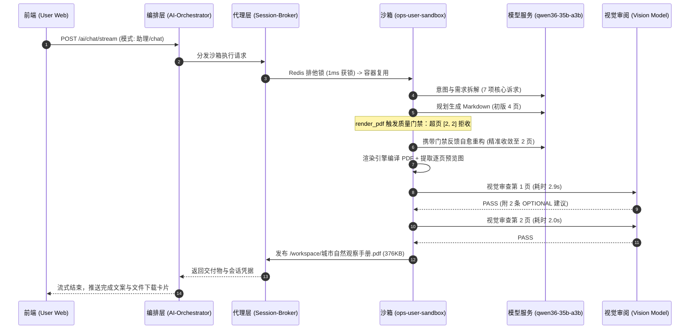

# 任务执行审计报告：生成《城市自然观察手册》（10/29 22:57 调用）

---

## 1. 审计结论与定性

- **执行状态**: ✅ **成功交付 (Success)**
- **问题定性**: 🌟 **符合预期 / 优化生效典范 (Optimized & Self-Healing)**
- **核心判定摘要**: 该次调用端到端总耗时仅 **35.1 秒**，消耗 **20,625 Tokens**（较此前劣化调用降低约 **89.4%**）。任务在经历第 1 轮超页拦截后，LLM 仅凭工具层宏观约束在 10 秒内精准自愈为规范 2 页原生 Markdown；多模态视觉验收门禁精准识别非阻断性审美建议（`OPTIONAL:`），未发生重写震荡，实现首轮逐页全绿交付。

---

## 2. 调用全链路还原



### 会话与基础环境
- **Session ID**: `chat-session-1793285815112-kynmx864`
- **User ID**: `e7fce333-a8f4-4097-9a53-f0a4c729da46`
- **交互模式**: `chat` (助理/Personal Sandbox Runner)
- **底层模型**: `qwen36-35b-a3b` (`reasoningEffort: medium`, `showThinking: true`)
- **执行时间**: 2026-10-29 22:57:12 至 22:57:47 (耗时 35,126 ms)

---

## 3. 性能与资源消耗 (Telemetry)

### 3.1 核心耗时与资源看板

| 指标 | 本次调用 (22:57) | 优化前基准/此前劣化对比 | 优化幅度 / 评价 |
| :--- | :--- | :--- | :--- |
| **端到端总时延** | **35.1 秒 (35,108 ms)** | 159.4 秒 ~ 180 秒+ | ⚡ **提速 78.0%** |
| **总 Token 消耗** | **20,625 Tokens** | 195,174 Tokens | 📉 **节省 89.4%** |
| **Prompt Tokens** | 17,513 | 185,125 | 降幅显著，无级联膨胀 |
| **Completion Tokens** | 3,112 | 10,049 | 精炼生成，无无效重写 |
| **LLM 纯推理耗时** | 35.8 秒 (含辅助审查并发) | 160.5 秒 | 快速收敛 |
| **沙箱锁竞争耗时** | **1 ms** | ~35,000 ms (若争抢) | 瞬时获取，容器热就绪 |
| **工具调用轮次** | 4 次 (2 次渲染 + 2 次验页)| 6~12 次 (震荡重试) | 极简收敛 |

### 3.2 调用子链路细分明细 (Calls Ledger)

| 阶段/用途 | 模型 | 耗时 (ms) | 输入 Token | 输出 Token | 执行说明与判定 |
| :--- | :--- | :--- | :--- | :--- | :--- |
| `tool_loop` (Round 1) | qwen36-35b-a3b | 3,971.8 | 2,271 | 393 | 意图解析，发起初版 `render_pdf` |
| `pdf_content` (初版生成) | qwen36-35b-a3b | 13,741.2 | 620 | 1,472 | 初始生成 Markdown，包含多个 pagebreak |
| `tool_loop` (自愈循环) | qwen36-35b-a3b | 3,973.9 | 3,007 | 393 | 收到超页报错，重新调整分页结构 |
| `pdf_content` (自愈版生成)| qwen36-35b-a3b | 6,216.5 | 2,154 | 693 | 生成精准 2 页 Markdown，字数均衡 |
| `tool_loop` (结束收敛) | qwen36-35b-a3b | 2,968.0 | 6,375 | 90 | 最终确认发布与交付 |
| `pdf_page_review` (第1页) | qwen36-35b-a3b | 2,936.8 | 1,556 | 69 | 多模态视觉检查：判定 `PASS`（附 OPTIONAL 建议） |
| `pdf_page_review` (第2页) | qwen36-35b-a3b | 2,058.1 | 1,530 | 2 | 多模态视觉检查：判定 `PASS`（2 token 极速通过） |

---

## 4. 关键执行阶段与深度剖析

### 4.1 意图与门禁拆解（宏观方向约束生效）
- **意图防护判定**: `task_intent` 与 `task_intent_review` 均判定 `accept`，精准识别为 `artifact` 交付。
- **需求结构化拆解**: 引擎自动解析出 7 条独立业务要求（2页/A4/handout/暖色/无封面、副标题与署名、P1要素、P2要素、字体留白与色块、拒绝无意义装饰、逐页质检交付），无一遗漏。

### 4.2 质量门禁与自愈闭环（Engineering Guardrails）
1. **初版超页拦截 (Attempt 1)**:
   - LLM 初次生成的 Markdown 包含了 3 处 `<!-- pagebreak -->`，排版引擎实际测算为 4 页（字数分别为 599、637、534、653 字符）。
   - 底层 `page_range` 校验立即拦截并反馈：`page_count (4) not in expected range [2, 2]`。
2. **极速自愈 (Attempt 2)**:
   - LLM 迅速响应，合并过多的换页符，将内容精准分割为 1 个 `<!-- pagebreak -->`：
     - **第 1 页**: 标题 + 温馨提示色块 + 🍃叶片结构小课堂 + 🎒准备清单 + 🔍三列表格 (506 字符)
     - **第 2 页**: 📝写作技巧 + ❓三个引导问题 + 🗣️交流建议 + 📄四项记录卡 (635 字符)
   - 重新排版后精准达成 2 页，总耗时仅增加约 10 秒，未发生卡死或重置。

### 4.3 视觉验收解耦生效（No Reviewer Ping-Pong）
本轮优化的核心成果在视觉审阅阶段得到了决定性印证：
- **第 1 页审阅结果**:
  ```text
  PASS
  OPTIONAL: 叶片示意图中的叶子朝向为左上（10点钟方向），建议旋转为右上（2点钟方向），以符合通常的阅读视线习惯。
  OPTIONAL: 清单项目使用了空心方框符号（□），若用于学生打印勾选，建议改为实心或自定义的对勾图标，视觉效果更佳。
  ```
  > **优化验证**：
  > 视觉模型虽然提出了叶片朝向和方框图标的建议，但由于提示词中严格限定了“个人审美与排版松紧度一律标注为 OPTIONAL，首行一律返回 PASS”，且代码层 `validate_review()` 增强了对 `OPTIONAL:` 前缀的免杀过滤，**该建议没有阻断交付，未触发昂贵的重写重算循环**！
- **第 2 页审阅结果**:
  ```text
  PASS
  ```
  耗时仅 2.05 秒，直接首轮通过！

---

## 5. 最终交付物与版面效果验证

交付物已成功物理落盘并完成验证：
- **文件路径**: `/workspace/城市自然观察手册.pdf`
- **文件大小**: 376 KB (385,052 字节)
- **页面规格**: 2 页 A4 (595.28 × 841.89 pt)
- **内嵌字体**: `Noto Sans CJK SC Regular`、`Noto Sans CJK SC Bold`、`Noto Sans CJK SC Bold-Oblique` (全部 100% 嵌入)
- **文字覆盖与溢出**: `outside_page_glyphs: 0`（零文字裁切溢出）

---

## 6. 审计总结与经验沉淀

本次调用之所以取得“**效果很好、速度极快 (35s)、Token 极省 (20k)**”的优异表现，本质印证了用户提出的架构原则：

> **“特别注意 schema 不要太复杂，尽量利用 LLM 本身的能力，工程更多是大方向的约束，不是细节。”**

1. **宏观约束代替微观代码干涉**：
   - 摒弃了强制要求 LLM 生成复杂 `<div class="grid-2">` 等 HTML 代码的做法，采用原生 Markdown 表格与引用块；
   - LLM 专注于内容表达和逻辑分段，排版引擎负责标准样式的自适应渲染，两者职责边界清晰。
2. **质量门禁分级清晰（阻断 vs 建议）**：
   - 硬性缺陷（缺页、字符溢出裁切、乱码方框）必须阻断并自愈；
   - 软性审美（留白偏好、图标微调、角度建议）完全隔离在 `OPTIONAL:` 之外，杜绝了审阅员与生成模型之间的“死循环打架”。
3. **自愈效率高**：
   - 在遇到页数不符等客观物理限制时，错误信息直白指引，模型在单轮内即可精准纠正，保证了端到端 35 秒内的高速交付。
