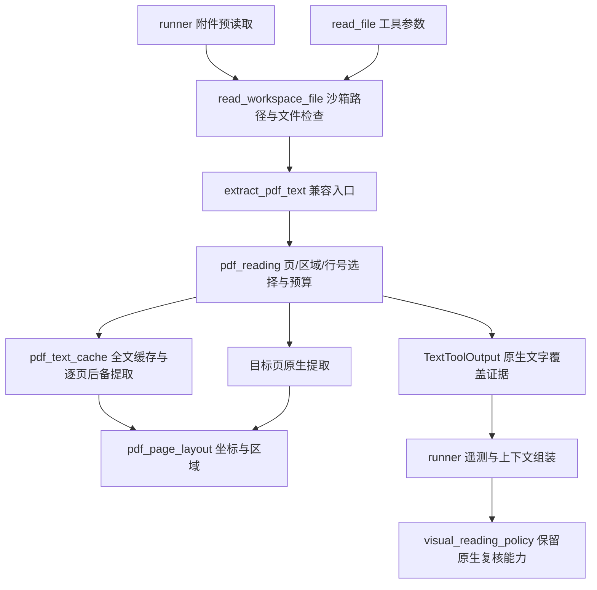

# PDF读取工具工程分析与修复（2026-11-12）

本次处理通用读取工程问题，不修订任何特定资料的摘要，不改变模型或推理参数配置，也不加入文档名、页码或内容特例。

## 读取链路及职责

视觉模型属于独立的`vision_inspect`路径，由原始用户请求或本地页面证据决定资格，单次仍最多4页。原生读取不隐式调用视觉、联网或生成工具。

## 确认的通用工程缺口

| 原行为 | 工程后果 | 修复 |
| --- | --- | --- |
| `extract_text()`跨栏平铺，清洗又压缩空白 | 文字还在，但区域关系丢失 | 独立版面模块保留坐标与区域；不确定布局保留空间文本 |
| 无截断字符串被当成全文完整，完整又触发移除工具 | 覆盖、质量、能力可用性混为一谈 | 结构化覆盖；PDF原生复核工具始终保留 |
| 只按整份文档的抽样图片占比开放视觉 | 个别纯图/扫描页可能遗漏 | 全文逐页记录未读取页，回传复核页资格；用户禁止视觉仍优先 |
| 跳过无文字页 | 物理页码覆盖无法核实 | 空白页、图像未读取页、错误页均保留占位和状态 |
| 页循环统一`except`清空已成功内容 | 一个坏页可导致全篇降级 | 单页隔离失败，逐页后备解析，保留其他页原生布局 |
| 全文读取只提供行号 | 页面/区域难以定点复核 | 增加`start_page/end_page/bbox`，冷缓存目标读取只提取请求页 |
| 以文本标记代替覆盖证据 | 被截断或失败的结果容易被误判 | PDF完整标志来自结构化结果；局部读取不冒充全文 |
| 只保存预检一句话，零工具调用无提取证据 | 无法复核当时注入范围 | 初始读取记录`pdf_reading`覆盖与截断、源哈希 |
| 旧平铺缓存与新输出格式混用 | 新代码仍可能返回旧布局 | 版本升级、原子缓存写入；失败结果不作为持久成功缓存 |

`runner.py`仅增加小型适配入口，不继续将版面提取逻辑堆入已有编排文件。新增模块分别负责页面证据、预算与读取契约；后备与缓存仍归原缓存模块。

## 兼容与性能

- 保留原有`read_file`名称和行号接口，新增PDF页码与区域参数。
- 简单完整PDF仍可一次模型调用直接回答；保留工具不意味着强制执行工具。
- 上下文组装的文字覆盖标志与工具列表分离；保留原生复核工具不能改变调用方已指定的思考参数。
- 预检抽样与全文提取复用页面提取证据；版面计算使用现有`pdfplumber`坐标，无新增模型或依赖。
- 全文缓存包含原生页证据和源哈希，不在工作区根目录写同名TXT；无来源校验的同名TXT不作为PDF读取依据。

## 验证

使用合成PDF覆盖独立双栏指标、表格行关系、三栏、混合扫描页、空白页、单页错误及后备、冷缓存页选择、区域坐标、无效参数、缓存失效、覆盖证据和预算续读。沿用只读交付、视觉分页及单次归纳回归，使用同一沙箱镜像和源码挂载，通过仓库根目录统一入口运行。

86项相关回归通过，源码语法检查与`git diff --check`通过。同镜像隔离沙箱的无模型验证确认：60页文件冷缓存请求第41–42页时仅提取这两页；单页区域不会混入另一栏，混合文件保留未读取页，原附件哈希未变。容器内加载模块的哈希与本地源码一致。

个人沙箱的`/usr/local/bin/dsh_modules`确认为当前仓库源码的只读目录挂载。此次只改Python源码，每次新DSH进程加载新模块，无需重建或重启编排服务；不宣称已经运行中的DSH进程会热更新。

验证结果与源码哈希记录见`docs/artifacts/reviews/pdf-reading-engineering-20261112/`，其中`validation.json`记录测试数量与运行核查。

区域坐标与文本API使用现有依赖提供的能力，接口依据见[pdfplumber官方文档](https://github.com/jsvine/pdfplumber#extracting-text)。

## 边界

布局识别是保守的几何启发式，不是通用表格语义解析器。无法证明任意复杂版面都能自动正确关联；因此不确定结构明确标记、保留按页/区域复核入口，也不以文字覆盖推断事实已验证。

纯文字层不能证明图片/图表内容已完整理解；混合扫描发现依赖本地图像覆盖及文字量证据。截止时间在页间与后备阶段检查，不是对PDF解析库单页内部计算的强制中断。

本次未调用真实模型重生成任何用户摘要，未部署远程服务器，也不宣称模型质量已经改善。
