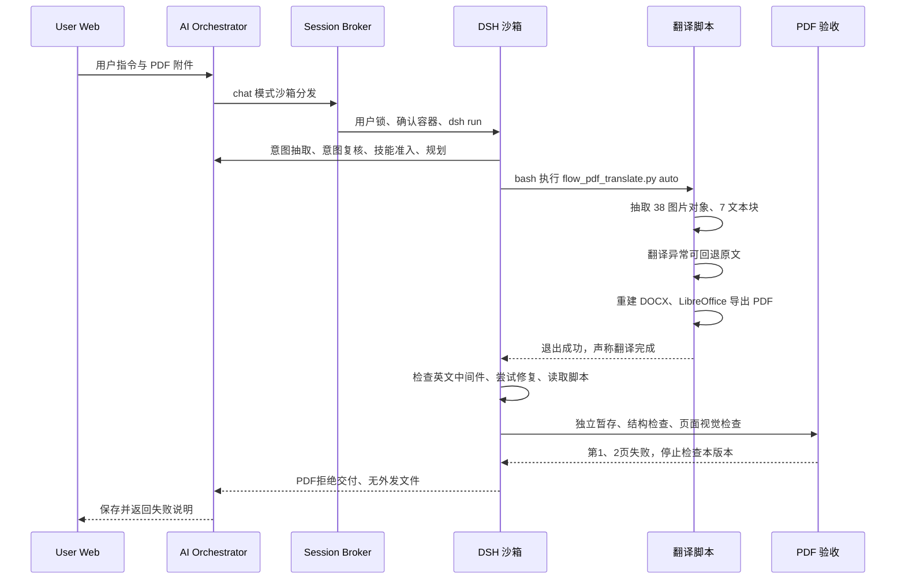

# PDF 中文翻译调用审计：2026-11-06 15:39

## 1. 结论与定性

**本轮业务失败，主因是工程实现，模型修复策略进一步消耗了时间；最终阻止交付是正确行为。**

内置 `flow_pdf_translate.py` 生成了 PDF，但没有产生中文译文，也没有保留原文双栏、表格和图片。失败链为：

1. 文本抽取按页面横向合并双栏，整篇只得到 7 个大段落，全部标成 paragraph。
2. 翻译脚本使用与平台不一致的网关环境变量；请求失败、响应异常或 JSON 缺键时均可静默返回原文。
3. 排版器把第一个 3,840 字符的大段落整体设为 15pt、加粗、居中；原文双栏结构丢失。
4. 图片回填依赖 heading，而这 7 个块没有 heading，因此抽取的 38 个图片对象均未插回；表格也未结构化重建。
5. 模型发现问题后继续检查源码和中间件，尝试调用不存在的 pdfplumber API，未完成修复。
6. 最终视觉验收拒绝候选，清空外发文件，返回用户引用的失败说明。

这不是单纯的“验收太严”或“模型翻译得不好”。保留的 Word 中间件 **7 段逐段等于抽取原文，中文字符为 0、表格为 0、内嵌图片为 0**；候选 PDF 同样没有中文字符和图片对象。

验收文字中的“we better 戛然而止”需要校正：后页确有续文，不能仅凭页尾未完句认定内容丢失。实际严重问题是左右栏内容被交错拼接、整页被当作标题，以及翻译根本未完成。放宽留白或跨页规则无法解决这些问题。

## 2. 目标轮与证据身份

| 项目 | 值 |
| --- | --- |
| 用户指令 | 翻译这个文档，保持格式不变，生成中文版的pdf |
| Session | `chat-session-1793948895385-0czd8fvz` |
| 用户 | `e7fce333-a8f4-4097-9a53-f0a4c729da46` |
| Assistant message | `1793950556004-ak8o8lcr` |
| Evidence turn | `1793950766424492334-db126a006fff4e229ccccd01c6a978a3` |
| Event run | `d02da1ae5d3c4bb1adc83990346e3a73` |
| 北京时间 | 15:35:56.731—15:39:26.435，15:39:26.498 保存回复 |
| 模型 | `d13e0d30-87b9-4e87-b96a-d8b1b3cf78af`，服务解析为 `qwen36-35b-a3b` |
| 参数 | chat；`--thinking --reasoning-effort medium --web-search` |
| 输入 | `2507.03009v4.pdf`，3,766,178 字节、7 页 |
| 输入 SHA-256 | `98e86e51f04f921581bb4f578f73d15c9a31d5e6d316ea51213a7918ff6cab48` |
| 候选输出 | `PDFMathTranslate_ZH.pdf`，72,922 字节、7 页 |
| 候选 SHA-256 | `eb119a5cbd7f4cfac593595ff95c901476f8c0db04f638e709378a0beba374e9` |
| 业务终态 | evidence `verified=false`，`pdf_delivery=reject`，`artifacts=[]` |

同一会话此前还有两轮执行，其中第一轮因视觉服务不可用被拒绝。本报告使用独立 event run、按 turn 保存的回执，以及哈希吻合的候选文件，未将前两轮混入本轮时延和归因。

沙箱/Harness `exitCode=0` 只表示进程正常结束，不表示文件翻译成功。

## 3. 全链路与时间线



| 阶段 | 北京时间 | 耗时 |
| --- | --- | ---: |
| 意图抽取、复核、PDF 技能准入 | 15:35:56.774—15:36:05.303 | 模型累计 8.486 秒 |
| 规划 | 15:36:05.376—15:36:26.204 | 20.827 秒 |
| 第一次执行模型请求 | 15:36:26.216—15:37:02.415 | 36.198 秒，期间发生一次30秒超时重试 |
| 第0轮 bash：检查输入存在 | 15:37:02.420—02.483 | 0.063 秒 |
| 第1轮 bash：执行翻译脚本 | 15:37:05.070—15:37:15.271 | 10.201 秒 |
| 第2轮 bash：check_pdf | 15:37:17.713—19.737 | 2.024 秒 |
| 第3—23轮：诊断、尝试修复、读源码 | 15:37:19.738—15:39:04.804 | 约 105.1 秒 |
| 最终总结模型 | 15:39:04.844—15:39:19.251 | 14.406 秒 |
| 外部 PDF 门禁渲染/暂存 | 15:39:19 后—15:39:21.611 | 约 2.3 秒 |
| 第1、2页并行视觉检查 | 15:39:21.611—15:39:26.413 | 墙钟约 4.8 秒 |
| 拒绝发布、保存证据、返回 | 至15:39:26.498 | — |

Dispatcher 的附件同步、Broker 用户锁和容器确认均正常。锁等待仅 1ms，容器已经运行；没有本轮附件找不到、容器未启动或锁竞争造成失败的证据。

任务意图为 `standalone / execute / artifact [.pdf]`，PDF 技能准入成功。MCP 候选未选中、执行门禁 disabled；授权了 web-search，但本轮没有搜索工具操作。模型规划明确提及内置脚本，因此不能把采用此脚本单独归为模型擅自选择错误方案。

## 4. 根因与责任证据

### 4.1 翻译接口配置错配与静默回退：工程主因

从本轮第17、19—23号回执完整还原了历史脚本：全部335行无缺失、无重叠冲突，并且与审计时本地脚本逐字节相同。源码 SHA-256 为 `6ecc7eb467708d9d44621886cd964e6ab9e05f440c5d93b626cbc0495c4a8f58`。

该历史版本第310行读取：

```python
api_base = os.getenv("OPENAI_API_BASE", os.getenv("AI_PROXY_URL", "http://127.0.0.1:8080/v1"))
```

平台 DSH 的 `config.py:13` 则采用 `DEEPSEEK_BASE_URL`。审计时目标容器的只读检查确认：

- `DEEPSEEK_BASE_URL=http://ops-ai-orchestrator:3007/ai/proxy/v1`；
- `OPENAI_API_BASE`、`AI_PROXY_URL` 均未设置；
- 容器内 `127.0.0.1:8080` 的 TCP 检测返回 errno 111（拒绝连接）。

`_translate_batch_streaming` 虽以 streaming 命名，实际 payload 是 `stream=False`。它在请求异常重试耗尽时直接 `return dict(batch_dict)`；返回 JSON 缺键时也通过 `parsed.get(k, orig)` 使用原文。`auto` 随后将这些原文写入 translated 字段，继续导出，最后打印“翻译完成”“已成功发布”，退出成功。没有失败块清单、目标语言检测或译文覆盖率门禁。

**已证实**：本轮全部 7 段都原样进入 Word，输出零中文；历史代码允许静默回退并报成功。**高置信推断**：本轮内部翻译请求落到错误的 localhost 地址而失败。具体历史异常没有被脚本记录，审计时环境也不是历史环境转储，因此不能把 errno 111 冒充本轮保存下来的原始异常。

离线 mock 使用从历史回执恢复的函数，复现“三次连接失败 → 等待1.5/3秒 → 返回原文”，并复现合法空 JSON `{}` 同样返回原文。没有调用真实模型或重新执行翻译。

### 4.2 双栏抽取错误与标题放大：工程主因

`extract_text_blocks_from_pdf:56` 使用 `page.extract_text(layout=False)`，按双换行分段，再将所有行以空格拼接。这个 PDF 每页只生成一个块，两个栏目的行被混合；从第10号回执即可看到摘要和右栏正文交替出现。

7个块长度依次为 3840、2564、3620、4266、904、4336、2314，全部是 paragraph。历史源代码只保留 `id/page/type/text`，没有双栏区域、文字坐标、字号或表格结构。

`build_docx_document` 第181行仅凭 `i == 0` 就将第一块视为主标题。因此第一整页抽取文本变成 15pt、加粗、居中，占满候选 PDF 前两页。中间件字体属性和保存的候选 PNG 均证实该行为。原文第1页的正常双栏结构与候选页面差异明显。

这是阅读顺序与结构重建错误，单纯调小字号、放宽跨页验收都不能恢复正确文意顺序。

### 4.3 图片和表格丢失：工程主因

脚本回执确认抽取了38个内嵌图片对象，但 `build_docx_document` 第199行仅在 `b_type == "heading" and i > 2` 时插图。本轮没有 heading，实际 Word 内嵌图片和候选 PDF 图片对象均为0。

38是 `pdfimages` 输出的图片对象数，不等同于38张独立业务图表；其中可能含组合图或掩膜。但“已经抽取”显然不能证明“已经插回”。

Word 表格数也为0。脚本没有重建表格的分支，原表的列项、勾选等被拼成普通文本。源码说明和提示词中的“原图原位”“表格结构保留”等承诺，超出了实际实现能力。

### 4.4 模型修复失败：次要模型原因

模型发现英文输出后，连续检查中间文档、解包 JSON 和脚本源码，产生21轮后续 bash 调用。其中包括：

- 把 list 类型的 `extracted.json` 当 dict 访问，触发 `TypeError`；
- 尝试 pdfplumber `Page.extract_lines()`，触发 `AttributeError`；
- 检查 pdf2zh，确认未安装；
- 最后多轮读取同一脚本，没有补译后重新 pack 出新的合格候选。

这部分属于模型 API 使用错误和修复策略低效；平台缺少早期语义失败信号、明确修复分支及快速停止机制，也放大了成本。它不是最初生成英文且破坏结构的唯一原因。

### 4.5 门禁正确拒绝，但解释不够精确

check_pdf 给出 `valid=true` 和 `visual_review=required`。它证明候选可解析、字体/边界等机器检查通过，未证明翻译成功或布局保真。随后 `external_pdf_gate` 将候选移到隐藏目录，绑定哈希和预览；第1、2页视觉检查失败，停止检查第3—7页，外发列表清空。

独立查看保存的前两页确认：页面仍为英文、文本顺序错乱、第一段异常放大。验收拒绝是合理的。

“we better”之后的“address the barrier…”出现在第2页，且中间夹着别栏内容。因此不能把该页尾未完句独立作为“全文缺失”证据；视觉模型的“重叠”描述也混入了阅读顺序混乱与单词粘连，不能据此推导字体坐标真实互相覆盖。

最终附加的“更换 report / handout”建议来自通用错误模板，与“保持原格式”的任务要求不匹配，应按翻译失败、结构失败、视觉服务不可用分别给建议。

## 5. 性能与遥测边界

| 指标 | 数值与解释 |
| --- | --- |
| HTTP端到端 | 210.352 秒 |
| Harness / DSH | 210.187 / 209.704 秒 |
| 用户锁等待 | 1ms |
| LLM累计 | 190.778 秒，包含并行视觉请求时长之和，不是互斥墙钟占比 |
| 31次模型账本 | 3次意图/准入 + 1次规划 + 24次tool_loop + 1次final_summary + 2次页面审阅 |
| 工具 | 24次模型 bash + 2次运行时 inspect_pdf_page；另有1条外部门禁 render_pdf 回执 |
| 模型账本Token | 输入459,694 / 输出6,598 / 合计466,292 |
| TTFT | 36.198秒，scope=model_request；对应首个tool_loop，不是完整用户端首字耗时 |
| 翻译脚本自身 | 10.201秒，但结果未翻译，不能按成功翻译速度评价 |
| 模型诊断循环 | 约105.1秒；大量源码和诊断回执随上下文重复送入模型 |
| 最终模型finishReason | length；final_summary输出1,200 Token达到上限 |

这里的 length 属于最终总结，不能用来解释PDF里的“we better”或断词：候选文件早在15:37已生成，后续没有成功替换。

服务日志另记录主模型30秒超时、aborted/TLS连接故障，以及备用模型连接拒绝、模型不存在和鉴权失败。首次30秒重试与首个tool_loop的36.198秒对应，属于工程链路延迟。其他同时间日志缺少每条请求与本轮call_id的一一映射，不能将全部故障都归到内部翻译步骤。

内部脚本直接调用 urllib，不走DSH统一模型账本。因此 `tokenUsageComplete=true` 仅说明该账本各条 usage 完整，不能保证所有内部请求/失败重试都被完整计费统计。31次逻辑调用也不是底层实际HTTP尝试次数。审计没有将输入Token视为“翻译正文量”。

## 6. 修复优先级与验收标准

1. **P0：先修翻译适配与失败契约。** 复用DSH实际网关/令牌配置，记录批次、错误和usage；连接失败、JSON缺键、值类型异常均显式失败。译文尚未生成时不得导出并宣称完成。检查目标语言与逐块覆盖，专业名词、引用等免译项单独处理。
2. **P0：修文档结构，或停止将现有脚本声明为保格式能力。** 按栏/区域建立阅读顺序，单独识别标题、正文、表格、图文锚点；只有真实标题使用标题样式。图像回填不依赖偶然的heading识别。保留文本、布局、图像映射以便对照。
3. **P1：增加早期验收。** 在LibreOffice导出前拦截零译文、整页标题、图片回填为零、表格结构消失；输出coverage/结构差异回执，让模型进入确定的补译或结构修复路径。
4. **P1：收敛模型修复与网络备用配置。** 对同类错误限制诊断轮数，避免连续读源码；维护经过健康检查且具备正确文本/视觉能力的备用模型。错误模型名或鉴权失败不应作为可靠兜底。
5. **P2：改进验收解释与用户反馈。** 将正常跨页续文与真实内容丢失分开；保留拒绝不合格中文PDF的门禁。去掉此场景下要求用户更换report/handout的建议。

修复验收应覆盖：本论文双栏阅读顺序、标题/摘要样式、表格结构、原图映射、逐块翻译覆盖、失败时无可发布文件。候选可解析和页数相同不能作为保真成功标准。

本次仅审计、只读取证与离线验证，未修改业务源码、未重新翻译、未发布候选、未重启服务。工作区原有PDF相关未提交改动完整保留；现有留白/跨页规则调整不能解决以上结构和翻译主因。

## 7. 可复查证据与范围

证据目录：[pdf-translation-audit-20261106-1539](../artifacts/reviews/pdf-translation-audit-20261106-1539/)。

- `target-message.json`：目标最终回复、完整executionTrace/metrics。
- `evidence.json`：目标turn独立27条工具/门禁回执，含当时脚本源码。
- `events.jsonl`、`timeline.json`：目标event run及北京时间线。
- `historical-flow_pdf_translate.py`：从历史回执拼回的完整脚本。
- `candidate.pdf`、`qa.json`、`page-1/2.png/txt`：哈希一致的未发布候选及验收记录。
- `original-page-1.png`：本次从输入PDF渲染的对照页。
- `intermediate.docx`、`extracted.json`：mtime与本轮匹配、已记录哈希的中间件。
- `offline-probe.json`：原文回退mock复现、逐段一致性、零中文/零图片等统计。
- `runtime-observations.json`：审计时不含密钥的环境及端口观察，明确不冒充历史快照。
- `service-logs.txt`：目标时间窗服务日志，锁token已脱敏。
- `sha256.json`：证据文件哈希清单。

代码定位先使用codebase-memory图谱，再读取当前文件；图谱部分新PDF模块未收录，以实际源码和历史回执为准。除完整恢复的翻译脚本外，没有取得当时所有模块/提示词的不可变快照。独立视觉复核针对保存的第1、2页；没有宣称其余页面已逐页验收，也没有把视觉报告中的每个描述都当成已证实事实。
