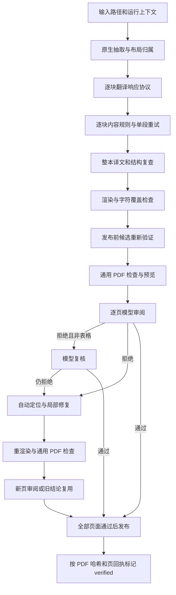

# PDF 翻译全链路校验逻辑审计

审计日期：2026-11-08。范围：当前工作区及活动技能中的 PDF 翻译、渲染、恢复、页面审阅、修复和发布校验。

## 1. 结论与边界

**当前并非一套统一的完整性校验，而是硬性结构约束、启发式内容规则、模型审阅和自动修复共同决定交付。主要问题是把无法证明内容损坏的信号当成硬失败，并且初次生成与修复后的验证标准不一致。**

本报告的“假阳性”指系统误报缺陷、拒绝本可继续处理的结果；“漏检”指规则接受未满足其宣称约束的结果。只分析程序的输入、分支、约束和证据，不判断任何实际译文的语义，也没有调用模型进行语义确认。

围绕相关校验入口完成源码审查，并保存了 41 个相关文件快照，其中 27 个技能文件与 `data/shared/dsh-skills/pdf/scripts` 活动副本逐字节一致。运行时模块使用当前仓库挂载。以下为当前实现分析，不将所有缺陷都归入上一轮 16:28 的执行；该轮尚未进入页面审阅或修复。

完成了 22 个离线机械样例，涵盖数字规则、审阅协议、复核记录、修复定位、空值接受和版本回执。样例使用固定字符串和假 Gateway，不发起翻译、视觉或网络调用。未修改业务源码，未重启服务。

## 2. 全部校验层与实际调用顺序



关键差异：初次候选走 `verify_candidate`；自动修复后的候选直接进入重渲染/预览/审阅，未重新经过同一套候选验证。

| 层 | 检查内容 | 失败影响与边界 |
| --- | --- | --- |
| 输入/上下文 | schema、Job/Run、输入输出路径、工作区边界、符号链接、文件存在、源文件 SHA256 | 硬失败；适合保留，属于工程约束。 |
| 原生抽取 | 每页至少 20 个抽取字符；文字位置、表格、图片区域 | 字符少直接报 layout_unresolved；合法短标题页、纯图页也可能不满足准入条件，不能等同于文件损坏。 |
| 布局/IR | 节点类型和 ID、reading_order、所有来源行恰好归属一次、表格网格和单元格归属、区域坐标与覆盖 | 硬失败；证明结构自洽，不证明上游抽取和分类正确。 |
| 模型响应 | 布局 JSON；翻译 JSON；finish_reason=stop；received_done；合法 ID 和字符串 | 硬失败；响应完整性属于工程检查。 |
| 译文值 | 非空、NUL/替换字符、数字兼容、字面值不变、URL 子串、是否原文照抄、目标语言字符 | 任一失败触发重试、恢复，最终阻断渲染；混合了协议检查和不可靠的内容推断。 |
| 渲染 | PDF 可解析、非零页数、页数要求、双提取器字符覆盖、越界字形、字体嵌入、链接目标、资源错误 | 硬失败；字符覆盖是全书字符多重集，不是段落和顺序验证。 |
| 候选验证 | 回执/文件哈希、重抽原文、原生表格和 IR 一致、再跑译文规则、候选字符和图片存在性 | 大量重复同一规则；错误来源和错误规则会被重复确认。 |
| 逐页审阅 | 模型 PASS/REPAIR/FAIL；内容准确性、漏译、行列关系、阅读顺序及版面 | 硬门禁，包含明确的语义审查；与“不进行语义确认”的目标冲突。 |
| 自动修复 | 从审阅问题定位节点、表格、源页，重译/重建/重布局 | 被误报驱动时可改写原本不需修改的内容；验证标准还比首次翻译更宽。 |
| 发布证明 | 所有页回执、对应 PDF 哈希、目标文件存在与哈希一致 | 应保留；当前修复路径存在版本回执接续问题。 |

主要入口：`pipeline.run_job`、`text_translator.translate_document`、`pdf_translation_delivery.verify_candidate` / `enforce_translation_delivery`、`pdf_preview_tool.inspect_pdf_page`、`pdf_repair_loop.execute_pdf_repair_loop`、`pdf_publication.has_verified_pdf_publication`。

## 3. 逐块内容规则：误报和漏检均已复现

`translation_validation.validate_value` 的执行顺序为：

1. 译文必须为非空字符串。
2. 译文不得含 `U+FFFD` 或 NUL。
3. 默认要求 `numbers_compatible`。
4. 原文被判为字面值/命令时，要求去除首尾空白后完全相同。
5. 原文 URL 必须是译文的子串。
6. 原文需要翻译时，应用字面值捷径、原文照抄判断、品牌豁免及目标文字字符检查。

`strict_numbers=True` 是默认值；当前主要调用点均未传 `False`。仅关闭数字规则不能关闭后面的语言/照抄规则或页面模型语义审阅。

### 3.1 数字规则并不检查“数值事实是否变化”

实现先做 NFKC，再用 `\d+(?:\.\d+)?` 抽取数字字符串并比较 Counter。它既不理解公式，也不处理数字的符号、单位、位置与作用域。

| 机械输入变化 | 当前结果 | 问题 |
| --- | --- | --- |
| `(cid:80)` → `∑`，其余数字不变 | 拒绝 | 字体字符编号误当事实数字。 |
| `1,000` → `1000` | 拒绝 | 前者被拆为 `1`、`000`，格式归一化不完整。 |
| `1.0` → `1` | 拒绝 | 比较字符串而非数字表示。 |
| `1e3` → `1000` | 拒绝 | 科学计数法未识别，前者拆为 `1`、`3`。 |
| 普通文本中的 `-5` → `5` | 通过 | 正负号未进入数字 token。 |
| 普通文本中的 `5%` → `5` | 通过 | 百分号未进入数字 token。 |
| 普通文本中的 `5 mg` → `5 kg` | 通过 | 单位未检查，尽管提示要求保留 units。 |
| `1 01` → `1` | 通过 | 前导零归一化先构造字典，相同键覆盖，次数未累加。 |
| 原文两个 `1`，译文无数字但出现一个“一” | 通过 | 中文豁免一次删除该数字的全部缺失次数，无位置/计数对应。 |
| 原文出现 January，译文额外出现三个 `1` | 通过 | 月份豁免同样没有次数和位置约束。 |

因此当前数字规则既过严又过宽。继续添加月份、量词或公式特例会继续引入近似语义推断，不能把它修成可靠的语义事实验证器。

位置：`translation_validation.py:36`、`:53`、`:88`、`:99`。

### 3.2 字面值和语言规则存在捷径与过度分类

- 原文含普通文本和 `7`，译文仅返回 `7`，仍可通过：`is_literal_or_command(translated)` 为真后直接 return None。这不是完整性证明。
- `This Is A Sentence` 原样返回被品牌/专有词豁免接受：依据是少于等于六词且词首大写，不是专有名词证据。
- `See a.b` 被去除全部空格后匹配“域名”正则，翻译其普通文本前缀也被判 `literal or command changed`。把整段压成类似域名的字符串扩大了字面值范围。
- URL `/a` 改成 `/attack`，只要前者仍是后者子串，逐值 URL 校验就可通过。渲染链接注解的目标集合检查是另一个独立层，不能证明这条子串规则本身正确。
- “出现任意一个汉字/假名”等字符条件不能证明目标语言完整；反过来，合理的符号、英文名或短标签可能没有这些字符。无需进行语义判读即可确认：字符脚本和长度条件不等于翻译完成证据。

位置：`translation_validation.py:113`、`:136`、`:159`、`:177`、`:180`。

### 3.3 结构化豁免依赖上游角色

`text_units` 排除 author、formula、furniture、reference；表格只翻译非空 cells，图形使用 legend_units。节点被分成哪种类型，会直接改变其是否需要译文以及是否被内容规则检查。

这不是独立交叉验证：角色来自布局识别及规则后处理。若某个公式混入 paragraph，立即进入数字规则；若某段误入豁免类型，它又可能退出翻译检查。ID 全覆盖不能发现这种角色错分。

## 4. 恢复并没有增加独立证据

初次翻译每批两次：批量生成一次，失败 ID 各单段再生成一次。每次都重新应用同一个 `validate_value`。`_build_translation_prompt(..., feedback=None)` 的 feedback 实际未使用；错误差异与上一份响应没有作为修复证据传入。

通过逐批检查后，`translate_document`、`pipeline.run_job`、`verify_candidate` 又分别执行 `validate_translation`。这些是同一规则在不同时间点的重复运行，可以发现状态变化，却不能降低该规则自身的误报率。

检查点要求来源哈希和重抽结果一致，能防止来源被改写；但 `(cid:N)` 等抽取污染会被原样保留，重复抽取一致也不能证明污染已解决。

`recover_pdf_translation` 按布局/翻译各限制恢复次数，属于必要的执行预算控制。但恢复次数耗尽应记录为恢复未收敛，不应暗示模型语义错误已被多次证实。

默认 `DSH_PDF_OPAQUE_TOKENS=0`。可选数字占位符模式会按每个数字出现位置生成 token，并检查缺失/重复/未知 token；但仍把 CID 中的数字当数字保护，且 token 可恢复回普通数字的放宽规则、后续 `validate_value` 和页面语义审阅依然存在。它不是关闭语义校验的开关，也不是本次问题的直接配置修复。

## 5. 渲染、结构与文件检查的能力边界

### 应保留的硬性工程检查

- 输入/候选/资产/回执路径的工作区约束，禁止符号链接和覆盖原稿。
- 文件存在、PDF 可解析、页数大于零、显式页数约束。
- schema、ID、来源行唯一归属、表格坐标与跨度合法、结构回执一致。
- 源文件、IR、候选和回执的版本与哈希绑定。
- 资源可读取、渲染过程完成、预览页数与候选页数一致。

这些检查应清楚命名为工程完整性，不能声称已证明翻译忠实。

### 当前实现需要收紧证据范围

`pdf_design.quality.inspect_pdf` 用 pypdf 和 pdfplumber 各提取全文，分别检查归一化后字符 Counter 是否覆盖 expected；`verify_candidate` 再做类似检查。

- 忽略顺序、段落身份、单元格身份和位置；别处重复字符可以抵消某处缺失。
- NFKC 后只保留字母数字，标点、运算符和部分格式差异不计入覆盖。
- 两个提取器任一不满足就硬失败；若提取映射不可靠，不能直接定性为渲染漏文。
- 越界字形和字体嵌入属于几何/环境策略，不是内容准确性检查；应报告具体字符位置/字体，而非统一要求改写正文。

`validate_regions` 对原生 visual_bounds 的宽高和覆盖率设硬门槛。若来源将装饰矩形或背景框认作图形锚点，下游也会要求保留/覆盖它；几何自洽不等于锚点分类可靠。此项是静态边界风险，未在本轮增加实际文档实验。

资产文件有逐个哈希检查，但候选 PDF 仅检查“至少有一张图片”，不足以证明每个资产都已放置。链接注解检查比较 URI 集合，能发现某目标完全缺失，但不能保证每个位置的链接归属。

## 6. 页面审阅：语义确认和文本关键词共同构成门禁

这部分是当前最明确的语义确认层：

- `REVIEW_INSTRUCTION` 要求判断正文翻译完整准确、忠实、普通标签漏译等。
- `translation_review_evidence` 注入最多 10 对原译文，每段截断 900 字符，要求“对照检查语义、数字”。定位使用译文前/后 20 字子串，定位不到的段落不会进入证据。
- `table_review_evidence` 用若干文本命中把表格放入提示，单元格截断至 120 字，再要求模型确认行列与数值归属。
- 初审拒绝且不是表格问题时，再调用模型做 confirmation；表格问题直接进入修复，不走这次复核。

按“不进行语义确认”的要求，这整组内容准确性裁决不应成为交付前置条件；继续增加语义复核模型只会新增不确定性和成本。

### 6.1 PASS 仍会被关键词规则推翻

`validate_review` 先在任意行搜索 PASS/REPAIR/FAIL，再扫描解释文本中的“建议、修复、存在重复、缺少”等词。否定清理正则覆盖有限。

已机械复现：

| 模型响应字符串 | 当前解析结果 |
| --- | --- |
| `PASS` + “不存在重复内容。” | 拒绝：命中“存在重复”。 |
| `PASS` + “不建议修改。” | 拒绝：命中“建议”。 |
| 前置任意文字，下一行 PASS | 接受；未严格要求首行。 |
| PASS + `OPTIONAL:` 后包含“缺少整段内容” | 接受；整行被跳过。 |

这组结果只反映解析协议，不评价这些句子的业务含义。应解析严格结构化 verdict 和 issue 数据，而不是用关键词重新推断自然语言否定含义。

### 6.2 复核协议也不能证明逐项覆盖

`validate_confirmation` 主要检查 PASS、记录数量、status、证据字数和引用片段重叠。两个问题的两条 resolution 都引用第一个问题，也可以通过，因为引用可与全部初审文本匹配，未建立 issue_id 的一一对应。

已复现 ALPHA/BETA 两问题、两记录均引用 ALPHA 仍被接受。所谓“证据长度不少于 15 字”只是文本长度约束，不是客观证明。不建议通过继续改进该语义复核来解决误报；按本次目标应取消此项语义硬门禁。

### 6.3 预算失败与内容失败必须分开

当前全轮页面审阅固定 180 秒、并发 2、每页最多 40 秒，单次视觉尝试 20 秒并允许一次重试。总预算不随页数扩展，长文档更易因服务时延无法完成验收。

`inspect_pdf_page` 将服务异常标为 `pdf_review_unavailable`，有意区别于内容拒绝；但外层只要 reviews 中有错误就可能进入 `execute_pdf_repair_loop`，修复循环按 `is_error` 收集全部失败，缺少错误码过滤。自由文本回退分类又可能将服务异常当 layout 问题。因此“服务未完成”有机会引发重新布局。该项是源码调用路径结论，不声称上一轮 16:28 已发生。

## 7. 自动修复路径的三个工程缺陷

### 7.1 初次翻译与修复的接受标准不一致

首次翻译拒绝空值、检查数字、禁止跨 ID 搬移文本。`node_repair.repair_nodes` 的提示则允许移动标号、将冗余节点返回空串；程序仅检查返回字典键集合一致、值为字符串，然后直接写入 translations/cache。

离线假 Gateway 返回 `{"n1":""}`：repair_nodes 成功保存；同一值交给标准 validate_value 立即报空值。此处没有语义判断，已确认接受标准冲突。

`execute_pdf_repair_loop` 随后直接 render_document / _stage_and_check，没有重新执行 validate_translation / verify_candidate。渲染 expected 又从修复后的值生成，空值本身不会再产生应有正文。这意味着首次翻译误报时异常严格，修复后反而可能漏掉基础协议问题。

修复也可能修改节点/表格结构，却不更新原始 source.ir；若之后真正重新走 verify_candidate，会被来源结构一致性约束拒绝。应明确不可变来源、可变结构版本和可变译文的边界，而不是绕开来源验证。

### 7.2 误报可能修错对象

`triage_review_issues` 对 table issue 优先取 page-map 中第一张表，不能精确定位时还会取全文第一张表。样例明确锚定同页第二表 t2，实际计划仍返回 t1。

文本问题也可能从前/后片段或 anchor 近似命中第一个节点。定位不足时应返回“无法确定修复目标”，不能把另一对象当确定目标。

### 7.3 旧审阅结论与新 PDF 的版本关系断裂

page-map 中的页 sha256 是“去空白提取文本”的哈希，不含布局、图片、字体或几何。相同文字、不同布局仍可能复用旧页面结论。它不适合作为视觉验收版本身份。

修复路径将旧 PASS 回执对象直接复用，只在内存中标记页面 reviewed；新渲染状态虽 register，但未像初次路径那样记录新的 pdf_render 回执。最后 `has_verified_pdf_publication` 又要求各页回执和渲染回执绑定同一个 PDF SHA256。

纯回执样例已复现：新 PDF 已发布、页回执绑定新哈希、唯一 render 回执仍是旧哈希时，verified=false；补成新 render 回执才为 true。实际修复流程是否到达成功发布还受其他条件影响，但版本接续缺陷在源码中明确存在。

## 8. 按不做语义确认的目标，建议的校验职责

| 处理方式 | 检查项 |
| --- | --- |
| 保留硬门禁 | 来源/目标/版本/哈希、路径、响应协议、ID 完整性、非空值、PDF 解析、明确的页面/资源/几何失败、完整的最终版本回执。 |
| 从阻断规则中移出 | 普通译文的数字 Counter 一致性、汉字/假名检测、原文照抄/品牌猜测、模型对忠实/准确/漏译的裁决、语义 confirmation。可记录诊断信息，但不因它自动重写。 |
| 改为确定性保全 | 已明确标注的代码、URL 目标、原图、公式等按类型保留；公式作为不可变资产或可信结构，不混入普通段落后猜数字。未映射字形报告为抽取问题。 |
| 统一流程 | 初次候选、恢复候选和修复候选均走相同的工程完整性入口；所有修改生成新版本、刷新结构/译文/渲染回执。 |
| 禁止自动修复的触发 | 模型主观意见、无定位问题、未知错误、网络/服务超时；这些状态不应触发重译或重布局。 |

即便只保留工程校验，也不能将“完成”描述成“语义准确已确认”。应该报告实际完成的保证：文件生成、节点交付完整、资源存在、版本绑定和可解析等。

不建议简单关闭所有校验，也不建议只将 strict_numbers 改为 False：后一做法仍保留语义页面门禁、修复绕行和版本回执问题，无法满足目标。

## 9. 证据与复现

证据目录：[pdf-validation-logic-audit-20261108](../artifacts/reviews/pdf-validation-logic-audit-20261108/)。

```bash
python3 docs/artifacts/reviews/pdf-validation-logic-audit-20261108/probe_validation.py
```

- `probe-results.json`：22 个样例及实际结果。
- `probe_validation.py`：使用同目录源码快照，可离线重现；无模型调用。
- `code-hashes.json`：41 个源码快照哈希和活动技能副本对比。
- `code-snapshot/`：本次分析使用的全部相关源码。

核心定位：`translation_validation.py:36/53/167/206`；`contracts.py:48/93`；`text_translator.py:41`；`pdf_design/quality.py:33`；`pdf_translation_delivery.py:38/285`；`pdf_review_contract.py:75`；`pdf_preview_tool.py:114/174`；`pdf_review_resolution.py:112`；`node_repair.py:29`；`pdf_repair_loop.py:18`；`pdf_issue_triage.py:30`；`pdf_publication.py:6`。
