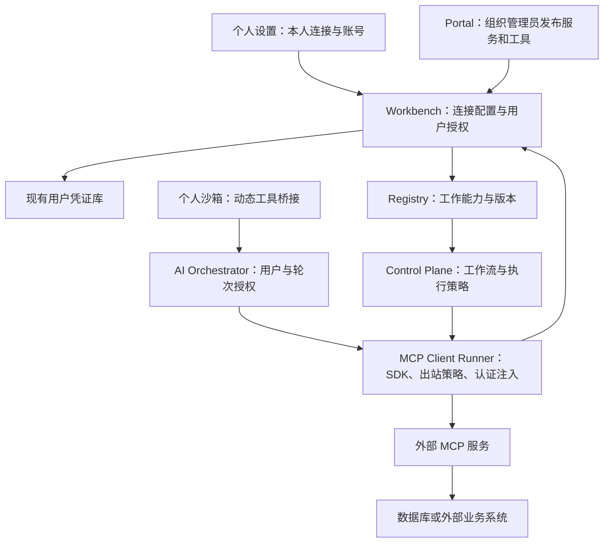

# MCP 外部工具接入设计与实施方案

日期：2026-11-04（Asia/Shanghai）。状态：待实施设计，未修改运行代码、数据库或部署配置，未进行 MCP 联调。

## 1. 范围与产品边界

平台只作为 MCP Client 调用外部服务。本方案不建设供外部客户端连接的平台 MCP Server，不扩大既有 `/mcp` 路由的暴露范围。此前 Phase 3 文档中的双向开放网关不属于此次实施范围。

按本轮需求将“凭证需要用户设计”理解为“凭证由用户自行设置/授权”：个人模式用户管理自己的连接；工作模式由组织管理员配置和发布连接与工具，使用者绑定自己的外部账号凭证。第一版不自动使用管理员凭证或企业共享凭证；后者如需要，另建显式服务身份策略。

三种权限必须独立：配置连接、获准调用工具、授权使用外部账号。管理员配置权不包含读取或代用用户凭证的权限。

| 操作 | 个人连接所有者 | 工作模式普通用户 | 对应组织管理员 |
| --- | --- | --- | --- |
| 创建、修改个人连接 | 仅本人 | 可在个人模式操作 | 无隐式代管权 |
| 配置组织服务地址与网络策略 | 不可 | 不可 | 可配置本组织 |
| 发布工作工具、设定写入策略与适用角色 | 不可 | 不可 | 可配置本组织 |
| 绑定、更新、撤销本人凭证 | 可 | 可 | 可操作本人凭证 |
| 查看他人凭证明文 | 不可 | 不可 | 不可 |
| 使用工作能力 | 不因拥有个人连接而获得 | 需组织授权且本人连接就绪 | 仍按执行身份和策略判断 |
| 将个人连接变成组织连接 | 不可直接转换 | 可提交不含凭证的配置建议 | 创建新组织连接并重新发布 |

“管理员不可读”指产品 API、界面与运行授权边界；服务端为发请求仍需解密，具有主机和主密钥权限的运维人员不在端到端加密隔离保证之内。

## 2. 已核对的项目基础

以下是源码观察，不代表部署环境验收通过：

| 现有模块 | 可复用内容 | MCP 接入的调整 |
| --- | --- | --- |
| `governance/workbench/src/credentials/` | 用户凭证 CRUD、AES-256-GCM 加密、脱敏展示、按 userId 查询 | 增加用途和服务绑定约束、版本与失效事件；不新建第二个凭证库 |
| `user-skill-credential-binding.service.ts` | 用户配置凭证的交互模式 | 现有绑定指向 Skill 参数；MCP 认证另建 connection 绑定，避免 Token 变成工具参数 |
| `control-plane/.../credentials/runtime-credential-resolver.service.ts` | 执行前解析引用、存储前脱敏的思路 | MCP 认证不经过普通 input 注入；在出站调用边界单独解析 |
| `registry-release/skill-registry/.../catalog-projection/` | 能力发现、执行授权、版本和契约摘要 | 发布 MCP 工具绑定的能力投影，沿用目录与 resolve 的校验 |
| `control-plane/.../adapters/` | Handler、RuntimeAdapter、冻结步骤执行 | 增加单独的 MCP Handler，使用现有运行类型和返回契约 |
| `session-broker` 与个人沙箱 `tools.py` | 用户隔离、轮次上下文、工具选择与执行 | 新增受控工具桥接；远端账号秘密不进入沙箱 |
| `user-web/.../SkillCredentialModal.tsx` | 选择凭证、保存并绑定的界面模式 | 抽取通用凭证选择器，新增连接授权页，不复制完整弹窗 |
| `database/schema-ownership.json` | 表属主与迁移治理 | 新表声明单一写入者；业务服务通过接口访问其他属主数据 |

已有 `control-plane/src/modules/mcp/` 是对外服务端雏形，不是外部 MCP 客户端。此次不在其中混入出站客户端逻辑。

## 3. 总体接线

### 3.1 配置与凭证：Workbench

连接 CRUD、组织管理权限、个人所有权和用户授权由 Workbench 提供，继续通过 platform 宿主部署。凭证留在现有库中。新模块建议 `apps/backend/governance/workbench/src/integrations/mcp/`，按 controller、connection、authorization、policy 分责。

凭证解密仅通过专用内部认证路径提供给可信 Runner。该路径不得仅依赖网络不可达或 `@Public()` 标记；必须验证服务身份、委托调用上下文与用户/组织/连接归属。不要开放“传入任意 userId 即导出凭证”的新接口。

### 3.2 发布：Registry

工作连接可有草稿、已发布、停用状态；工具发现结果是候选目录，管理员勾选并发布后才成为工作能力。采用现有发布/能力模型，增加 MCP 绑定元数据和专用投影，避免再维护一套独立 Skill 生命周期。

对每个可发布业务操作暴露稳定 capabilityKey，例如 `organization.finance.monthly-revenue`，关联不可变的 `bindingVersionId`。不把整个 MCP 服务的所有工具默认暴露给 Planner，也不将用户的个人连接并入工作目录。

发现与执行都按当前组织和身份校验。凭证未配置时可显示“需要连接账号”，但不能伪装为已就绪，也不因目录曾经可见而跳过执行时授权。

### 3.3 执行：MCP Client Runner

建议新增轻量 Node/TypeScript 出站执行服务 `apps/backend/runtimes/mcp-client-runner/`，使用官方 SDK。隔离第三方网络请求、认证、并发和大结果处理，避免放进已有大型聊天 Service。

第一版只开放内部管理/调用接口，部署端口不映射公网，不提供平台 MCP Server。Runner 无业务表写权限，不自建用户库和密钥库。配置读取走 Workbench 内部接口，发布策略由可信版本引用定位。

模块建议：`client-manager.service.ts`、`invocation.service.ts`、`outbound-policy.service.ts`、`credential-provider.service.ts`、`result.mapper.ts`。协议协商、工具列表和调用使用 SDK，不手写 JSON-RPC。

第一版只支持经验证的 Streamable HTTP 与 tools 能力。stdio 的远端程序安装/执行不属于首版；旧 HTTP+SSE 兼容按具体服务需求增加。遇到不支持的传输、认证或交互功能应明确拒绝，不静默弱化约束。

## 4. 数据模型与生命周期

下列均为拟新增模型，不是已实现表结构。连接与用户授权由 governance-platform 写入；工具绑定由 registry-release 写入。主迁移、Prisma 镜像和 `schema-ownership.json` 按仓库现有治理同步。

| 模型 | 核心字段 | 约束 |
| --- | --- | --- |
| `McpConnection` | id、scope(personal/organization)、ownerUserId、orgId、name、status、activeRevisionId | personal 必须有所有者；organization 必须有 orgId；用户输入不能任意变更 scope |
| `McpConnectionRevision` | connectionId、revision、endpoint、transport、authProfile、networkPolicyRef、limits、configurationDigest、catalogSnapshot | 不可变修订；禁止凭证、DSN 密码和任意用户私有 header 混入配置 |
| `UserMcpAuthorization` | userId、orgId、connectionId、credentialId、credentialRevision、consentedAuthDigest、status、verifiedAt、verifiedIdentity | 使用已有 UserCredential；包含认证目标与授权同意记录；无共享身份自动兜底 |
| `McpToolBinding` | connectionRevisionId、remoteToolName、input/outputSchema、schemaDigest、descriptionDigest、effectPolicy、capabilityRef、status | 绑定发布后不可原地修改；工作执行引用明确版本 |

调用事实复用现有 execution/step/出站效果账本，扩展必要 provider 字段，不先建另一套执行历史。个人模式若无 executionId，以 userId/sessionId/turnId/toolCallId 关联轻量调用记录，组织审计与个人历史分别授权。

现有 UserCredential 拟增加可选 purpose、secretSchemaVersion、revision 等元数据，旧记录保持原用途。MCP 授权第一版使用显式 purpose 与字段白名单，不仅依赖名字中包含 token/key 的启发式识别。

## 5. 凭证与远端身份

### 5.1 三种不同秘密

必须区分平台登录凭证、访问 MCP 服务的凭证、MCP 服务连接数据库的凭证。平台 JWT 和内部服务密钥不能转发给外部 MCP 服务。

用户在本平台绑定一个 MCP Token，并不能证明数据库按该用户隔离。如果外部 MCP 服务固定使用一个共享 DSN，所有 Token 仍可能查询同一个数据库账号可见的数据。

因此工作数据库连接至少满足一种条件：

1. 远端服务将每个已认证主体映射到相应数据库角色/连接，并在服务端强制隔离；
2. 管理员部署不同隔离实例，每个用户或授权组连接自己的数据源；
3. 操作本身是经审核的业务 API/固定查询，远端可靠验证主体并限定资源。

不满足时只能标记“共享数据源访问”，不能宣称用户级数据库隔离；首版按用户凭证要求，不上线依赖伪隔离的工作写入。

无需为满足此条自写数据库驱动。优先选能满足身份要求的现成服务；固定 DSN 的现成产品可先用于受控只读样例。实例隔离是可选部署方式，需核算连接池和维护成本。

### 5.2 用户授权流程

1. 用户打开本人连接页，看到服务名称、真实地址、认证方式、用途和将发送的数据类型。
2. 支持服务自身签发的 Bearer Token；API Key 使用该服务约定的明确 header。值写入凭证库，数据库配置只存引用。
3. OAuth 服务使用官方 SDK 的认证支持和独立用户授权流程，凭证仍由各用户授权；不能用复制 OAuth access token 代替完整的刷新与撤销支持。
4. 首版若只实现手工 Token/API Key，界面只列出已验证的这两类服务，OAuth-only 服务标记暂不支持。
5. 探测仅做握手、工具发现，以及服务提供的无副作用身份检查。没有 whoami 就显示身份“未验证”，不能根据“握手成功”宣称数据库权限已验证。
6. 缺失、过期或撤销时进入 `needs_authorization`，给用户账号连接入口，秘密不能通过聊天补参收集。

### 5.3 使用边界

- 工具业务参数不包含认证 header、credentialId、endpoint；这些由服务端绑定决定。
- 不使用现有 `getUserEnv()` 汇总注入路径传 MCP Token；也不通过普通 `resolveInputForRuntime()` 把它解密进 inputJson、上下文或计划变量。实施时必须同步修改 `getUserEnv()`，显式排除 `purpose=mcp_transport` 的记录，并让通用 Skill 凭证解析拒绝这类用途；只在新调用方不传 Token、却不修改旧汇总路径，仍可能把 api_key/custom 类 MCP 凭证带进沙箱。
- Runner 取得委托上下文后，到 Workbench 校验 userId、orgId、连接、用途、有效期、用户同意范围，并按调用需要短时获取认证材料。
- 使用专用服务认证、audience 与短期委托票据；票据授权范围限定到连接修订、工具集合、用户及本次执行/轮次。不要将万能内部密钥交给个人沙箱。
- Token 只在调用进程内存中使用；日志、异常、HTTP tracing、执行输入输出都走统一脱敏。必须覆盖 Authorization、URL userinfo/query、header、DSN、嵌套字段和远端回显。
- 复用客户端/认证缓存时按组织、用户、连接修订、凭证及修订分区；工具发现缓存也必须分区，因为不同用户可见工具可能不同。撤销/换绑后失效，调用前重查状态。
- 管理员修改 endpoint、认证目标、认证 header 模板或 OAuth scopes 后生成新修订，原用户授权不自动迁移。防止把旧 Token 发到新目标。
- 所谓工具 schema 摘要冻结只证明客户端契约未变；远端代码行为仍可能变化。自管服务固定镜像版本，第三方服务通过回归监控与停用处理。

## 6. 两种模式的调用流程

### 6.1 个人模式

用户在“设置 → 外部工具 → 个人连接”配置 URL、认证方式和自己的账号，选择允许提供给 Agent 的工具，默认只读。连接可探索，但写入须经过本平台 effectPolicy 和现有用户确认机制；未知效果不能自动当只读。

AI Orchestrator 从受信任身份与当前会话生成限时工具快照和委托；Session Broker 只传递连接/工具引用及轮次授权。Python 侧新增独立桥接模块，向工具列表按需加入发现后的业务 Schema，并把工具调用交给 Runner。模型不能通过 arguments 指定其他用户、mode、orgId、任意 URL 或原始认证 header。

如工具数量大，先使用只含名称/描述摘要的授权目录检索，再按需装载 Schema。参数必须按装载版本校验，工具别名与远端名称映射由服务端保存，不能依赖字符串前缀猜测。

个人授权快照不是永久权限；调用时重查连接与授权是否停用。个人结果默认只进入本人会话与成果物，不自动归入组织归档。

### 6.2 工作模式

管理员在 Portal 配服务地址、认证类型、网络规则和工具策略，使用管理员自己的测试账号验证候选目录。发布只保存无密钥配置；不把测试账号凭证带进能力版本。

发布后，普通用户在 User Web 的“工作连接”页只能绑定/撤销自己的凭证。工具目录是否可见仍按组织角色判断，实际可执行还要与该用户远端可用工具/权限取交集。管理员测试看见的工具，不代表所有用户都能调用。

执行沿用冻结计划：

`版本化业务能力 → 专用 MCP Handler → Runner → 绑定的远端工具 → 归一化执行回执`

建议使用现有 `workflow/custom + builtin/domain-handler` 扩展点，最终 routeKey 以现有路由测试确定；MCP 工具按组织能力发布，不伪装成全局 platform 系统能力。新增专用 Handler 类，注册表只做小规模接线，不把网络逻辑塞入 `chat-orchestrator.service.ts`。

工作计划保留 connectionRevisionId、bindingVersionId、Schema/策略摘要、credentialSubjectPolicy；不保存 Token。凭证轮换后使用当前有效授权，不将旧秘密冻结进计划。

执行凭证主体由流程规则确定：第一版默认发起人；审批人只审批，不自动替换为审批人的凭证。需要按阶段执行者调用时，必须在该阶段配置显式身份规则。后台定时执行需要用户明确授权该工作流及权限范围，授权过期后暂停，不使用管理员账号兜底。

## 7. 管理与调用接口草案

以下路径为拟定 REST/内部接口，不是平台 MCP Server；无需对外开放 MCP 端点。

| 接口组 | 示例 | 身份约束 |
| --- | --- | --- |
| 个人连接 | `/api/me/mcp/connections` | JWT 当前用户；userId 不从 body 取 |
| 组织连接 | `/api/admin/mcp/connections` | 当前组织管理员；校验组织归属 |
| 本人工作账号授权 | `/api/me/mcp/connections/:id/authorization` | 校验当前用户有权使用该组织连接；禁止修改服务地址 |
| 探测与授权状态 | `/:id/test`、`/:id/status` | 只使用本人授权，返回脱敏状态；限流 |
| 发现、选择与发布工作工具 | `/api/admin/mcp/connections/:id/tools`、`/publish` | 管理员；需要有效候选快照与策略 |
| 内部调用 | `/internal/mcp/invoke` | 服务身份 + 限时委托 + 权限重验 |

内部 invoke 中的 bindingId、arguments、invocationId、deadline 属于调用描述；actor、org、mode、credentialSubject、工具允许集以经验证的委托为准。测试接口也要执行相同出站策略，不得成为任意 URL 探测器。

## 8. 写入、故障与结果协议

MCP 协议本身不提供业务幂等、跨调用事务或跨库原子性。读取、变更、破坏性/未知效果按管理员本地策略分类，远端 annotations 只作参考，不能作为授权依据。

| 事件 | 系统处理 |
| --- | --- |
| 凭证缺失/过期/401 | `needs_authorization`；等待本人重新授权 |
| 403、角色或组织不符 | `forbidden`；不扩大权限、不换账号重试 |
| 工具 Schema、配置或策略发生不兼容变更 | `contract_changed`；重新发布或重规划，不能静默追最新 |
| 握手/连接失败且尚未发送业务调用 | 可按限额重试 |
| 经本地认证的只读操作失败 | 有界重试；服务端可能仍继续运行，记录实际状态 |
| 写入调用已发送但响应超时/连接断开 | `outcome_unknown`；保留证据，核查远端状态；禁止盲重试 |
| 远端支持业务幂等键与状态查询 | 在可验证承诺范围内使用同一键恢复；不能把协议 requestId 当幂等键 |
| 进程崩溃后存在未确认的 dispatched 写入 | 恢复为待核查，不因未记 success 重新提交 |

复用出站效果账本，发送前持久化 logicalEffectKey、主体、工具与输入摘要；重试沿用同一逻辑键。锁/账本避免本平台重复发送，但不能独自解决远端提交与本地记账之间的不确定窗口。

映射结果保留协议错误、工具 `isError`、结构化结果、文本、资源链接、截断标识及远端请求引用，校验输出 Schema。二进制与大数据落现有成果物服务并附 ACL；不可将未授权资源链接自动下载。分页/截断结果不能宣称全量已处理。

调用审计至少保存 traceId、execution/turn/toolCallId、connectionRevision、bindingVersion、credentialSubject 与非秘密授权修订、策略摘要、耗时、结果状态和受保护的产物引用。业务内容按敏感性存储，不将完整数据库行/SQL 参数无差别写进共享日志。外部返回内容标记为数据，不可覆盖系统权限与流程规则。

## 9. 出站网络与凭证基础加固

用户能配置 URL 后必须在发请求处执行出站限制：HTTPS 默认；拒绝 URL 内嵌秘密；限制重定向及跨域认证转发；验证 DNS、实际连接 IP 与端口；OAuth metadata/token 发现也使用同一策略。平台控制服务、云 metadata、Docker socket 和回环地址不得被个人连接访问。

个人连接默认公共网络。企业内网服务由管理员按连接声明明确域名/IP/CIDR 与端口允许规则，并叠加平台禁止目标；管理员不能任意开放整个内部网络。自管数据库 MCP 服务只放在指定网络段，通过受控 Runner 访问。

新通道上线前应验证以下现有基础，避免扩大已有风险：

- 现有 internal credential controller 标记 `@Public()`；新凭证路径必须显式强制服务/委托鉴权，并核对旧接口的独立访问保护。本次未实测匿名可达性，不能据此直接认定部署漏洞。
- `getDecryptedPayload` 及部分 runtime 查询只检查 active；MCP resolver 必须同时检查 expiresAt、用途、绑定主体与组织。
- `custom` 类型的脱敏预览主要按字段名启发式处理；MCP 字段按显式秘密 Schema 全量遮蔽，不能以“加密落库”替代返回值检查。
- Workbench 与 Control Plane 已存在加解密/绑定逻辑重复；MCP 不复制第三份。抽取共享纯加密工具或由现有 vault 统一提供受控能力，业务查询保持属主边界。

## 10. 分批落地与验收

### PR 1：凭证和配置基座

新增连接/修订/授权模型与 API，复用用户凭证库存储；补 purpose、revision、expiry、目的服务同意范围与撤销失效。新增表属主、迁移镜像和数据库权限；完成个人/组织权限矩阵及内部解密边界测试。先不连接真实业务数据库。

### PR 2：Runner 与只读真实联调

官方 SDK、HTTP 传输、网络策略、身份隔离、工具发现、结果映射、调用限额与审计。以受控测试 MCP 服务和一个固定版本数据库 MCP 实例，验证真实 PostgreSQL/MySQL 样例。验证服务身份模型，不宣称固定共享 DSN 有用户隔离。

### PR 3：个人模式和用户设置

User Web 增加个人连接/工作账号连接页面，复用凭证选择器；DSH 新增桥接模块，Orchestrator/Broker 增加受限上下文，按需装载工具。首批只读，两个用户同时调用并检查隔离、凭证失效和恢复。

### PR 4：工作模式发布与冻结执行

Portal 管理页、组织工具绑定版本、Registry 投影与 resolve、Control Plane 专用 Handler、缺账号待授权续接。测试管理员配置/普通用户授权、角色撤销、目录变化、旧版本回放和审批身份。

### PR 5：受控写入

先发布一个支持幂等和可核查状态的固定业务写入操作，接入效果账本和现有审批；测试回滚、响应丢失、重复提交、断线恢复与凭证撤销。通过后再扩展写入场景；通用任意 SQL 写入不作为首批工作工具。

### 后续可独立增量

OAuth 完整生命周期、更多 MCP 服务、组织服务身份（如用户后续要求）、旧传输兼容、隔离的自管数据库 MCP 实例。不得以首版 Token 连通宣称支持所有 OAuth 或本地 stdio 服务。

### 必须通过的验收矩阵

| 场景 | 硬断言 |
| --- | --- |
| A/B 用户同一组织连接并发 | 不能共享认证客户端状态、目录缓存、调用结果或状态句柄 |
| 跨组织、伪造 userId/mode/bindingId | 后端拒绝；个人连接不能进入工作计划 |
| 普通用户修改组织 endpoint/工具策略 | API 拒绝，而非仅前端隐藏按钮 |
| 工作服务变更目标地址或 scopes | 原用户 Token 不发送到新目标，重新授权 |
| 未配置、过期、撤销、轮换 | 状态与缓存同步；缺失不回退管理员凭证 |
| 管理员工具发现与普通用户目录不同 | 执行取交集，不借管理员目录扩大能力 |
| 本人凭证、日志与模型上下文 | UI 只脱敏；Token 不出现在工具参数、沙箱 env、计划、事件及错误回显 |
| 用户 URL、DNS 变化、重定向、OAuth 发现 | 按实际出站目标执行策略，不能访问平台保留网络 |
| Schema/输出错误、超大或截断结果 | 明确状态；不把工具成功当业务验收通过 |
| 写入后响应丢失/Runner 崩溃 | outcome_unknown 或远端状态核查，无盲重试副作用 |
| 定时流程与审批人切换 | 使用冻结 credentialSubjectPolicy，审批不替换身份 |
| 旧能力回归 | 原有文档、财务分析和非 MCP 工作流无需改变调用协议 |

所有 Docker 操作从仓库根目录经 `./docker/start-smart.sh`，PROJECT_ROOT 指向当前仓库，挂载使用 `${PROJECT_ROOT}`。新增 Runner 后更新标准 Compose/启动配置；按常驻服务与 Python 新进程的加载方式重启相关服务并核对版本。正常验证先做模块测试，再做与本次变更相关的真实链路；不得用设计清单代替执行证据。

## 11. 规模与推荐启动范围

本需求包含双模式、组织配置、用户凭证、工具发布及受控执行，已超过单服务只读原型。粗略为三个可交付里程碑：配置与只读 Runner、双模式可用、受控写入；建议按 PR 和验收结果估排期，不沿用此前“几天接通”的原型估计承诺完整交付。

首个闭环选择一个支持用户身份验证的 MCP 服务、个人只读工具、一个工作只读能力和两个测试用户。保留通用模型和接口，不在首个迭代同时支持全部数据库、全部认证和所有传输。

## 12. 源码与外部依据

- [用户凭证库](../../apps/backend/governance/workbench/src/credentials/user-credential-vault.service.ts)
- [凭证加密与预览](../../apps/backend/governance/workbench/src/credentials/user-credential.crypto.ts)
- [Skill 凭证绑定](../../apps/backend/governance/workbench/src/credentials/user-skill-credential-binding.service.ts)
- [执行前凭证解析](../../apps/backend/execution-control/control-plane/src/modules/execution/credentials/runtime-credential-resolver.service.ts)
- [统一目录投影](../../apps/backend/registry-release/skill-registry/src/builtin/catalog-projection/builtin-skill-catalog-projection.service.ts)
- [内置 Handler 注册](../../apps/backend/execution-control/control-plane/src/modules/execution/adapters/builtin-handler-registry.service.ts)
- [个人沙箱工具](../../apps/backend/runtimes/personal-sandbox-runner/src/dsh_modules/tools.py)
- [用户凭证交互](../../apps/frontend/user-web/src/features/skills/components/SkillCredentialModal.tsx)
- [数据库治理](../../database/README.md)
- [原 Phase 3 设计](Phase3-Interactive-Web-Artifacts-and-MCP-Gateway-Design_v1.0.md)
- [MCP 官方 SDK](https://modelcontextprotocol.io/docs/sdk)：复用客户端与传输。
- [MCP 授权规范](https://modelcontextprotocol.io/specification/latest/basic/authorization)：按目标资源使用用户授权 Token，不外发平台 Token。
- [MCP 安全实践](https://modelcontextprotocol.io/specification/latest/basic/security_best_practices)：出站目标、认证与网络边界。

已实现 Streamable HTTP 出站客户端、双模式管理、个人凭证隔离、工具发布与写入确认，并完成受控 MCP 服务和真实 PostgreSQL 验证。当前 SDK 固定为 1.32.2；尚未验证特定供应商真实账号授权和生产部署。具体入口、实施差异、验证范围及运维步骤见 [使用与运维](MCP-Outbound-Operations.md)。不根据远端名称或工具 hint 推断业务保证。
