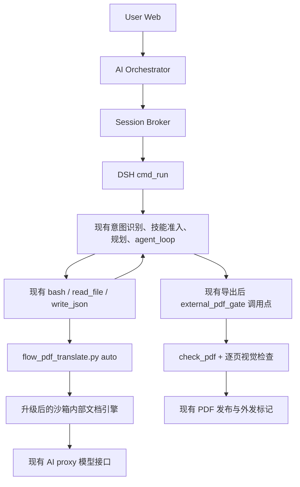

# 复杂 PDF 翻译与可读排版落地方案 v1.0

- 日期：2026-11-06
- 状态：首版代码已落地、默认关闭；本地回归通过，真实论文模型验收未完成（见第12节）
- 约束：保持现有服务调用、模型工具调用和 PDF 发布结构
- 依据：[15:39翻译调用审计](../audits/pdf-translation-call-audit-2026-11-06-1539.md)

## 1. 决策

以现有 PDF skill 的 `flow_pdf_translate.py` 为兼容入口，在沙箱工具内部建设“原生提取 + 多模态布局理解 + 文档中间表示 + 按块翻译 + 受控 HTML/CSS 重排”。优先复用已有 Jinja2、WeasyPrint、pdfplumber、Poppler、Noto 字体和 PDF 检查/发布能力。

第一版不将 PDF 转成 DOCX 后重建。原始 DOCX 的翻译和用户明确要求的 Word 输出继续沿用现有路径。本方案处理既有 PDF，不替换新建报告、讲义和表单的生成路径。

产品目标按以下顺序处理冲突：

1. 内容完整、阅读顺序正确、表格数字和公式不失真。
2. 正文与图表可读，字号、分页和图注关系合理。
3. 保留章节、分栏倾向、图文关系、色彩和样式层级。
4. 尽量接近原位置和页数；除用户明确要求外，不以固定页数压缩内容。

默认策略名为 `balanced`。它允许局部调整栏宽、图片位置和分页，不能自行摘要、删段、改数字或隐藏未翻译区域。用户明确要求逐页位置一致时应用更严格约束；约束无法同时满足则失败并解释冲突，不偷偷转成阅读版。

2026-11-07 用户确认：7页译为6页可以接受，“格式不变”按主要内容、章节与图表关系无重大变化验收。中文正文可适当放大，英语/日语相应缩小；当前统一策略为中文10.5pt、英语/日语9.5pt，其他层级配套调整。命令/URL字符连续性、普通标签译文、脚注锚点、题注归属、原始外链目标必须保留；这些事实和关系缺陷不因允许重排而豁免。layout-html/10引入源链接证据、关联组排版和严格事实核对，不再接纳未通过审阅的兜底候选。

## 2. 保持现有调用结构的边界

以下结构和顺序保持：



| 边界 | 决策 |
| --- | --- |
| HTTP入口、Dispatcher、Broker、用户锁 | 不增加路由、服务、队列或异步任务；不改变参数协议 |
| 意图识别、技能准入、planning、agent_loop | 保留原调用顺序；不另建PDF专用agent，不跳过planning |
| 模型看到的工具 | 不增加 `analyze_document`、`translate_pdf` 等工具名；保持已有工具schema |
| CLI | 保持 `auto INPUT OUTPUT --lang`；保留 `unpack/pack` 命令名 |
| 模型网关 | 继续使用现有 `/ai/proxy/v1/chat/completions` 和平台凭据；不直连外部厂商 |
| 内部模型请求 | 可增加布局分析/按块翻译请求；属于已有工具内部实现，不承诺请求次数不变 |
| PDF检查与发布 | 保持现有调用点、全页检查要求、哈希绑定和发布所有权 |
| 前端交付 | 保持 FINAL/METRICS/OUTBOUND_FILE 与文件卡片协议 |

允许的运行时适配只发生在已有 shell 执行器、图像请求实现和 PDF 门禁内部：传预算、归并子进程证据、识别隐藏候选、校验翻译完整性。它们不增加外层调用阶段。

## 3. 当前代码基线与直接复用点

本节描述2026-11-06工作区实际源码；仓库有既存未提交改动，不将设计视为已部署行为。

| 当前模块 | 已有能力 | 本方案的使用方式 |
| --- | --- | --- |
| `src/dsh_modules/tool_routing.py` | 翻译任务收敛为bash/read_file/write_json | 原样保留 |
| `skills/pdf/scripts/flow_pdf_translate.py` | auto/unpack/pack，现有模型按此命令执行 | 缩成兼容CLI，将职责下沉 |
| `skills/pdf/scripts/pdf_design/renderer.py` | Jinja2、WeasyPrint、受限本地资源加载、字体、候选检查 | 复用基础能力，新增结构文档渲染器；不把IR转成单一Markdown |
| `skills/pdf/templates/` | document.html、print.css和已有报告样式 | 新增translation子目录，隔离既有报告模板 |
| `src/dsh_modules/config.py` | DEFAULT_PROXY_URL / VIRTUAL_API_KEY | 文本和视觉适配均复用，消除localhost错误回退 |
| `src/dsh_modules/llm.py` | call_model_proxy、deadline、usage/call_id | 翻译请求直接复用 |
| `src/dsh_modules/file_tools.py` | inspect_image，现有非流式图像请求 | 提取私有transport供布局分析复用；原inspect_image返回契约保持 |
| `src/dsh_modules/shell_tools.py` | 子进程、pipefail、进程组终止、deadline | 增加已知PDF入口的预算/证据桥接 |
| `src/dsh_modules/pdf_external_delivery.py` | shell产物暂存、结构检查、接管交付 | 在原调用点增加当前run manifest入口与语义前检 |
| `src/dsh_modules/pdf_preview_tool.py` | 版本绑定、并行2页检查、全部页通过才发布 | 保留发布行为，补充阅读上下文和输入来源映射 |
| `src/dsh_modules/pdf_publication.py` | 回执、页码和文件哈希核对 | 继续作为既有PDF发布证明 |
| `src/dsh_modules/telemetry.py` | 模型账本、call_id去重、错误与事件 | 父进程归并子进程账本，不新增协议标记 |

已有WeasyPrint固定版本是68.1；设计首轮不升级，不因引入HTML路线改装Chromium。实际多栏/跨栏/长表格能力必须在这个镜像和版本上验证。

当前runner约1121行、agent_loop约1152行、tools约774行、file_tools约1020行。新业务逻辑放独立模块；不继续在这些文件堆叠文档编排。file_tools如需复用图像transport，应作保持公共API的小步职责下沉。

## 4. 兼容入口与模块组织

模型继续执行：

```bash
python3 /opt/dsh/skills/pdf/scripts/flow_pdf_translate.py auto \
  /workspace/2507.03009v4.pdf /workspace/2507.03009v4_中文版.pdf --lang zh-CN
```

可增加可选 `--layout balanced|preserve|reading`，默认balanced。会话、run、有效模型、deadline、资源目录等由父进程注入内部context，不要求模型填写。输出参数表示发布目标，CLI只生成隐藏候选，成功状态叫 `candidate_ready`，不能声称已发布。

建议文件结构（均为拟新增/调整项）：

```text
skills/pdf/scripts/
  flow_pdf_translate.py                 # 兼容CLI，目标不超过200行
  pdf_translation/
    contracts.py                       # IR、job/result schema和版本
    pipeline.py                        # 阶段编排、缓存及有限恢复
    native_parser.py                   # 原生字符/行/样式/表格候选
    layout_analyzer.py                 # 多模态布局、读序与锚点
    asset_extractor.py                 # 完整图形/公式区域素材
    text_translator.py                 # 分批、术语、保护片段、补译
    translation_validation.py          # 覆盖率、数字、缺键、残留语言
    layout_planner.py                  # 原结构与阅读约束的调和
    html_renderer.py                   # 类型化组件→Jinja2→WeasyPrint
    render_validation.py               # 字体/边界/内容与映射验证
    model_gateway.py                   # 调用现有DSH模型能力
    job_store.py                       # 原子状态、版本、来源哈希
  pdf_design/                          # 既有报告生成模块，保留
skills/pdf/templates/translation/
  document.html
  print.css
  components/{heading,paragraph,table,figure,formula,footnote}.html
src/dsh_modules/
  pdf_translation_bridge.py            # shell子进程context、事件及回执
  pdf_translation_delivery.py          # 当前run尝试/隐藏候选及前检
  model_image_transport.py             # 从inspect_image下沉的共享传输
```

每个业务模块优先控制在200—500行；复杂解析/排版超过500行再按职责拆。CLI不承担模型请求、解析与排版全部逻辑。复用DSH包的安装路径，不复制网关实现，不依赖开发机绝对路径。

`unpack/pack`的迁移：新unpack产生版本化IR与manifest，pack接受该工作目录；旧list格式extracted/translated.json可通过兼容读取转换。旧格式缺少布局来源时只能明确标记阅读版能力，不能声称保留原布局；JSON缺译文不再默认原文。

## 5. 工具内部流水线

### 5.1 提取事实，再让模型解释结构

原生PDF优先使用已有pdfplumber读取字符/词/行、字体、位置和表格候选。记录PDF页面尺寸、旋转、裁剪和图像像素的变换；统一坐标为去旋转后的PDF point，并保存到预览像素的转换关系。

给每个原生行/单元格分配稳定ID。多模态模型看到页面图像和这些ID的候选框，主要返回区域类型、行ID分组、阅读顺序、标题层级及图注/脚注关联。原生文字优先来自提取结果；不让模型凭截图重新抄写全部正文，更不能根据常识补不存在的句子。

对双栏使用区域内的纵向顺序和栏目顺序，不能把全页按y排序后直接横向拼接。跨页续段保留多个source_span，翻译前合并语义，排版后仍能反查原页。

第一版使用“已有原生解析 + 现有视觉网关”避免增加模型权重依赖。解析器保留接口；Docling/MinerU为后续基准测试候选，不在首版同时安装多套解析栈。

### 5.2 IR：完整文档数据，不是单一Markdown

以下为schema示意，最终以contracts.py的可校验类型为准：

```json
{
  "schema_version": "pdf-document-ir/1",
  "source": {"sha256": "...", "page_count": 7},
  "pages": [{"id": "p1", "width_pt": 612, "height_pt": 792, "rotation": 0}],
  "nodes": [{
    "id": "para_12", "type": "paragraph", "parent": "sec_1",
    "source_spans": [{"page_id": "p1", "bbox_pt": [72, 210, 286, 360], "line_ids": ["l31", "l32"]}],
    "runs": [{"text": "...", "style_id": "body_regular"}],
    "protected_fragments": [], "confidence": 0.94
  }],
  "reading_order": ["title_1", "authors_1", "abstract_1", "sec_1", "para_12"],
  "assets": [{"id": "figure_1", "path": "assets/figure_1.png", "sha256": "...", "caption_id": "caption_1"}],
  "tables": [], "styles": {}, "translations": {}
}
```

type至少区分标题、作者、正文、列表、表格、图片、图注、公式、脚注、参考文献、页眉页脚。表格保存单元格坐标、rowspan/colspan、原始数字和单位；翻译结果按node/cell ID另存，禁止重写source层。

每个正文source_span必须有一个明确归属，排除项也必须记录原因。图中标签属于图资产时不可再混入正文，页眉页脚不得每页重复译成正文。提取后检查阅读顺序无循环、无重复、无未说明的遗漏。

稳定ID用于恢复和缓存，不能依赖模型返回的编号顺序。缓存键至少包括输入哈希、IR/schema版本、解析器/模型/提示词版本、目标语言与术语版本；任何变化都不能直接复用旧验收。

### 5.3 图片、矢量图与公式

以“文档图形区域”为单位提取素材，不能将pdfimages的XObject数量当作独立插图数量。图可能由多张位图、路径、掩膜和文字组成；必要时按区域从原页高分辨率渲染完整裁图，保留图注在独立节点中，避免重复。

首版公式保留原图形/区域并保护引用标记；不让翻译模型自由改写公式。必须验证基线、分辨率和公式编号，单独检查图形中是否意外包含正文。

原图内可翻译标签需单独登记。首版不具备可靠图内改写能力时，可在需求允许的情况下附中文图例并明确保留原标签；若用户要求图中文字全部中文化，则未处理标签属于未完成，不能以正文译完代替整体完成。

### 5.4 翻译与完整性

保留原章节上下文和全文术语表，按语义段/表格单元格批量翻译，按输入Token和最大输出预算切批，不能机械每10个块一批。禁止将长页合为单块。

通过现有call_model_proxy请求，沿用本轮有效文本模型、配置和平台网关；视觉模型沿用DSH_VISION_MODEL/平台vision别名。脚本不再读取自创OPENAI_API_BASE/AI_PROXY_URL并回退localhost。

每批结果必须满足：ID集合准确、值类型正确、非空、响应完整、保护片段和表格数字/单位可对齐。链接、术语、作者姓名、参考文献和代码等免译类型单独标注；正文完全原样返回或目标语言异常时触发补译/复核。不能只用中文字符占比宣称翻译质量合格。

已成功块持久化，缺失或错误块最多补译1轮；连接失败等传输重试遵循现有网关策略，pipeline不再外套多层重试。仍失败则写partial/failed与错误块ID并返回非零，绝不回填原文后报成功。finish_reason=length不作为完整译文接受。

### 5.5 组件化HTML与自适应排版

由代码将IR映射到受控Jinja组件。模型输出类型化布局建议，不编写任意整份HTML/CSS，不决定精确文字坐标。使用真实h1/h2/p/table/figure结构，图注、脚注、引用使用稳定锚点。

布局约束建议（首版试验值，须经样本文档验证）：正文10.5—11.5pt、字号下限9.5pt、脚注单独设下限；不采用全篇缩放。默认保留可验证的分栏倾向；宽图和宽表进入跨栏区域，复杂区域可以局部改成单栏。跨栏/多栏分段必须按逻辑区域组织，不能把左右列做成逐行交替的grid。

溢出时依次调整可用宽度与局部留白、改变局部栏数、让内容自然跨页，再在下限内微调字号。长表允许按行跨页并重复表头；禁止对整张长表设置永不拆分导致挤出页面。模型无需预先给每页手工切段。

首版渲染器复用pdf_design中的资源加载、字体和基础QA，新增专用结构模板；不调用现有Markdown清洗/讲义扩写逻辑。基础代码如需复用，提取小模块而不改变render_report公共参数。

只依赖固定版本WeasyPrint已验证的公开API及CSS能力。不依赖其私有box tree作为永久审计协议；区域映射可由HTML ID、PDF锚点及输出文字匹配建立，无法精确定位的块显式标记并复核。多栏、表头重复、跨页单元格、CJK断行和公式必须有真实渲染样本。

## 6. 子进程、预算与调用记账

### 6.1 Shell兼容桥

shell_tools在识别可信安装目录中的flow_pdf_translate入口时，委托pdf_translation_bridge建立context；普通bash行为不变。识别以解析后的真实脚本路径为依据，不能凭命令中出现同名字符串就提升预算或接受回执。skill统一给出直接python入口，复杂shell写法无法识别时仍按普通bash执行，不能绕过最终门禁。

context包含父run ID（可取ExecutionJournal.path.stem）、本次job ID、有效模型、目标语言/需求、可用预算、预期输入和输出、版本号；目录由父进程独占创建，子进程通过环境变量取得。不给模型增加必填参数，不将令牌写入context或回执。

桥接器是shell层内部适配，不将pipeline移入runner或另建服务。子进程通过已安装的dsh_modules导入配置与模型功能；开发环境使用显式包根配置，不能猜项目根后静默采用另一套运行时。

### 6.2 时间预算

当前bash默认60秒，heavy-task识别不包含flow_pdf_translate；模型传入工具schema之外的timeout=300不会自动放宽。必须由shell内部已知入口策略传预算。

建议工具总预算上限300秒、模型并发2、布局结构补正1轮、翻译补译1轮、布局修复最多2个候选版本。这些是可配置的初始上限，不是性能承诺。所有阶段共用一个截止时间，重试、换后端、重新渲染不能重置。

若DSH已有有限总deadline，执行预算不得超过其剩余时间，并为既有最终验收保留时间。初步按 `R=min(180, ceil(预计页数/2)*40+30)` 秒规划验收余量；这是容量规划保守值，不改变现有review时钟。原页数只是估计，译文页数增加后重新评估剩余预算，不能声称保证覆盖。余量不足时早停或使用后续用户请求恢复，不引入后台自动续跑。

停止/超时继续使用现有进程组终止；检查点必须原子写入，被终止的子任务不能事后覆盖候选或发布旧结果。对长文按页/章节缓存，但完整文档未通过前不能当成全本交付。

### 6.3 子进程遥测与进度

子进程contextvars不会自动共享父TelemetryStats。子进程将模型开始/完成/失败、usage、call_id、阶段、batch ID、source IDs和耗时写入当前job的JSONL；父桥接器在执行中增量读取，按call_id导入现有账本，finally仍导入失败前的有效事件，防止双计。

图像请求复用当前非流式路由。建议从file_tools的inspect_image下沉私有model_image_transport，保留原函数签名、文字前缀及QA行为；新布局适配器取得未截断的结构化正文和finish_reason再校验，不能复用要求PASS/REPAIR/FAIL的pdf_review_model作为布局解析器。

父进程只为已知引擎且schema/run匹配的完成回执产生现有运行时checkpoint；不信任任意stdout的“成功”。继续使用既有DSH_PROGRESS协议，不增加Broker心跳协议。进度仅代表阶段完成，不表示已验收或可交付。

外层工具回执只返回阶段、统计、错误块ID和内部回执路径，不把全部源码、base64图像或整篇IR反复送入主模型。完整证据保留在job目录。并发请求显式传tracker，避免ContextVar在工作线程未传播导致漏记。

## 7. 隐藏候选与现有门禁的接入

### 7.1 文件和状态

```text
/workspace/.dsh/pdf-jobs/<parent_run>/<job_id>/
  context.json
  manifest.json
  source.ir.json
  translated.ir.json
  assets/
  model-events.jsonl
  translation-qa.json
  versions/v1/{document.html,print.css,candidate.pdf,render-qa.json}
```

manifest至少包含schema/run/job、输入路径与哈希、目标路径、候选路径/哈希、IR与翻译QA哈希、引擎/模型/模板版本、状态、错误/免译项和候选版本。创建状态为running，结束原子写candidate_ready/partial/failed；真正published状态只能由父PDF门禁写入。

流水线生成前即登记当前run尝试。父桥接器无论退出成功、失败或被杀，都形成当前turn的结构化ToolResult，成功也只表示candidate_ready。标准CLI独立执行时同样生成可检查隐藏候选，不声称已发布。

### 7.2 接管原external_pdf_gate调用点

现有候选发现会跳过隐藏目录，因此不能只改CLI后就期待自动发现。pdf_external_delivery在原位置委托pdf_translation_delivery，从当前turn回执找manifest，而非全盘搜索历史job。

验收顺序：验证run绑定与路径/符号链接边界 → 重算输入/IR/候选哈希 → 检查翻译完整性与资源映射 → 复用check_pdf → register_pdf_render → 既有逐页视觉验收 → 全部通过后原子替换发布目标。

候选直接在隐藏目录检查，不先移到公开目标；旧合格文件保持到新版本通过。staged路径与现有render回执形状兼容，无需改变前端协议。hash绑定覆盖全部最终页面，换候选后旧页面通过记录失效。

**失败接管同样必须成立。** 如果记录了翻译尝试但没有candidate，门禁仍返回“已接管”，输出可解释失败、outbound=[]并让runner沿用现有结果覆盖分支。不可因为候选数为0返回False，导致之后将错误说明编成PDF后交付。

当前ArtifactExporter在外部门禁之前可能自动从Markdown补生成PDF。因此门禁不能只看是否存在某个PDF：翻译任务必须要求输入哈希和完整性证据匹配的候选。缺manifest、manifest失败或通用补生成文件没有来源绑定时一律不作为翻译成果发布；相关本轮草稿转入隐藏隔离，最终外发清空。保持runner现有调用顺序，不通过新增前置流程解决。

逐页审阅增加当前候选的源节点/跨页续段摘要，允许正常跨页与非逐像素相似；文本完整性主要由全本映射检查，视觉检查负责字形、重叠、表格、图注等。视觉服务失败属于service_unavailable，保留候选并失败，不要求重写全部正文。首次失败后仍按现有策略停止继续检查该版本。

## 8. 验收和错误契约

| 层 | 首版要求 |
| --- | --- |
| 来源与结构 | 样本正文/表格source IDs全部被映射或明确免译/排除，无重复；读序无交错 |
| 译文完整性 | 应译块全部有有效结果；缺键/空值/整体原文回退不能成功；保留数字、单位、公式/引用 |
| 图文 | 每个应保留的图形区域都有实际输出与图注锚点；不按XObject数量判断 |
| 表格 | 行列关系、合并单元格、表头及数字单位一致；跨页仍可阅读 |
| 排版 | 字号不低于策略下限，无裁切、重叠、乱码；允许页数变化 |
| PDF | 现有parse、字体、边界、正文覆盖与预览检查通过 |
| 发布 | 每一页均有当前candidate哈希的有效视觉回执，才可外发 |
| 隔离 | 原件不变，旧成果不被失败候选覆盖，HTML/IR/脚本不混入附件 |

覆盖率是映射与执行证明，不等同语义翻译准确率；扫描件无法证明覆盖的区域须标记低置信并复核，不捏造100%。不采用全页像素相似度作为主要门槛，译文长度和分页可以合理变化。

错误至少区分 `layout_unresolved`、`translation_transport_failed`、`translation_incomplete`、`protected_content_changed`、`asset_mapping_failed`、`render_overflow`、`review_service_unavailable`、`budget_exhausted`、`source_changed`、`manifest_mismatch`。响应带stage、node/page IDs、可恢复性和候选版本；不再统一建议换report/handout。

## 9. 实施拆分与完成标准

| 阶段 | 范围 | 完成标准 |
| --- | --- | --- |
| PR1：止损与契约 | CLI失败回退修正、网关统一、job schema、shell桥和失败接管 | 连接拒绝/缺键/原文未译均非零；不导出替代PDF；账本可追踪 |
| PR2：原生解析与布局 | 原生source IDs、VLM区域/读序、图/表/公式IR、低置信处理 | 此次7页论文左右栏不交错，第一整页不再成为标题，图表均有归属 |
| PR3：结构化翻译 | Token切批、术语、保护片段、完整性检查、缓存补译 | 全文应译块覆盖，表格数字/公式不变；错误不被原文兜底掩盖 |
| PR4：HTML重排 | 组件、字体、分栏/跨栏、长表分页、受限资源、候选QA | 该论文完整可读；页数可变；无非预期内容删减 |
| PR5：发布闭环 | 隐藏候选、哈希/来源验证、现有逐页检查、失败/旧文件隔离 | 哈希不符、缺页审阅、服务失败均无外发；旧成果保持 |
| PR6：回归与灰度 | 固定样本集、历史调用对照、镜像/运行模式验证、文档 | 通过下述回归和性能测量后才启用默认引擎 |

PR1—5可顺序集成到关闭的新引擎开关，PR6才放量；实现阶段不得在PR1就把尚无质量验证的新引擎设默认。开关关闭的迁移路径也必须保留PR1的显式失败行为，不能退回原文报成功。

首轮样本集至少8类：本次7页双栏论文、单栏报告、含合并单元格长表、跨栏矢量图、公式/脚注、扫描件、原生+扫描混合、包含代码/网址/参考文献的长文。首版可以对暂不支持的扫描/图内翻译明确失败，但不能以支持原生PDF的结果替代其验收。

故障回归：代理401/503/连接拒绝、length、缺key、重复ID、图片丢失、损坏IR、超时/取消、旧候选、符号链接、输入变化、视觉不可用、无candidate及Markdown自动兜底。跨格式回归：新建PDF报告/讲义、Word翻译、Excel翻译调用与交付保持。

测试选择真实故障与关键行为，不为每个mapper写镜像实现的测试。记录阶段耗时、模型/图像请求数、输入输出Token、峰值RSS、页面数和修复版本数。建立本地测量基线后设置SLO；不承诺尚未测量的“30秒完成”或保真率。

外层主模型在正常情况下只需1次生成工具调用及至多1次诊断/恢复，这是效率目标；不为达到次数目标修改agent_loop策略。主模型只看简短回执，避免重演本次21轮源码诊断。

## 10. 部署、灰度与后续选型

第一版沿用已有依赖；先以安装前检查确认原生解析/图像裁切能力。若新增Python库、字体或解析模型，统一进入requirements/沙箱镜像及check-runtime.py，不在用户任务现场pip安装或下载模型。

实现后从仓库根目录经 `./docker/start-smart.sh` 执行相关Docker验证。沙箱由Broker动态创建，不假定它是Compose服务，不虚构 `up sandbox` 命令；依赖改变时按已有镜像生命周期重建目标测试沙箱，源码ro挂载变化也需确认新DSH进程和实际哈希。具体构建/切换步骤在实现PR中依据当时脚本与配置确认。

建议增加内部 `DSH_PDF_TRANSLATION_ENGINE` 选择开关，由已知入口适配器传入子进程；不扩展Broker请求参数。旧路径仅作迁移比较，网络/译文失败必须显式失败。结构、译文、模板与引擎版本均落manifest，缓存和验收不跨版本复用。

后续再比较Docling/MinerU解析适配与BabelDOC保真后端。BabelDOC若接入，必须适配本平台网关、deadline、子调用账本和候选发布契约，不能直接运行后独立发布。其价值是减少专业PDF保真重排的自研量；不与首版同时建设两套完整排版实现。

WeasyPrint遇到已证实无法满足的分页需求时，再评估Paged.js/Chromium或Prince适配；保留相同IR和候选/验收接口。增加后端不改变用户/模型工具入口。渲染版本变化必须重新运行视觉基准，不能只检查import通过。

## 11. 参考与本轮交付范围

外部能力核实于2026-11-06：

- [DoclingDocument](https://docling-project.github.io/docling/concepts/docling_document/)：文本、表格、图像、层级、读序、坐标与来源的统一表示参考。
- [BabelDOC](https://funstory-ai.github.io/BabelDOC/)：可嵌入Python API以及布局解析、翻译和重排后端参考。
- [WeasyPrint API](https://doc.courtbouillon.org/weasyprint/stable/api_reference.html)：只依赖公开API；官方提示渲染版本变化需要重新检查输出。此链接为当前文档，实际实现按项目固定68.1验证。

前述内容为目标设计；实际首版范围、测试结果和仍未完成的验收以第12节及实施记录为准，不能将设计目标视为已通过的能力。

## 12. 首版实现状态（2026-11-06）

已在兼容CLI、现有shell执行器及原PDF发布调用点内落地。服务链路、工具schema、runner调用顺序和前端协议保持不变。实现记录见 [PDF翻译引擎实施与验收](../audits/pdf-translation-implementation-2026-11-06.md)。

- 实现：原生行事实、几何段落候选、VLM结构分组、严格ID覆盖、表格单元格、区域图形/公式裁切、按块翻译与一次补译、Jinja/WeasyPrint重排、隐藏候选、父子账本归并、来源/哈希/译文独立检查、现有逐页验收。
- 默认 `DSH_PDF_TRANSLATION_ENGINE=disabled`；隔离测试容器设置为 `layout-html-v1`。真实样本验收完成前不默认放量；关闭时明确失败，不能退回旧脚本的原文兜底。
- `unpack/pack` 命令保留，但只接受新版本IR工作目录；未实现旧list格式转换，明确失败。缓存自动恢复、术语表、Token精算切批、候选自动修版、完整样式runs、精确源块到输出页锚点尚未实现。
- `balanced` 保留分栏倾向并自然分页；`reading` 单栏；`preserve` 当前仅约束源页边界和总页数，**不具备逐像素位置保真能力**，不得这样宣传。
- 作者、参考文献、公式及页眉页脚有明确免译策略；图内标签保留原图并附译文图例，不提供图内覆盖改写。扫描件缺少可靠原生文字时明确拒绝，尚无OCR支持。
- 本地PDF回归131项、完成判断9项通过；真实论文布局旧分组曾被完整性检查拒绝，新段落候选版本被上游视觉服务不可用阻断，尚未获得真实全本译文和全页PASS。不能宣称这篇7页论文已修复验收或达到保真率/性能SLO。
