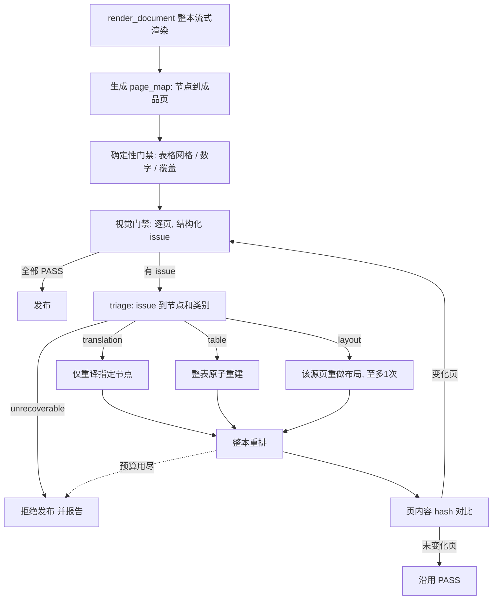

# PDF 翻译：失败页局部修复设计与验收标准 v1.0

## 1. 背景与目标

审计 `2026-11-07 09:56` 与后续分析表明：现有链路在门禁失败时只能整份拒绝，局部问题无法修复。

目标：保留整本流式排版（`html_renderer`），在门禁失败后**按源节点局部修复**，并只复审内容变化的页。

非目标：

- 不改为原位 bbox 回填。
- 不承诺像素级位置不变，也不承诺固定页数。
- 不覆盖 XLSX 等其他生成链路。

## 2. 现状（改动基线）

| 环节 | 现状 | 缺口 |
|---|---|---|
| 翻译 `text_translator.translate_document` | 批次翻译，第二轮逐块补译；`translations` 以节点 ID 为键 | 没有跨 job 缓存；不能指定节点集合重译 |
| 渲染 `html_renderer.render_document` | 整本 IR 一次渲染为一份 HTML 与 PDF | 渲染产物不记录"节点→成品页" |
| 视觉门禁 `review_current_pdf_pages` / `inspect_pdf_page` | 逐页并发审阅；`state['reviewed']`/`['failed']`；最多 3 个版本；总时钟 180s | 输出是自由文本，无法路由；失败即 `record_pdf_failure`，整份拒绝 |
| 发布 `enforce_translation_delivery` | 全部页通过才发布 | 没有修复回路 |
| 运行时恢复 `recover_pdf_translation` | 仅处理 `translation_incomplete`、`layout_unresolved`、`budget_exhausted`，每阶段一次 | 不处理门禁失败 |

## 3. 总体设计



核心原则：

1. **重试单位是源节点**（段落、图、整表），不是成品页。
2. **整本重排成本低**（秒级），模型调用才是成本，因此重排整本、模型只调受影响节点。
3. **复审只看变化页**，用成品页内容 hash 判断。
4. **表格是原子节点**，只能通过重建并重新通过确定性网格校验来关闭问题，不能靠再投一次票。
5. **失败默认整份不发布**，并给出失败页、节点和原因清单。

## 4. 数据契约

### 4.1 结构化 issue（视觉门禁输出）

视觉模型返回首行 `PASS` 或 `REPAIR`，后接 JSON 数组 `ISSUES:`：

```json
{"page": 6, "kind": "table|translation|layout|render",
 "anchor": "表 1 左侧列标题", "quote": "页面上可见的原文片段",
 "evidence": "至少 20 字，描述当前图片上的具体缺陷"}
```

- `kind` 缺失或不在枚举内：按 `layout` 处理，并在遥测中记录 `issue_kind_defaulted`。
- 无法解析 JSON：沿用现有自由文本路径，视为 `layout`，不得导致整体崩溃。
- 现有 `table_issue()` 关键词判断保留，作为 `kind` 缺失时的兜底分类。

### 4.2 page_map（渲染产物）

渲染后写入 `versions/vN/page-map.json`：

```json
{"version": 2, "pages": [
  {"page": 6, "sha256": "…", "nodes": ["p5_b1", "p5_b2"], "tables": ["5_t1"]}]}
```

- 节点到成品页的映射以 WeasyPrint 的盒模型位置为准（渲染时为每个节点输出 `data-node-id`，再从布局结果读取所在页）。
- 某节点跨页时，同时出现在多个页的 `nodes` 中，并标记 `spans: true`。
- 页 `sha256` 为该页渲染文本与关键几何的规范化哈希，用于复审复用判断。

### 4.3 节点译文缓存

`translation-cache.json`，键为 `sha256(source_text + lang + implementation_version + glossary_hash)`，值为译文。

- 修复重译只更新被指定的节点，其余直接读缓存，不调用模型。
- 2026-11-07 修订：审阅判错的节点全部交给模型重新生成，不以纯数字、符号、命令或免译角色跳过，也不自动扩大到其他未判错节点。相关目标节点按批共同修复，允许模型把游离标号移入对应说明，并用空字符串清除冗余独立块；代码只检查返回 ID 集合和字符串类型，内容正确性由重渲染后的页面审阅判断。
- 修复输入同时提供当前译文及完整审阅问题（kind、anchor、quote、evidence），反馈按目标节点 ID 传递，不能用自然语言位置描述代替字典键。
- 缓存只在同一 job 目录内使用，不跨用户、不跨任务共享。

### 4.4 repair 状态（manifest 扩展）

`manifest.repair = {"rounds": n, "history": [{"round", "issues", "nodes", "outcome"}]}`，用于审计和防死循环。

## 5. 模块设计

遵循单一职责与文件体量约束，新增文件而非继续扩大 `pdf_translation_delivery.py`。

| 文件 | 职责 |
|---|---|
| `pdf_translation/page_map.py` | 生成并读取 `page-map.json`，页 hash 计算 |
| `pdf_translation/node_repair.py` | 按节点集合重译，缓存读写，单节点修复提示词 |
| `pdf_translation/table_rebuild.py` | 按 `native_tables` 锚点原子重建表格节点，并通过 `validate_table` |
| `dsh_modules/pdf_issue_triage.py` | 解析结构化 issue，映射到节点和类别，判定是否不可恢复 |
| `dsh_modules/pdf_repair_loop.py` | 修复回路编排：预算、重排、复审范围、终止条件 |
| `dsh_modules/pdf_review_contract.py`（修改） | 增加 `ISSUES:` 协议解析 |
| `dsh_modules/pdf_translation_delivery.py`（修改） | 只保留入口，把"失败即拒绝"改为调用 `pdf_repair_loop` |
| `pdf_translation/html_renderer.py`（修改） | 输出 `data-node-id`；表格 `break-inside: avoid`（可行时），续表重复表头 |
| `pdf_translation/pipeline.py`（修改） | 新增 `repair` 模式，复用同一 job 目录与 manifest |

## 6. issue 分类与修复动作

| kind | 修复动作 | 重试上限 | 关闭条件 |
|---|---|---|---|
| translation（漏译、误译、占位符、数字） | 对 issue 命中的节点单独重译，带原文、当前译文、证据 | 每节点 2 次 | `validate_value` 通过，且复审该页 PASS |
| table | 按源锚点重建整表；译文逐格重译 | 每表 1 次 | `validate_table` 通过，且复审该页 PASS |
| layout（节点归属、阅读顺序、图注关联） | 重新分析该源页布局，替换该页节点集 | 每源页 1 次 | `validate_ir` 与 `validate_regions` 通过，且复审 PASS |
| render（溢出、截断、分页） | 调整该节点样式参数（字号档位、表格列宽策略），不改译文 | 每节点 1 次 | 复审 PASS |

不可恢复（直接终止，不消耗重试）：

- 源 PDF 无法解析或哈希变化。
- 扫描件或无法可靠解析区域。
- `engine_not_enabled`。
- 总 deadline 剩余不足一次最小修复所需时间（取 45 秒，与现有 `recover_pdf_translation` 一致）。
- 修复调用返回协议错误且已用尽重试。

## 7. 预算与终止

- 修复总轮数上限 **3**（与现有 `_REVIEW_ROUNDS` 上限一致，统一到 `pdf_repair_loop` 持有，旧计数继续兜底）。
- 每轮只处理本轮 issue 涉及的节点，不得扩大范围。
- 所有修复和复审共享原任务 deadline，不重置时钟。
- **同一节点在连续两轮被同一类 issue 命中**视为不收敛，立即终止并报告，不再消耗预算。
- 重试用尽后：整份不发布，返回失败页清单、节点 ID、issue 证据。是否支持"部分发布并标注失败页保留原文"留作 v1.1，v1.0 不实现。
- 原稿和旧合格输出不得被未验收候选覆盖（沿用现有规则）。

## 8. 复审复用规则

重排后对每个成品页计算 `sha256`：

- 与上一版相同且上一版 PASS：沿用，不调用模型。
- 不同：必须重新复审。
- 被修复节点所在页，始终强制复审。
- 表格页只要含被重建的表，始终强制复审，且复审提示词继续注入 `table_review_evidence`。

## 9. 遥测与审计

新增 guard 事件：`pdf_repair_round`（轮次、issue 数、节点数）、`pdf_repair_node`（节点、kind、结果）、`pdf_review_reused`（复用的页数）、`pdf_repair_terminated`（原因）。

新增指标：修复前后模型调用数和 Token、复审复用率、各 kind 的修复成功率。

## 10. 兼容与风险

| 风险 | 对策 |
|---|---|
| 节点到页的映射不准 | 以 WeasyPrint 布局结果为准；映射失败的 issue 降级为 `layout` 并重做整页 |
| 视觉模型不遵守 `ISSUES:` 协议 | 自由文本回退路径；协议遵从率纳入验收指标 |
| 修复引入新问题 | 复审范围覆盖所有 hash 变化页；不收敛检测 |
| 重排导致后续页连锁变化 | 页 hash 对比，变化页重审；连锁变化页多时受预算约束 |
| 修复使总耗时过长 | 共享 deadline；最多 3 轮；不可恢复条件提前终止 |
| `IMPLEMENTATION_VERSION` 变更使旧检查点失效 | 升级为 `layout-html/8`，同步更新 `SKILL.md`，旧候选须重新生成 |

## 11. 验收标准

### 11.1 功能验收（自动化测试，放入 `tests/`，不依赖外部模型，用 `FixtureGateway`）

| 编号 | 场景 | 通过条件 |
|---|---|---|
| F1 | 单页译文漏译，其余页正常 | 只重译命中节点；其余节点模型调用数为 0；最终发布 |
| F2 | 表 1 单元格归属错误（复用 `fixtures/pdf_translation_0956/broken-tables.json`） | 表格被按锚点原子重建；`validate_table` 通过；整份发布 |
| F3 | 同一表格问题，复核模型返回无证据 PASS | 不被接受；仍须重建表格 |
| F4 | 布局问题（节点归属错误） | 仅该源页重做布局，最多 1 次；其余页布局不变 |
| F5 | 修复后页 hash 未变的页 | 不再调用视觉模型，遥测出现 `pdf_review_reused` |
| F6 | 同一节点连续两轮同类 issue | 终止，报告不收敛，不发布 |
| F7 | 修复预算用尽仍失败 | 不发布；返回失败页清单与证据；旧合格输出字节不变 |
| F8 | 不可恢复（扫描件、源哈希变化、`engine_not_enabled`） | 不消耗修复轮次，直接终止并说明原因 |
| F9 | 视觉输出非结构化自由文本 | 按 `layout` 处理，不崩溃 |
| F10 | 跨页表 | 整表为一个节点；断页只发生在行边界；续页重复表头；网格校验通过 |
| F11 | 重复 `auto` 调用 | 仍复用本轮候选，不重新调用模型（回归 0956 用例） |
| F12 | 修复期间 deadline 耗尽 | 以明确错误终止，不挂起，不发布 |

### 11.2 非功能验收

| 指标 | 标准 |
|---|---|
| 修复开销 | 单页单节点问题的修复，总模型调用数 ≤ 重译调用 1 次 + 受影响页复审 ≤ 2 次 |
| 不扩大范围 | 未被 issue 命中的节点，译文字节与修复前完全一致 |
| 复审复用 | 修复一页时，hash 未变的页不触发视觉调用 |
| 时间 | 修复回路不得突破原任务 deadline；一次局部修复的墙钟时间应显著低于一次完整重跑（目标 ≤ 完整 auto 的 25%，以实测为准，不作确定承诺） |
| 文件体量 | 新增和修改的业务源码文件均 ≤ 1200 行 |
| 兼容 | 既有 `test_pdf_translation_*`、`test_pdf_deliverable_hardening.py`、`test_pdf_prompt.py` 全部通过 |

### 11.3 端到端验收

用审计样本 `2507.03009v4.pdf`：

1. 对 `p5_b1` 与 `p7_b8` 注入已知错误（使用保存的破损 IR），运行完整流程。
2. 期望：被修复后两张表的行列与原表一致（表 1 产品列 6 个、表 2 三列且 194 在 Total 列）；整份发布；其他页不变。
3. 对另一份无错误样本，修复回路不触发，行为与现状一致，耗时无退化。
4. 按 `AGENTS.md`：修改后重启相关服务，通过 `./docker/start-smart.sh` 验证，并检查日志与接口结果。

### 11.4 审计验收

每次修复任务的审计记录须包含：issue 列表、命中节点、各轮动作、复审复用页数、终止原因。审计报告能据此直接判断修复是否收敛。

## 12. 实施阶段

| 阶段 | 内容 | 退出条件 |
|---|---|---|
| P1 | 结构化 issue 协议、`page_map`、`pdf_issue_triage` | F9，映射准确率用 0956 样本验证 |
| P2 | 表格原子重建、渲染 `data-node-id`、续表表头 | F2、F3、F10 |
| P3 | 节点缓存与局部重译、`pdf_repair_loop`、预算与终止 | F1、F4、F5、F6、F7、F8、F12 |
| P4 | 遥测、文档同步（`SKILL.md`、`docs/design/README.md`）、E2E | 11.2、11.3、11.4 全部满足 |

并发布局与翻译不在本设计范围内，待本设计落地并稳定后另行评估。

## 13. 待决策项

1. v1.0 是否只做"整份拒绝 + 失败清单"，还是要提前纳入"通过页发布、失败页保留原文并标注"。
2. 修复总轮数 3 是否接受，或需要按任务时长动态调整。
3. 渲染类问题是否允许调整字号档位，还是只允许调整布局参数。
